# Workflow analysis: Demo: invoice processing (synthetic)

Recorded 2026-10-21 09:12 · 19 min of activity · 205 steps · 6 applications · 3 tasks · analysed with muse-spark-1.3 for screenshots and muse-spark-1.3 for text

## Summary

- **Recorded work:** 19 min
- **Time automation could save:** about 14 min per recording like this one (76% of the recorded time)
- **If the recorded work is done 20 times a month:** about 4.8 hours a month, roughly $144 at $30 an hour
- **Biggest opportunity:** Process vendor invoice for payment (high potential). The same 23-step routine ran 8 times.

> Savings are estimates based on this one recording. Set how often the process runs (and, in the app's Admin panel, what an hour of each position costs) to match the real business.

## Opportunities

| # | Task | Time | Repeats | Applications | Automation potential | Est. saving per recording |
|---|---|---|---|---|---|---|
| 2 | Process vendor invoice for payment | 16 min | 8 | Outlook, Acrobat Reader, Excel, Chrome · Vendor Portal | High (71/100) | 13 min |
| 3 | Share weekly AP summary with manager | 1.7 min | 1 | Excel, Outlook | Low (24/100) | 30 s |
| 1 | Review payables using inbox and portal | 45 s | 1 | Outlook, File Explorer, Excel, Chrome | Low (16/100) | 36 s |

## What to automate first

Impact (hours saved a month) against effort (days to build). Quick wins come first: high impact for under 5 days of work. High impact here means at least 1 hour a month.

<svg viewBox="0 0 640 360" width="100%" style="max-width:640px" role="img" aria-label="Impact against effort, one bubble per task" xmlns="http://www.w3.org/2000/svg" font-family="system-ui,Segoe UI,sans-serif" font-size="11"><rect x="58.0" y="20.0" width="308.2" height="239.9" fill="#1e8e3e" fill-opacity="0.07"/><text x="66.0" y="36.0" fill="#1e8e3e" font-weight="600">Quick wins</text><rect x="366.2" y="20.0" width="253.8" height="239.9" fill="#2f5bd3" fill-opacity="0.07"/><text x="374.2" y="36.0" fill="#2f5bd3" font-weight="600">Major projects</text><rect x="58.0" y="259.9" width="308.2" height="56.1" fill="#b06d00" fill-opacity="0.07"/><text x="66.0" y="275.9" fill="#b06d00" font-weight="600">Fill-ins</text><rect x="366.2" y="259.9" width="253.8" height="56.1" fill="#9aa0a6" fill-opacity="0.07"/><text x="374.2" y="275.9" fill="#9aa0a6" font-weight="600">Not worth it yet</text><line x1="366.2" x2="366.2" y1="20" y2="316" stroke="#9aa0a6" stroke-dasharray="4 4"/><line x1="58" x2="620" y1="259.9" y2="259.9" stroke="#9aa0a6" stroke-dasharray="4 4"/><text x="85.2" y="332" text-anchor="middle" fill="#5f6368">0.5</text><text x="169.8" y="332" text-anchor="middle" fill="#5f6368">1</text><text x="254.4" y="332" text-anchor="middle" fill="#5f6368">2</text><text x="366.2" y="332" text-anchor="middle" fill="#5f6368">5</text><text x="450.8" y="332" text-anchor="middle" fill="#5f6368">10</text><text x="535.4" y="332" text-anchor="middle" fill="#5f6368">20</text><text x="339" y="352" text-anchor="middle" fill="#5f6368">effort: days to build (log scale)</text><text x="52" y="320.0" text-anchor="end" fill="#5f6368">0</text><text x="52" y="172.0" text-anchor="end" fill="#5f6368">3</text><text x="52" y="24.0" text-anchor="end" fill="#5f6368">5</text><text transform="translate(14 168) rotate(-90)" text-anchor="middle" fill="#5f6368">impact: hours saved a month</text><circle cx="85.2" cy="304.8" r="7.0" fill="#b06d00" fill-opacity="0.85"><title>1. Review payables using inbox and portal: 0.2 h a month ($6), about 0.5 days to build</title></circle><text x="85.2" y="308.8" text-anchor="middle" fill="#fff" font-weight="700">1</text><circle cx="522.6" cy="69.3" r="7.9" fill="#9aa0a6" fill-opacity="0.85"><title>2. Process vendor invoice for payment: 4.4 h a month ($133), about 18 days to build</title></circle><text x="522.6" y="73.3" text-anchor="middle" fill="#fff" font-weight="700">2</text><circle cx="353.4" cy="304.8" r="7.0" fill="#9aa0a6" fill-opacity="0.85"><title>3. Share weekly AP summary with manager: 0.2 h a month ($5), about 4.5 days to build</title></circle><text x="353.4" y="308.8" text-anchor="middle" fill="#fff" font-weight="700">3</text></svg>

| Phase | # | Task | Saves a month | Effort | Pays back | Why this effort |
|---|---|---|---|---|---|---|
| **Later** (Fill-in) | 1 | Review payables using inbox and portal | 0.2 h ($6) | 0.5 days | 20 months | recommended approach: about 0.5 days |
| **Hold** (Not worth it yet) | 2 | Process vendor invoice for payment | 4.4 h ($133) | 18 days | 32.7 months | recommended approach: about 15 days; Chrome · Vendor Portal has no known API: screen automation, +2 days; 2 open questions to settle first, +1 day |
| **Hold** (Not worth it yet) | 3 | Share weekly AP summary with manager | 0.2 h ($5) | 4.5 days | 180 months | recommended approach: about 3 days; 3 open questions to settle first, +1.5 days |

<sub>Effort starts from the recommendation's estimate (hours 0.5, days 3, weeks 15) and adds 2 days per system without a known API and half a day per open question. Payback: the hours to build it (days × 8) against the hours saved each month. Planning estimates: confirm with whoever builds it.</sub>

## Workflow map

Tasks in the order they happened. Double-bordered boxes are routines that repeated. Colour shows automation potential: red high, amber medium, green low.

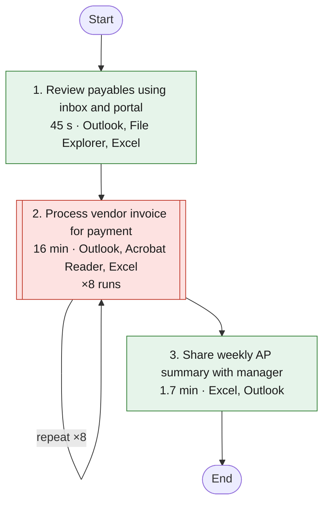

## How the applications connect

Solid arrows: switching from one application to another. Dotted arrows: values copied in one application and pasted into another.

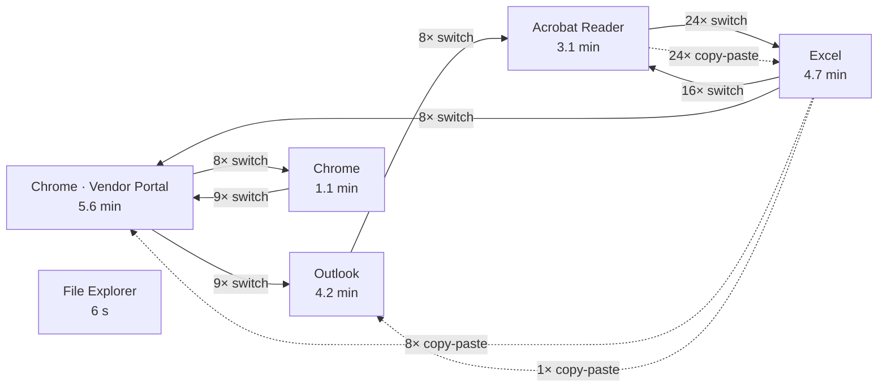

| Application | Time | Steps |
|---|---|---|
| Chrome · Vendor Portal | 5.6 min | 58 |
| Excel | 4.7 min | 53 |
| Outlook | 4.2 min | 42 |
| Acrobat Reader | 3.1 min | 34 |
| Chrome | 1.1 min | 17 |
| File Explorer | 6 s | 1 |

## Task details

### 2. Process vendor invoice for payment

**Automation potential: High (71/100)** · 16 min in total · 8 repeats of about 2.1 min · Outlook, Acrobat Reader, Excel, Chrome · Vendor Portal, Chrome

Processes a vendor invoice received by email for payment. Invoice details are extracted from the PDF into the AP tracker, then re-entered in the vendor portal with supporting documentation attached, and the source email is archived.

**Inputs:** Vendor invoice email with PDF attachment  
**Outputs:** Updated AP tracker with invoice details; Submitted vendor payment request with attached invoice; Processed invoice email moved to Processed folder  
**Decision points:** Determine the correct due date to record for the invoice; Determine the appropriate GL code for the invoice  

**Why it stands out:**

- The same 23-step routine ran 8 times
- 32 values copied by hand from one application to another
- 369 characters typed by hand
- 80 switches between applications
- 16 minutes of the recording

**Estimated saving:** about 13 min per recording like this one (81% of this task; about 1.7 min for each of the 8 repeats), about 4.4 hours or $133 a month.

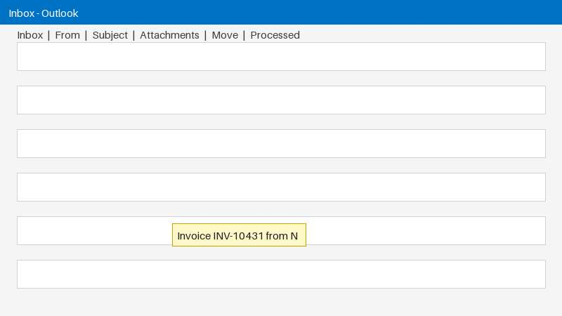 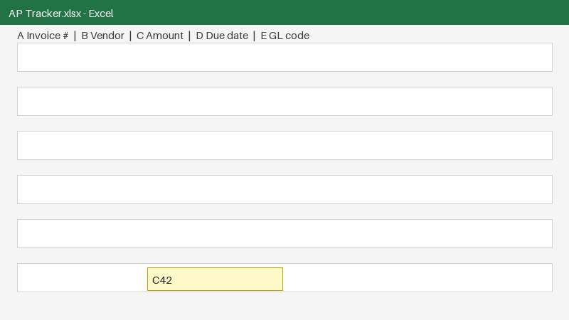 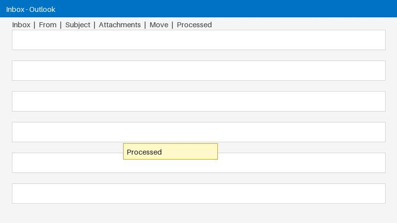

**Steps (one repeat):**

1. [Outlook] Opens the vendor invoice email in the inbox.
2. [Outlook] Opens the invoice PDF attachment from the email.
3. [Acrobat Reader] Copies the invoice number from the PDF invoice.
4. [Excel] Pastes the invoice number into column A of the tracker.
5. [Acrobat Reader] Copies the vendor name from the invoice PDF.
6. [Excel] Pastes the vendor name into column B of the tracker.
7. [Acrobat Reader] Scrolls the invoice PDF to locate the total due.
8. [Acrobat Reader] Copies the total due from the invoice PDF.
9. [Excel] Pastes the total due into the Amount column of the tracker.
10. [Excel] Enters a value in the Due date column of the tracker.
11. [Excel] Enters the GL code in column E of the tracker.
12. [Excel] Copies the invoice amount from the AP tracker.
13. [Chrome · Vendor Portal] Opens a new payment request in the vendor portal.
14. [Chrome · Vendor Portal] Enters the vendor name in the payment request form.
15. [Chrome · Vendor Portal] Pastes the invoice amount into the payment request form.
16. [Chrome · Vendor Portal] Enters the invoice number into the invoice number field of the payment request.
17. [Chrome · Vendor Portal] Enters the due date into the due date field of the payment request.
18. [Chrome · Vendor Portal] Clicks Attach file to open the file dialog for supporting documentation.
19. [Chrome] Selects the invoice file in the Open dialog to attach it.
20. [Chrome] Attaches supporting file to the new vendor payment request.
21. [Chrome · Vendor Portal] Submits the new vendor payment request in the portal.
22. [Outlook] Opens the move options for the invoice email in Outlook.
23. [Outlook] Moves the processed invoice email to the Processed folder.

**Standard operating procedure:** [sop-task2.html](sop-task2.html) (a draft with a screenshot per step, the rules and checks; for the process owner to review and approve)

#### Recommendations

_From the AI analysis._

1. **Capture invoice once with AI extraction and auto-write AP tracker**: _AI document extraction · effort: weeks · about 35% of this task's time · steps 1-11_

   Trigger Power Automate cloud flow on Outlook inbox arrival with PDF attachment via Microsoft Graph mail API. Send PDF to Azure Document Intelligence invoice model to return InvoiceId, VendorName, InvoiceTotal, DueDate with confidence. If confidence >0.85 auto-append row to AP Tracker.xlsx via Microsoft Graph Excel API; if low, route to human review in Teams/Outlook. Archive source email to Processed via Graph move.

   *Why:* ECRS eliminate + automate: removes 24 Acrobat Reader->Excel hand copies, scrolling to find total, and 369 typed chars. Evidence: transportation waste 4 values/item, 76% time moving/re-typing, cycle efficiency 11%.

   Tools: Power Automate, Microsoft Graph mail API, Azure Document Intelligence invoice model, Microsoft Graph Excel API

2. **Submit Vendor Portal payment from single payload - API first, browser automation fallback**: _Desktop automation (RPA) · effort: weeks · about 30% of this task's time · steps 12-21_

   Ask vendor/IT for Vendor Portal API docs, auth, and test in Postman: endpoints for create payment, attach file, submit. If no API, use Power Automate Desktop or Playwright script that reads the single payload (invoice number, vendor, amount, due date) plus downloaded PDF and fills New Payment Request, attaches file, submits once with duplicate-submit guard. Reuse Excel row as audit record, not as copy source.

   *Why:* Theory of Constraints - fix the bottleneck (0.8 min/item portal write). Also poka-yoke: eliminates 3 proven re-typed duplicates and double Submit seen in run 6, plus 8 Excel->Portal hand pastes.

   Tools: Power Automate, Playwright, Microsoft Graph Excel API

3. **Eliminate Excel as in-between copy file**: _Process change · effort: hours · about 10% of this task's time · steps 3-17_

   Change rule: capture each value once into automation memory/table then write to both Excel and portal in same step. Keep Excel only as system record written by automation, not as intermediate copy-paste. Batch validate all 8 invoices first, then submit; exceptions go to a person queue.

   *Why:* ECRS eliminate and combine: evidence shows 1 value (Total due -> column C -> Amount) copied in only to be copied out, and Vendor/Invoice/Due date exist elsewhere. Reduces motion waste (10 switches/item).

   Tools: Excel, Power Automate

4. **Turn Due date and GL code typing into rules and dropdowns**: _Process change · effort: days · about 6% of this task's time · steps 10-11, 17_

   Interview AP owner to document rules for Due date (e.g., Net 30 from invoice date?) and GL code (vendor-to-GL map?). Replace free typing in steps 10-11 with Excel VLOOKUP/XLOOKUP table or Power Automate lookup, plus dropdowns. Make portal Due date and GL fields pull from same lookup. Measure error rate in Power BI before/after.

   *Why:* ECRS simplify + poka-yoke: open questions show both values typed by hand (10 chars and 4 chars) with unknown origin; free typing causes defects and blocks straight-through automation.

   Tools: Excel, Power Automate, Power BI

**Assumptions to confirm:**

- AP Tracker.xlsx is stored in OneDrive/SharePoint so Microsoft Graph Excel API can read/write it; local-only file would need migration first
- Vendor Portal has no confirmed API (status unknown) - advice assumes no API until vendor/IT confirms docs, auth, and attach/submit endpoints
- Invoice PDFs contain selectable text; scanned images will need OCR via Azure Document Intelligence
- Due date in column D (10 chars typed) and GL code in column E (4 chars typed) are derivable by rule/lookup - source logic not visible in recording and must be confirmed with AP owner
- No separate approval step is required beyond portal Submit; if approval is needed it stays manual
- Outlook mail permissions (Mail.ReadWrite) and a Processed folder can be granted to the automation identity
- Vendor names and invoice-number formats in portal match the PDF exactly; no fuzzy matching or vendor onboarding needed

**Quick wins:**

- Enable Excel Data Validation on Due date (date only) and GL code (4-char list/dropdown) to enforce poka-yoke before automation

**Check before automating:**

- Vendor Portal has no documented API - browser automation breaks on portal UI change and needs selector maintenance and login/MFA handling
- AI misread of Total due, vendor, or invoice number causes wrong payment; requires confidence threshold, human review queue, and duplicate-invoice check before Submit
- GL code and Due date rules unknown - automating wrong assumption creates systematic mis-coding and late/early payments
- Double-submit risk seen in run 6 (Submit clicked twice) - automation must be idempotent and check invoice number already exists in tracker/portal before creating request

**Existing tools and guides found online:**

- [How to Extract Specific Data from PDF to Excel Using VBA](https://www.exceldemy.com/extract-specific-data-from-pdf-to-excel-using-vba/): ⧭ Output: Run this code. And it'll copy data from the PDF file called "standardnormaltable" to the worksheet called "Sheet1" in the active workbook. Read More: 
- [How to Extract Data from PDF to Excel (4 Suitable Ways)](https://www.exceldemy.com/extract-data-from-pdf-to-excel/): The article will show to you 4 different process on how to extract data from pdf to Excel. Download our practice workbook and follow us.
- [How to Copy Data From a PDF to Excel (2026 Guide) - lido.app](https://www.lido.app/blog/copy-data-from-pdf-to-excel): The most reliable way to copy data from a PDF to Excel is to use an AI-powered tool like Lido. Upload the PDF, and the AI reads the document, preserves the tabl
- [How to Extract Data from PDF to Excel Using Power Automate](https://www.thebricks.com/resources/guide-how-to-extract-data-from-pdf-to-excel-using-power-automate): Discover how to automate extracting data from PDFs to Excel with Power Automate. Save hours, reduce errors, and streamline your workflow effortlessly.

**Tools that usually fit these applications:**

- [Microsoft Power Automate](https://www.microsoft.com/power-platform/products/power-automate): Desktop flows (RPA) plus cloud flows for Outlook, Excel, SharePoint, Teams and many other connectors
- [n8n](https://n8n.io): Self-hostable workflow automation that connects web apps through their APIs, with AI steps
- [Zapier](https://zapier.com): No-code integrations between cloud apps
- [UiPath](https://www.uipath.com): Enterprise RPA for desktop and legacy apps without APIs (SAP GUI, Citrix, mainframe screens)

**Automation draft** (python, saved to `automations/task2.py`)

Top recommendation: poll Outlook via Graph, extract invoice fields via Azure Document Intelligence invoice model, create single payload for Excel and Vendor Portal, write to Excel via Graph and archive email. Low-confidence items route to human review.

```python
import os, requests, msal
TENANT=os.getenv('TENANT_ID'); CLIENT=os.getenv('CLIENT_ID'); SECRET=os.getenv('CLIENT_SECRET')
DI_ENDPOINT=os.getenv('DI_ENDPOINT'); DI_KEY=os.getenv('DI_KEY')
SITE_ID=os.getenv('SITE_ID'); DRIVE_ID=os.getenv('DRIVE_ID'); FILE_ID=os.getenv('AP_TRACKER_FILE_ID')
# 1. auth to Microsoft Graph
app=msal.ConfidentialClientApplication(CLIENT, authority=f'https://login.microsoftonline.com/{TENANT}', client_credential=SECRET)
tok=app.acquire_token_for_client(scopes=['https://graph.microsoft.com/.default'])['access_token']
gh={'Authorization': f'Bearer {tok}'}
# 2. find unread vendor invoice emails with PDF
msgs=requests.get('https://graph.microsoft.com/v1.0/me/mailFolders/inbox/messages?$filter=isRead eq false&$top=10&$expand=attachments', headers=gh).json().get('value',[])
for m in msgs:
    pdfs=[a for a in m.get('attachments',[]) if a.get('name','').lower().endswith('.pdf')]
    if not pdfs: continue
    att_id=pdfs[0]['id']; msg_id=m['id']
    pdf_bytes=requests.get(f'https://graph.microsoft.com/v1.0/me/messages/{msg_id}/attachments/{att_id}/$value', headers=gh).content
    # 3. Azure Document Intelligence prebuilt-invoice
    url=f'{DI_ENDPOINT}/formrecognizer/documentModels/prebuilt-invoice:analyze?api-version=2023-07-31'
    h={'Ocp-Apim-Subscription-Key': DI_KEY, 'Content-Type':'application/pdf'}
    op=requests.post(url, headers=h, data=pdf_bytes).headers['Operation-Location']
    import time; res=None
    for _ in range(20):
        time.sleep(2); res=requests.get(op, headers={'Ocp-Apim-Subscription-Key': DI_KEY}).json()
        if res.get('status') in ('succeeded','failed'): break
    doc=res['analyzeResult']['documents'][0]['fields']
    inv_no=doc.get('InvoiceId',{}).get('valueString','')
    vendor=doc.get('VendorName',{}).get('valueString','')
    total=doc.get('InvoiceTotal',{}).get('valueCurrency',{}).get('amount')
    due=doc.get('DueDate',{}).get('valueDate','')  # needs human rule if missing
    conf=min([doc.get('InvoiceId',{}).get('confidence',0), doc.get('VendorName',{}).get('confidence',0)])
    if conf<0.85 or not total:
        print(f'HOLD {inv_no} low confidence -> route to human'); continue
    payload={'invoice_number':inv_no,'vendor':vendor,'amount':total,'due_date':due}  # single capture for Excel+Portal
    print(payload)  # 4. write to Excel via Graph + submit to portal via Playwright/API in next stage
    # Example Excel append (table): requests.post(f'https://graph.microsoft.com/v1.0/drives/{DRIVE_ID}/items/{FILE_ID}/workbook/tables/APTable/rows/add', headers={**gh,'Content-Type':'application/json'}, json={'values':[[inv_no,vendor,total,due,'']]} )
    # 5. archive email
    requests.post(f'https://graph.microsoft.com/v1.0/me/messages/{msg_id}/move', headers={**gh,'Content-Type':'application/json'}, json={'destinationId':'Processed'})

```

#### Data flow: field to field

Taken from the recording: every value that was copied or typed, where from and where to.

| Step | From | To | How | Seen in runs |
|---|---|---|---|---|
| 4 | Acrobat Reader · INV-#.pdf · Invoice number | Excel · AP Tracker.xlsx · column A | copy-paste | 8 of 8 |
| 6 | Acrobat Reader · INV-#.pdf · Vendor | Excel · AP Tracker.xlsx · column B | copy-paste | 8 of 8 |
| 9 | Acrobat Reader · INV-#.pdf · Total due | Excel · AP Tracker.xlsx · column C | copy-paste | 8 of 8 |
| 10 | typed by hand | Excel · AP Tracker.xlsx · column D | typed (10 characters) | 8 of 8 |
| 11 | typed by hand | Excel · AP Tracker.xlsx · column E | typed (4 characters) | 8 of 8 |
| 14 | typed by hand; **same value as Acrobat Reader · INV-#.pdf · Vendor** (fingerprint match, 8 of 8 runs) | Chrome · Vendor Portal · New Payment Request · Vendor | typed (17 characters) | 8 of 8 |
| 15 | Excel · AP Tracker.xlsx · column C (originally Acrobat Reader · INV-#.pdf · Total due) | Chrome · Vendor Portal · New Payment Request · Amount | copy-paste | 8 of 8 |
| 16 | typed by hand; **same value as Acrobat Reader · INV-#.pdf · Invoice number** (fingerprint match, 8 of 8 runs) | Chrome · Vendor Portal · New Payment Request · Invoice number | typed (9 characters) | 8 of 8 |
| 17 | typed by hand; **same value as Excel · AP Tracker.xlsx · column D** (fingerprint match, 8 of 8 runs) | Chrome · Vendor Portal · New Payment Request · Due date | typed (10 characters) | 8 of 8 |

**Decide before automating:**

- Where does **Excel · AP Tracker.xlsx · column D** come from? It was typed by hand (10 characters). A fixed rule, a lookup, or a person's judgement?
- Where does **Excel · AP Tracker.xlsx · column E** come from? It was typed by hand (4 characters). A fixed rule, a lookup, or a person's judgement?

#### How the systems can connect

Each option has a status: *documented* (official documentation, access still needed), *found online, confirm* (a web search hit), *unknown* (no evidence: ask the vendor or IT), or a fallback.

| System | Role | Options |
|---|---|---|
| Outlook | used, no data moved | API: [Microsoft Graph mail API](https://learn.microsoft.com/graph/api/resources/mail-api-overview) *(documented)*<br>n8n: [n8n Microsoft Outlook node](https://docs.n8n.io/integrations/builtin/app-nodes/n8n-nodes-base.microsoftoutlook/) *(documented)*<br>Postman: [Try the Graph calls in Postman first](https://learn.microsoft.com/graph/use-postman) *(documented)* |
| Acrobat Reader | source | n8n: [n8n Extract From File (PDF text)](https://docs.n8n.io/integrations/builtin/core-nodes/n8n-nodes-base.extractfromfile/) *(documented)*<br>API: [Azure Document Intelligence invoice model](https://learn.microsoft.com/azure/ai-services/document-intelligence/prebuilt/invoice) *(documented)* |
| Excel | source and target | API: [Microsoft Graph Excel API](https://learn.microsoft.com/graph/api/resources/excel) *(documented)*<br>n8n: [n8n Microsoft Excel 365 node](https://docs.n8n.io/integrations/builtin/app-nodes/n8n-nodes-base.microsoftexcel/) *(documented)*<br>SQL: [Keep the tracker in a database table instead](https://docs.n8n.io/integrations/builtin/app-nodes/n8n-nodes-base.postgres/) *(option)*<br>File: [Read and write the file directly (n8n Read/Write Files)](https://docs.n8n.io/integrations/builtin/core-nodes/n8n-nodes-base.readwritefile/) *(documented)* |
| Chrome · Vendor Portal | target | API: Vendor Portal API *(unknown, ask the vendor or IT)*<br>Postman: [Test the portal's API in Postman once you have its documentation](https://learning.postman.com/docs/introduction/overview/) *(after API access)*<br>SQL: Write to the portal's database directly *(unknown, ask the vendor or IT)*<br>Browser automation: [Playwright script that fills the form](https://playwright.dev/python/docs/locators) *(works without an API)* |

#### Proposed automation sequence

1. **Trigger** · Outlook: When a new email arrives, download its attachment (checked on a schedule, e.g. every 15 minutes).
   - _How: Microsoft Graph mail API (n8n: Microsoft Outlook node or HTTP Request) (documented)_
2. **Extract** · Acrobat Reader: Read Invoice number, Vendor, Total due from INV-#.pdf.
   - _How: n8n Extract From File + field parsing; Azure Document Intelligence for scans (documented)_
3. **Write** · Excel: Write into AP Tracker.xlsx.
   - column A ← Invoice number (Acrobat Reader)
   - column B ← Vendor (Acrobat Reader)
   - column C ← Total due (Acrobat Reader)
   - column D ← typed by hand (10 characters): open question
   - column E ← typed by hand (4 characters): open question
   - _How: Microsoft Graph Excel API (workbook in OneDrive/SharePoint), or a SQL table (documented)_
4. **Write** · Chrome · Vendor Portal: Write into New Payment Request, using: New payment request, Attach file, Submit, and attach the file (INV-#.pdf).
   - Vendor ← Vendor (Acrobat Reader): typed by hand, but the fingerprints prove it is the same value (8 of 8 runs)
   - Amount ← Total due (Acrobat Reader)
   - Invoice number ← Invoice number (Acrobat Reader): typed by hand, but the fingerprints prove it is the same value (8 of 8 runs)
   - Due date ← column D (Excel): typed by hand, but the fingerprints prove it is the same value (8 of 8 runs)
   - _How: No public API found: ask the vendor for an API or bulk upload. Until then, browser automation (Playwright) (unknown, ask the vendor or IT)_
5. **Finish** · Outlook: Then in Outlook: Move → Processed.
   - _How: Microsoft Graph mail API (n8n: Microsoft Outlook node or HTTP Request) (documented)_
6. **Decide**: Where does Excel · AP Tracker.xlsx · column D come from? It was typed by hand (10 characters). A fixed rule, a lookup, or a person's judgement?
   - _How: Business decision before building (open)_
7. **Decide**: Where does Excel · AP Tracker.xlsx · column E come from? It was typed by hand (4 characters). A fixed rule, a lookup, or a person's judgement?
   - _How: Business decision before building (open)_
8. **Human check**: Determine the correct due date to record for the invoice
   - _How: Keep a person here, or define the rule (open)_
9. **Human check**: Determine the appropriate GL code for the invoice
   - _How: Keep a person here, or define the rule (open)_

**To build it**, once the questions above are answered, run `python -m flowsme build demo-invoice-processing --task 2`. It writes an n8n workflow to import, a Postman collection to test each connection, and SQL and Playwright starters.

#### To-be process

What the work looks like after the change, and who does each part: automation (blue) or a person (orange). People handle only the exceptions the checks flag.

| | As-is | To-be with your tools | To-be with suggested tools |
|---|---|---|---|
| Hands-on minutes per item | 2.1 | 1.4 | 0.4 |
| Values typed or pasted by hand per item | 9 | 2 | 2 |
| Steps a person does per item | 23 | 2 | 2 |

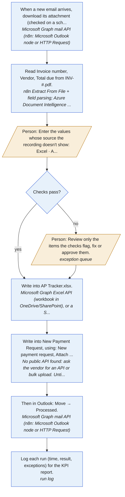

| # | Who | What | How |
|---|---|---|---|
| 1 | Automation | When a new email arrives, download its attachment (checked on a schedule, e.g. every 15 minutes). | Microsoft Graph mail API (n8n: Microsoft Outlook node or HTTP Request) |
| 2 | Automation | Read Invoice number, Vendor, Total due from INV-#.pdf. | n8n Extract From File + field parsing; Azure Document Intelligence for scans |
| 3 | Person | Enter the values whose source the recording doesn't show: Excel · AP Tracker.xlsx · column D, Excel · AP Tracker.xlsx · column E (until a rule or lookup replaces them). | - |
| 4 | Automation | Check every item before writing it (4 validation rules, plus duplicates and mismatches between fields). | checks in the workflow |
| 5 | Person | Review only the items the checks flag, fix or approve them. | exception queue |
| 6 | Automation | Write into AP Tracker.xlsx. | Microsoft Graph Excel API (workbook in OneDrive/SharePoint), or a SQL table |
| 7 | Automation | Write into New Payment Request, using: New payment request, Attach file, Submit, and attach the file (INV-#.pdf). | No public API found: ask the vendor for an API or bulk upload. Until then, browser automation (Playwright) |
| 8 | Automation | Then in Outlook: Move → Processed. | Microsoft Graph mail API (n8n: Microsoft Outlook node or HTTP Request) |
| 9 | Automation | Log each run (time, result, exceptions) for the KPI report. | run log |

#### Business rules

Every rule the process follows, in one place: what the recording proves, what you said, and what is recommended or still to confirm. Confirm the open ones with the process owner before building.

| ID | Type | Rule | Field | Evidence | Status |
|---|---|---|---|---|---|
| BR-1 | mapping | column A = Invoice number from Acrobat Reader · INV-#.pdf · Invoice number | Excel · AP Tracker.xlsx · column A | copied in 8 of 8 runs | confirmed by the recording |
| BR-2 | mapping | column B = Vendor from Acrobat Reader · INV-#.pdf · Vendor | Excel · AP Tracker.xlsx · column B | copied in 8 of 8 runs | confirmed by the recording |
| BR-3 | mapping | column C = Total due from Acrobat Reader · INV-#.pdf · Total due | Excel · AP Tracker.xlsx · column C | copied in 8 of 8 runs | confirmed by the recording |
| BR-4 | unknown | Where column D comes from is not recorded | Excel · AP Tracker.xlsx · column D | typed by hand in 8 of 8 runs | ask the process owner |
| BR-5 | unknown | Where column E comes from is not recorded | Excel · AP Tracker.xlsx · column E | typed by hand in 8 of 8 runs | ask the process owner |
| BR-6 | mapping | Vendor = Vendor from Acrobat Reader · INV-#.pdf · Vendor | Chrome · Vendor Portal · New Payment Request · Vendor | typed, and the fingerprints match in 8 of 8 runs | confirmed by the recording |
| BR-7 | mapping | Amount = Total due from Acrobat Reader · INV-#.pdf · Total due | Chrome · Vendor Portal · New Payment Request · Amount | copied in 8 of 8 runs | confirmed by the recording |
| BR-8 | mapping | Invoice number = Invoice number from Acrobat Reader · INV-#.pdf · Invoice number | Chrome · Vendor Portal · New Payment Request · Invoice number | typed, and the fingerprints match in 8 of 8 runs | confirmed by the recording |
| BR-9 | mapping | Due date = column D from Excel · AP Tracker.xlsx · column D | Chrome · Vendor Portal · New Payment Request · Due date | typed, and the fingerprints match in 8 of 8 runs | confirmed by the recording |
| BR-10 | validation | Must be unique: check it is not already recorded before writing it (stops duplicates, e.g. paying twice). | Excel · AP Tracker.xlsx · column A; Chrome · Vendor Portal · New Payment Request · Invoice number | field 'column A' holds 'Invoice number' | recommended |
| BR-11 | validation | Must exist in the master list (e.g. vendor master): pick from a list instead of typing. | Excel · AP Tracker.xlsx · column B; Chrome · Vendor Portal · New Payment Request · Vendor | field 'column B' holds 'Vendor' | recommended |
| BR-12 | validation | Must be a number in the expected currency, above zero, and equal to the source document. Flag anything above the approval limit for a person. | Excel · AP Tracker.xlsx · column C; Chrome · Vendor Portal · New Payment Request · Amount | field 'column C' holds 'Total due' | recommended |
| BR-13 | validation | Must be a valid date in one agreed format and a sensible range (not in the past, not years ahead). | Chrome · Vendor Portal · New Payment Request · Due date | field 'Due date' holds 'column D' | recommended |
| BR-14 | decision | Determine the correct due date to record for the invoice | - | a judgement call seen in the recording | write down the rule |
| BR-15 | decision | Determine the appropriate GL code for the invoice | - | a judgement call seen in the recording | write down the rule |

#### User stories and acceptance tests

For whoever builds the automation: each criterion is a test to pass before go-live. `flowsme build` also writes them as `acceptance.feature` (Gherkin) and `user_stories.md`.

**US-1 Start by itself: Outlook.** As the person who does this work today, I want the automation to start by itself (when a new email arrives, download its attachment (checked on a schedule, e.g. every 15 minutes)), so that nobody has to remember to run it.

- Given a new item is ready, when the trigger fires, then the automation starts and picks up the item.

**US-2 Read the source: Acrobat Reader.** As the person who does this work today, I want the automation to read Invoice number, Vendor, Total due from INV-#.pdf, so that nobody has to open each item by hand.

- Given a new item arrives, when the automation runs, then it does this: read Invoice number, Vendor, Total due from INV-#.pdf.

**US-3 Enter values without a known source.** As the person who does this work today, I want to enter only the values whose source isn't recorded, so that the rest is automated while those rules are settled.

- Given the source of Excel · AP Tracker.xlsx · column D is not yet known, when an item is processed, then the item waits for a person to enter that value.
- Given the source of Excel · AP Tracker.xlsx · column E is not yet known, when an item is processed, then the item waits for a person to enter that value.

**US-4 Check before writing.** As the person who does this work today, I want every item checked before it is written, so that mistakes are caught before they reach the records.

- Given an item that breaks BR-10 (Excel · AP Tracker.xlsx · column A; Chrome · Vendor Portal · New Payment Request · Invoice number), when the automation checks it, then nothing is written and the item goes to the review queue with the reason.
- Given an item that breaks BR-11 (Excel · AP Tracker.xlsx · column B; Chrome · Vendor Portal · New Payment Request · Vendor), when the automation checks it, then nothing is written and the item goes to the review queue with the reason.
- Given an item that breaks BR-12 (Excel · AP Tracker.xlsx · column C; Chrome · Vendor Portal · New Payment Request · Amount), when the automation checks it, then nothing is written and the item goes to the review queue with the reason.
- Given an item that breaks BR-13 (Chrome · Vendor Portal · New Payment Request · Due date), when the automation checks it, then nothing is written and the item goes to the review queue with the reason.
- Given an item that is already recorded, when it arrives again, then it is not written a second time and goes to review as a possible duplicate.

**US-5 Review only the exceptions.** As the person who does this work today, I want to see only the items that fail a check, with the reason, so that I review exceptions instead of every item.

- Given an item fails a check, when I open the review queue, then I see the item, the failed rule and its source, and can fix and approve it or reject it.
- Given I approve a fixed item, when the automation continues, then it is written like any other item.

**US-6 Write to Excel.** As the person who does this work today, I want the automation to write into AP Tracker.xlsx, so that nobody re-keys these values.

- Given an item passed its checks, when the automation writes it, then Excel · AP Tracker.xlsx · column A = Invoice number from Acrobat Reader · INV-#.pdf · Invoice number (BR-1).
- Given an item passed its checks, when the automation writes it, then Excel · AP Tracker.xlsx · column B = Vendor from Acrobat Reader · INV-#.pdf · Vendor (BR-2).
- Given an item passed its checks, when the automation writes it, then Excel · AP Tracker.xlsx · column C = Total due from Acrobat Reader · INV-#.pdf · Total due (BR-3).

**US-7 Write to Chrome · Vendor Portal.** As the person who does this work today, I want the automation to write into New Payment Request, using: New payment request, Attach file, Submit, and attach the file (INV-#.pdf), so that nobody re-keys these values.

- Given an item passed its checks, when the automation writes it, then Chrome · Vendor Portal · New Payment Request · Vendor = Vendor from Acrobat Reader · INV-#.pdf · Vendor (BR-6).
- Given an item passed its checks, when the automation writes it, then Chrome · Vendor Portal · New Payment Request · Amount = Total due from Acrobat Reader · INV-#.pdf · Total due (BR-7).
- Given an item passed its checks, when the automation writes it, then Chrome · Vendor Portal · New Payment Request · Invoice number = Invoice number from Acrobat Reader · INV-#.pdf · Invoice number (BR-8).
- Given an item passed its checks, when the automation writes it, then Chrome · Vendor Portal · New Payment Request · Due date = column D from Excel · AP Tracker.xlsx · column D (BR-9).

**US-8 Write to Outlook.** As the person who does this work today, I want the automation to then in Outlook: Move → Processed, so that nobody re-keys these values.

- Given an item passed its checks, when the automation runs, then it does this: then in Outlook: Move → Processed.

**US-9 Log every run.** As the process owner, I want every run logged with time, result and exceptions, so that I can see the time saved and the error rate, and prove the benefit.

- Given a normal item, when the automation processes it, then it needs no hands-on work and the remaining manual part takes under 0.4 min.
- Given a run finishes, when I open the KPI report, then I see items processed, exceptions, and minutes per item against the old process.

#### Process improvement (Lean Six Sigma, DMAIC)

**Define.** What must go right (critical to quality):

- Invoice number must be correct and never processed twice
- Total due must match the source exactly
- Each item done within the agreed time (now about 2.1 min of hands-on work)

| Suppliers | Inputs | Process | Outputs | Customers |
|---|---|---|---|---|
| whoever sends to Outlook<br>Acrobat Reader | Acrobat Reader · INV-#.pdf · Invoice number<br>Acrobat Reader · INV-#.pdf · Total due<br>Acrobat Reader · INV-#.pdf · Vendor | Trigger: Outlook<br>Extract: Acrobat Reader<br>Write: Excel<br>Write: Chrome · Vendor Portal<br>Finish: Outlook | Chrome · Vendor Portal · New Payment Request<br>Excel · AP Tracker.xlsx | Who uses these outputs? (not visible in the recording: ask) |

**Measure.** 2.1 min of hands-on work per item, 8 items in this recording, 9 manual entries per item.

Run-to-run variation over 8 items: mean 123 s, standard deviation 7 s (coefficient of variation 5%), fastest 116 s (item 7), slowest 136 s (item 6).

<svg viewBox="0 0 640 220" width="100%" style="max-width:640px" role="img" aria-label="Seconds per item, Process vendor invoice for payment" xmlns="http://www.w3.org/2000/svg" font-family="system-ui,Segoe UI,sans-serif" font-size="11"><line x1="56" x2="624" y1="46.9" y2="46.9" stroke="#c5221f" stroke-width="1.2" stroke-dasharray="5 4"/><text x="50" y="50.9" text-anchor="end" fill="#c5221f">UCL 146s</text><line x1="56" x2="624" y1="104.1" y2="104.1" stroke="#5f6368" stroke-width="1.2"/><text x="50" y="108.1" text-anchor="end" fill="#5f6368">mean 123s</text><line x1="56" x2="624" y1="161.3" y2="161.3" stroke="#c5221f" stroke-width="1.2" stroke-dasharray="5 4"/><text x="50" y="165.3" text-anchor="end" fill="#c5221f">LCL 100s</text><polyline points="56.0,96.2 137.1,104.4 218.3,120.9 299.4,108.6 380.6,109.0 461.7,71.3 542.9,122.6 624.0,98.9" fill="none" stroke="#2f5bd3" stroke-width="2"/><circle cx="56.0" cy="96.2" r="4" fill="#2f5bd3"><title>Run 1: 126 s</title></circle><text x="56.0" y="208" text-anchor="middle" fill="#5f6368">1</text><circle cx="137.1" cy="104.4" r="4" fill="#2f5bd3"><title>Run 2: 123 s</title></circle><text x="137.1" y="208" text-anchor="middle" fill="#5f6368">2</text><circle cx="218.3" cy="120.9" r="4" fill="#2f5bd3"><title>Run 3: 116 s</title></circle><text x="218.3" y="208" text-anchor="middle" fill="#5f6368">3</text><circle cx="299.4" cy="108.6" r="4" fill="#2f5bd3"><title>Run 4: 121 s</title></circle><text x="299.4" y="208" text-anchor="middle" fill="#5f6368">4</text><circle cx="380.6" cy="109.0" r="4" fill="#2f5bd3"><title>Run 5: 121 s</title></circle><text x="380.6" y="208" text-anchor="middle" fill="#5f6368">5</text><circle cx="461.7" cy="71.3" r="4" fill="#2f5bd3"><title>Run 6: 136 s</title></circle><text x="461.7" y="208" text-anchor="middle" fill="#5f6368">6</text><circle cx="542.9" cy="122.6" r="4" fill="#2f5bd3"><title>Run 7: 116 s</title></circle><text x="542.9" y="208" text-anchor="middle" fill="#5f6368">7</text><circle cx="624.0" cy="98.9" r="4" fill="#2f5bd3"><title>Run 8: 125 s</title></circle><text x="624.0" y="208" text-anchor="middle" fill="#5f6368">8</text><text x="340" y="219" text-anchor="middle" fill="#5f6368">run</text></svg>

<sub>Individuals control chart: limits at the mean ± 2.66 × the average change between items. All items are inside, so the process is stable and its time is predictable.</sub>

Steps that vary most between items:

- Step 2: Opens the invoice PDF attachment from the email. (6 s on average, ± 2 s)
- Step 14: Enters the vendor name in the payment request form. (8 s on average, ± 2 s)
- Step 8: Copies the total due from the invoice PDF. (5 s on average, ± 2 s)

| Time per item | Minutes | Share |
|---|---|---|
| waste (non-value-adding) | 1.56 | 76% |
| business-required | 0.27 | 13% |
| value-adding? (judgement, confirm) | 0.23 | 11% |

Process cycle efficiency: **11%** (value-adding time ÷ total).

Error exposure: 9 manual entries per item now, 2 after automation, about 160 items a month.

| Human error rate (source) | Errors a month now | After automation | DPMO | Sigma level |
|---|---|---|---|---|
| 0.14% per entry: [Nahm et al. 2008: source to database, clinical trials](https://doi.org/10.1371/journal.pone.0003049) | 2.1 | 0.5 | 1,430 | 4.0 |
| 0.29% per entry: [Garza et al. 2025: meta-analysis of 93 studies, single data entry](https://doi.org/10.1016/j.ijmedinf.2024.105749) | 4.2 | 0.9 | 2,900 | 4.0 |
| 3.70% per entry: [Mays & Mathias 2019: manual transcription of numeric results](https://pmc.ncbi.nlm.nih.gov/articles/PMC6351970/) | 53.3 | 11.8 | 37,000 | 3.0 |

**Analyze.** Waste found in the recording:

| Waste | Evidence | Min per item |
|---|---|---|
| Transportation waste | 4 values per item carried between applications by copy-paste | 0.68 |
| Motion waste | 10 window switches and 6 navigation steps per item | 0.53 |
| Over-processing waste | 3 values typed by hand that the fingerprints prove already exist elsewhere (Vendor = Acrobat Reader · INV-#.pdf · Vendor, Invoice number = Acrobat Reader · INV-#.pdf · Invoice number, Due date = Excel · AP Tracker.xlsx · column D); 1 value copied into one file only to be copied out again (column C in Excel) | 0.34 |
| Defects and rework | Run 4 needed 2 extra steps: Scrolls through the invoice document to review its contents.; Zooms in on the invoice to read details clearly.. 'Submit' in Chrome · Vendor Portal was clicked twice in a row (run 6). | - |
| Unused talent | 76% of this person's time on this task is moving and re-typing data | - |

Bottleneck (Theory of Constraints): **Write · Chrome · Vendor Portal** at 0.8 min per item. Improve this stage first: speeding up any other stage doesn't shorten the whole.

**Improve.** First remove waste (ECRS), then automate what's left:

- **Eliminate:** Stop copying values into an in-between file that is then copied out again (Excel). Keep it only if someone needs it as a record, and then let the automation write it.
- **Eliminate:** Stop re-typing values that already exist: Vendor in Chrome · Vendor Portal, Invoice number in Chrome · Vendor Portal, Due date in Chrome · Vendor Portal.
- **Combine:** Capture each value once and write it to all 2 destinations in one step (Chrome · Vendor Portal, Excel).
- **Rearrange:** The routine ran 8 times one item at a time. Validate every item first, then submit in one batch; exceptions go to a person.
- **Simplify:** Turn free typing into rules, lookups or drop-downs: column D (Excel), column E (Excel).
- **Automate:** Then automate what is left, as in the tool plan below.

Tool plan. Your tools: Microsoft 365, Power Automate, Power BI. Runs the workflow: Power Automate (cloud flows).

| Stage | Now (min/item) | With your tools | With suggested tools |
|---|---|---|---|
| 1. Trigger · Outlook | 0.22 | Email API (Microsoft 365 (Outlook and Excel through Microsoft Graph), Power Automate (cloud flows)): 0.01 | Email API (Microsoft 365 (Outlook and Excel through Microsoft Graph), Power Automate (cloud flows)): 0.01 |
| 2. Extract · Acrobat Reader | 0.38 | stays manual: 0.38 | AI document extraction (people review unsure fields) (Azure Document Intelligence): 0.06 |
| 3. Write · Excel | 0.55 | Spreadsheet API (Microsoft 365 (Outlook and Excel through Microsoft Graph), Power Automate (cloud flows)): 0.24 | Spreadsheet API (Microsoft 365 (Outlook and Excel through Microsoft Graph), Power Automate (cloud flows)): 0.24 |
| 4. Write · Chrome · Vendor Portal | 0.80 | stays manual: 0.80 | Build a small API in front of the page (browser automation inside) (Python scripts (with FastAPI and Playwright)): 0.08 |
| 5. Finish · Outlook | 0.11 | Email API (Microsoft 365 (Outlook and Excel through Microsoft Graph), Power Automate (cloud flows)): 0.01 | Email API (Microsoft 365 (Outlook and Excel through Microsoft Graph), Power Automate (cloud flows)): 0.01 |
| **Total** | **2.1** | **1.4** | **0.4** |

Per month (160 items): 5.6 h now, 3.7 h with your tools, 1.1 h with the additions.

Adding tools, biggest gain first:

- **Python scripts (with FastAPI and Playwright)** saves another 1.0 min per item (2.7 h a month). Cost: free; needs someone to maintain the code.
- **Azure Document Intelligence** saves another 0.1 min per item (0.3 h a month). Cost: paid per page.

If the vendor provides an API key for **Vendor Portal API**, use it instead of browser automation: it is more reliable and won't break when the page changes.

<sub>Minutes after automation assume each method removes this share of a stage's time (people still review exceptions): api 95%, database 95%, ai extraction 85%, pdf rules 70%, api wrapper 90%, browser 85%, rpa 80%. These are planning estimates; measure after the pilot.</sub>

**Control.** Validation checklist: error-proofing first, then detection. Why that order: When values flowed electronically instead of being transcribed, transcription errors fell from 6.1% to zero. ([Poon et al. 2010](https://pubmed.ncbi.nlm.nih.gov/20445181/)) Checking entries by eye was not significantly better than no checking; double entry was far better. ([Barchard & Pace 2011](https://doi.org/10.1016/j.chb.2011.04.004)) Built-in validation alarms prevented only a small fraction of errors. ([Goldberg et al. 2008](https://pmc.ncbi.nlm.nih.gov/articles/PMC2656002/)) A second, independent entry of the same data caught 88% of errors. ([Kawado et al. 2003](https://pubmed.ncbi.nlm.nih.gov/14500053/))

| Where | Type | Check | Evidence |
|---|---|---|---|
| Excel · AP Tracker.xlsx · column A | prevent | Pass the value from Acrobat Reader · INV-#.pdf · Invoice number directly instead of re-keying it; after writing, compare the two automatically. | copied by hand at step 4 |
| Excel · AP Tracker.xlsx · column A | detect | Must be unique: check it is not already recorded before writing it (stops duplicates, e.g. paying twice). | field 'column A' holds 'Invoice number' |
| Excel · AP Tracker.xlsx · column B | prevent | Pass the value from Acrobat Reader · INV-#.pdf · Vendor directly instead of re-keying it; after writing, compare the two automatically. | copied by hand at step 6 |
| Excel · AP Tracker.xlsx · column B | detect | Must exist in the master list (e.g. vendor master): pick from a list instead of typing. | field 'column B' holds 'Vendor' |
| Excel · AP Tracker.xlsx · column C | prevent | Pass the value from Acrobat Reader · INV-#.pdf · Total due directly instead of re-keying it; after writing, compare the two automatically. | copied by hand at step 9 |
| Excel · AP Tracker.xlsx · column C | detect | Must be a number in the expected currency, above zero, and equal to the source document. Flag anything above the approval limit for a person. | field 'column C' holds 'Total due' |
| Excel · AP Tracker.xlsx · column D | prevent | Replace free typing with a rule, a lookup or a drop-down. | typed by hand (10 characters) at step 10 |
| Excel · AP Tracker.xlsx · column E | prevent | Replace free typing with a rule, a lookup or a drop-down. | typed by hand (4 characters) at step 11 |
| Chrome · Vendor Portal · New Payment Request · Vendor | prevent | Pass the value from Acrobat Reader · INV-#.pdf · Vendor directly instead of re-typing it; after writing, compare the two automatically. | typed by hand at step 14; the fingerprints show it is the same value as Acrobat Reader · INV-#.pdf · Vendor (8 of 8 runs) |
| Chrome · Vendor Portal · New Payment Request · Vendor | detect | Must exist in the master list (e.g. vendor master): pick from a list instead of typing. | field 'Vendor' holds 'Vendor' |
| Chrome · Vendor Portal · New Payment Request · Amount | prevent | Pass the value from Acrobat Reader · INV-#.pdf · Total due directly instead of re-keying it; after writing, compare the two automatically. | copied by hand at step 15 |
| Chrome · Vendor Portal · New Payment Request · Amount | detect | Must be a number in the expected currency, above zero, and equal to the source document. Flag anything above the approval limit for a person. | field 'Amount' holds 'Total due' |
| Chrome · Vendor Portal · New Payment Request · Invoice number | prevent | Pass the value from Acrobat Reader · INV-#.pdf · Invoice number directly instead of re-typing it; after writing, compare the two automatically. | typed by hand at step 16; the fingerprints show it is the same value as Acrobat Reader · INV-#.pdf · Invoice number (8 of 8 runs) |
| Chrome · Vendor Portal · New Payment Request · Invoice number | detect | Must be unique: check it is not already recorded before writing it (stops duplicates, e.g. paying twice). | field 'Invoice number' holds 'Invoice number' |
| Chrome · Vendor Portal · New Payment Request · Due date | prevent | Pass the value from Excel · AP Tracker.xlsx · column D directly instead of re-typing it; after writing, compare the two automatically. | typed by hand at step 17; the fingerprints show it is the same value as Excel · AP Tracker.xlsx · column D (8 of 8 runs) |
| Chrome · Vendor Portal · New Payment Request · Due date | detect | Must be a valid date in one agreed format and a sensible range (not in the past, not years ahead). | field 'Due date' holds 'column D' |
| 'Submit' in Chrome · Vendor Portal | prevent | Capture the confirmation or reference number after submitting, and check it before trying again, so a slow page never creates a duplicate. | 'Submit' in Chrome · Vendor Portal was clicked twice in a row (run 6). |
| exceptions | detect | Route items that need extra handling (unclear scans, missing data) to a person instead of forcing them through the automation. | Run 4 needed 2 extra steps: Scrolls through the invoice document to review its contents.; Zooms in on the invoice to read details clearly.. |
| every run | control | Reconcile counts: items received = rows written = records submitted. Investigate any gap. | standard control for multi-system hand-offs |
| every run | control | Log each item with its result (done / exception / failed) and review exceptions daily. | needed to measure error rate after go-live |

Measure after go-live, in the final report (Power BI, Looker Studio or Excel, fed by the run log from `flowsme build`; suggested: Power BI):

- Items processed per day
- Hands-on minutes per item (target: 0.4 or less)
- Exceptions sent to a person (%)
- First-pass yield: items done with no correction (%)
- Errors caught by checks, by type
- Duplicates blocked

### 3. Share weekly AP summary with manager

**Automation potential: Low (24/100)** · 1.7 min in total · done once · Excel, Outlook

This task distributes the weekly accounts payable summary to management. The user refreshes the Summary sheet in the AP tracker, then creates and sends an Outlook email with the summary details and tracker file to the AP manager.

**Inputs:** AP tracker with current payables data  
**Outputs:** Weekly AP summary email with tracker sent to AP manager  
**Decision points:** Verify summary data is refreshed and accurate before sharing; Confirm correct recipient, subject, and attachments before sending  

**Why it stands out:**

- 1 value copied by hand from one application to another
- 242 characters typed by hand

**Estimated saving:** about 30 s per recording like this one (29% of this task), about 0.2 hours or $5 a month.

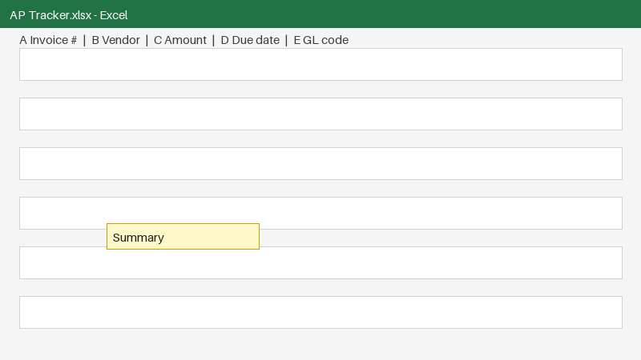 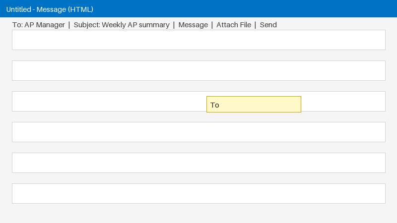 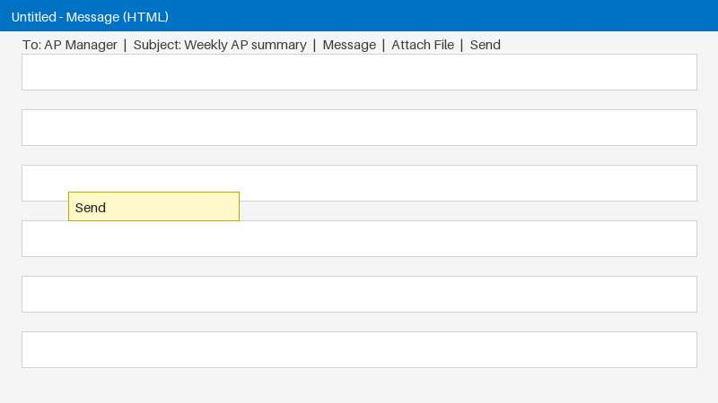

**Steps:**

1. [Excel] Opens the Summary sheet in the AP tracker.
2. [Excel] Refreshes the summary data in the AP tracker.
3. [Excel] Copies the summary data from the tracker.
4. [Outlook] Creates a new email to share the AP summary.
5. [Outlook] Addresses the new email to the AP manager.
6. [Outlook] Enters the weekly AP summary as the subject.
7. [Outlook] Composes the summary message in the email body.
8. [Outlook] Attaches the AP tracker file to the email.
9. [Outlook] Attaches the AP tracker spreadsheet to the weekly summary email.
10. [Outlook] Sends the weekly AP summary email to the manager.

**Standard operating procedure:** [sop-task3.html](sop-task3.html) (a draft with a screenshot per step, the rules and checks; for the process owner to review and approve)

#### Recommendations

_From the AI analysis._

1. **Scheduled Power Automate flow to refresh Summary and send manager email**: _API integration · effort: days · about 85% of this task's time · steps 1-10_

   Move AP Tracker.xlsx to SharePoint. Build scheduled Power Automate cloud flow for weekly run. Flow runs Office Script to RefreshAll + return Summary range, then uses Outlook connector to send fixed To, templated Subject, and HTML table body with file link.

   *Why:* Theory of Constraints: fixes 1.42 min Outlook bottleneck and copy-paste waste. ECRS Automate after simplifying. Evidence: 1 value Excel->Outlook, PCE 23%, documented Graph mail and Excel APIs.

   Tools: Power Automate, Excel Online, Office Scripts, Outlook

2. **Replace dual attachments with single SharePoint link + HTML summary**: _Process change · effort: hours · about 20% of this task's time · steps 3, 8-9_

   Eliminate steps 8-9 duplicate attachments. Keep one source file in SharePoint and include View tracker link in email body. Paste HTML table only, not full workbook copy. Set SharePoint versioning for audit.

   *Why:* ECRS Eliminate: removes transportation waste and version confusion from attaching the same tracker twice.

   Tools: SharePoint, Outlook

3. **One-click Office Script to refresh and validate Summary**: _Script · effort: hours · about 30% of this task's time · steps 1-3_

   Create Office Script Refresh_AP_Summary that calls refreshAllDataConnections, recalculates Summary sheet, validates totals are non-blank and dates match current week, and returns named range for email. Fail loudly if refresh fails.

   *Why:* Poka-yoke: makes stale-data error impossible rather than checking later. Evidence: manual refresh before copy is missed easily.

   Tools: Office Scripts, Excel Power Query

4. **Standardize To Subject Body as fixed template**: _Built-in feature · effort: hours · about 40% of this task's time · steps 4-7_

   Lock To to fixed AP manager distribution list, Subject to Weekly AP Summary - WE YYYY-MM-DD, and Body to template with placeholders for Total Payable, Overdue, Paid. Require owner sign-off on template once, then reuse in flow.

   *Why:* ECRS Simplify: turns free typing (To 24 chars, Subject 38 chars, Body 180 chars) into rules. Evidence: recording cannot tell source, so must confirm template is acceptable.

   Tools: Outlook, Power Automate

**Assumptions to confirm:**

- AP Tracker.xlsx can be stored in SharePoint or OneDrive for Business so Power Automate and Excel Online can access it
- Summary sheet refresh in step 2 is a Power Query / Pivot refresh with no manual judgement or cleanup
- Outlook To recipient is a stable AP manager or distribution list and can be fixed as a rule
- Subject and body can be templated from Summary fields plus week-ending date; no free-text judgement is required
- Sender has permission to run Office Scripts and send via Outlook / Graph mail API

**Quick wins:**

- Save AP manager as Outlook contact + Quick Parts template for To / Subject / Body to stop 242 chars of retyping
- Enable Data > Queries & Connections > Refresh on open and add Refresh All button on Summary sheet
- Store single AP Tracker.xlsx in SharePoint and send link instead of attaching file twice

**Check before automating:**

- Auto-send with stale totals if Power Query refresh fails - need fail-stop and alert, measure after go-live
- Local AP Tracker.xlsx vs SharePoint copy divergence if user keeps editing locally
- Fixed manager address becomes wrong on role change - need owner for distribution list
- Sensitive AP data in email body and link - need correct sharing permissions and retention

**Existing tools and guides found online:**

- [Think Like a Bot: How to Build a Weekly Review Agent in ...](https://thinklikeabot.blogspot.com/2025/12/how-to-build-weekly-review-agent-in.html): Dec 10, 2025 · Learn how to build a Copilot Studio agent that reviews your emails, meetings, and Teams messages weekly and sends a priority summary automaticall
- [Automate Weekly Status Updates With Slack, Asana & AI](https://mccarygroup.com/replace-manual-weekly-status-updates-slack-asana-ai/): The manager still reviews the update, but no longer has to assemble it from scratch. This guide explains how to replace manual weekly status updates with Slack,
- [GitHub - firstlinkai/MS-Teams-Weekly-Summary-Automation: MS ...](https://github.com/firstlinkai/MS-Teams-Weekly-Summary-Automation): n8n Template: Weekly MS Teams Activity Summary This n8n template lets you summarize individual team member activity on Microsoft Teams for the past week and gen
- [Automating Recurring Team Status Reports with Power Automate ...](https://www.wickedsmartdata.com/articles/automating-recurring-team-status-reports-with-power-automate-forms-sharepoint-and-teams): Oct 21, 2026 · Learn to automate weekly team status reports with Power Automate: collect Forms responses, aggregate data in SharePoint, and post formatted summa

**Tools that usually fit these applications:**

- [Microsoft Power Automate](https://www.microsoft.com/power-platform/products/power-automate): Desktop flows (RPA) plus cloud flows for Outlook, Excel, SharePoint, Teams and many other connectors
- [n8n](https://n8n.io): Self-hostable workflow automation that connects web apps through their APIs, with AI steps
- [Zapier](https://zapier.com): No-code integrations between cloud apps
- [Excel Power Query and Office Scripts](https://learn.microsoft.com/office/dev/scripts/overview/excel): Repeatable imports, clean-up and transformations inside Excel

**Automation draft** (power_automate, saved to `automations/task3.txt`)

Scheduled Power Automate cloud flow that refreshes the Summary sheet via Office Script and sends the templated Outlook email with link. Replaces steps 1-10 manual work.

```text
TRIGGER: Recurrence - Every Friday 15:00 UTC (Weekly AP summary)
ACTION 1: Excel Online (Business) - Run script [Refresh_AP_Summary] on /Shared Documents/AP Tracker.xlsx
  - Script: await workbook.refreshAllDataConnections(); await workbook.getWorksheet('Summary').calculate(); return range A1:E20 values + totals
ACTION 2: Compose - Build Subject: concat('Weekly AP Summary - WE ', utcNow('yyyy-MM-dd'))
ACTION 3: Compose - Build HTML Body with outputs from Script (Total Due, Overdue, Paid, Top vendors) + link to file
ACTION 4: Outlook - Send an email (V2)
  - To: ap-manager@[domain] (from fixed contact)
  - Subject: outputs Subject
  - Body: outputs HTML Body
  - Attachment: Link to SharePoint file (not duplicate .xlsx attachment)
ACTION 5: SharePoint - Error branch: If Run script fails -> Send alert to owner and DO NOT send summary
```

#### Data flow: field to field

Taken from the recording: every value that was copied or typed, where from and where to.

| Step | From | To | How | Seen in runs |
|---|---|---|---|---|
| 5 | typed by hand | Outlook · Untitled · To | typed (24 characters) | 1 of 1 |
| 6 | typed by hand | Outlook · Untitled · Subject | typed (38 characters) | 1 of 1 |
| 7 | Excel · AP Tracker.xlsx · column A | Outlook · Untitled · Message body | copy-paste | 1 of 1 |
| 7 | typed by hand | Outlook · Untitled · Message body | typed (180 characters) | 1 of 1 |

**Decide before automating:**

- Where does **Outlook · Untitled · To** come from? It was typed by hand (24 characters). A fixed rule, a lookup, or a person's judgement?
- Where does **Outlook · Untitled · Subject** come from? It was typed by hand (38 characters). A fixed rule, a lookup, or a person's judgement?
- Where does **Outlook · Untitled · Message body** come from? It was typed by hand (180 characters). A fixed rule, a lookup, or a person's judgement?

#### How the systems can connect

Each option has a status: *documented* (official documentation, access still needed), *found online, confirm* (a web search hit), *unknown* (no evidence: ask the vendor or IT), or a fallback.

| System | Role | Options |
|---|---|---|
| Excel | source | API: [Microsoft Graph Excel API](https://learn.microsoft.com/graph/api/resources/excel) *(documented)*<br>n8n: [n8n Microsoft Excel 365 node](https://docs.n8n.io/integrations/builtin/app-nodes/n8n-nodes-base.microsoftexcel/) *(documented)*<br>SQL: [Keep the tracker in a database table instead](https://docs.n8n.io/integrations/builtin/app-nodes/n8n-nodes-base.postgres/) *(option)*<br>File: [Read and write the file directly (n8n Read/Write Files)](https://docs.n8n.io/integrations/builtin/core-nodes/n8n-nodes-base.readwritefile/) *(documented)* |
| Outlook | target | API: [Microsoft Graph mail API](https://learn.microsoft.com/graph/api/resources/mail-api-overview) *(documented)*<br>n8n: [n8n Microsoft Outlook node](https://docs.n8n.io/integrations/builtin/app-nodes/n8n-nodes-base.microsoftoutlook/) *(documented)*<br>Postman: [Try the Graph calls in Postman first](https://learn.microsoft.com/graph/use-postman) *(documented)* |

#### Proposed automation sequence

1. **Trigger**: Start on a schedule or by hand: the recording shows no clear trigger.
   - _How: n8n Schedule Trigger (option)_
2. **Extract** · Excel: Read column A from AP Tracker.xlsx.
   - _How: Microsoft Graph Excel API (workbook in OneDrive/SharePoint), or a SQL table (documented)_
3. **Write** · Outlook: Write into Untitled, using: New Email, Attach File, AP Tracker.xlsx, Send.
   - To ← typed by hand (24 characters): open question
   - Subject ← typed by hand (38 characters): open question
   - Message body ← column A (Excel)
   - Message body ← typed by hand (180 characters): open question
   - _How: Microsoft Graph mail API (n8n: Microsoft Outlook node or HTTP Request) (documented)_
4. **Decide**: Where does Outlook · Untitled · To come from? It was typed by hand (24 characters). A fixed rule, a lookup, or a person's judgement?
   - _How: Business decision before building (open)_
5. **Decide**: Where does Outlook · Untitled · Subject come from? It was typed by hand (38 characters). A fixed rule, a lookup, or a person's judgement?
   - _How: Business decision before building (open)_
6. **Decide**: Where does Outlook · Untitled · Message body come from? It was typed by hand (180 characters). A fixed rule, a lookup, or a person's judgement?
   - _How: Business decision before building (open)_
7. **Human check**: Verify summary data is refreshed and accurate before sharing
   - _How: Keep a person here, or define the rule (open)_
8. **Human check**: Confirm correct recipient, subject, and attachments before sending
   - _How: Keep a person here, or define the rule (open)_

**To build it**, once the questions above are answered, run `python -m flowsme build demo-invoice-processing --task 3`. It writes an n8n workflow to import, a Postman collection to test each connection, and SQL and Playwright starters.

#### To-be process

What the work looks like after the change, and who does each part: automation (blue) or a person (orange). People handle only the exceptions the checks flag.

| | As-is | To-be with your tools | To-be with suggested tools |
|---|---|---|---|
| Hands-on minutes per item | 1.7 | 1.7 | 1.2 |
| Values typed or pasted by hand per item | 4 | 3 | 3 |
| Steps a person does per item | 10 | 2 | 2 |

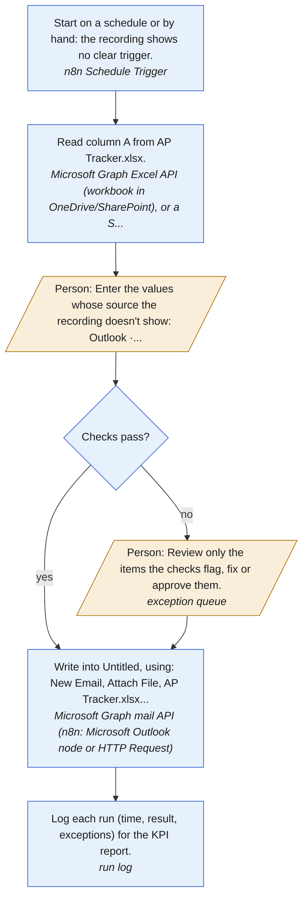

| # | Who | What | How |
|---|---|---|---|
| 1 | Automation | Start on a schedule or by hand: the recording shows no clear trigger. | n8n Schedule Trigger |
| 2 | Automation | Read column A from AP Tracker.xlsx. | Microsoft Graph Excel API (workbook in OneDrive/SharePoint), or a SQL table |
| 3 | Person | Enter the values whose source the recording doesn't show: Outlook · Untitled · To, Outlook · Untitled · Subject, Outlook · Untitled · Message body (until a rule or lookup replaces them). | - |
| 4 | Automation | Check every item before writing it (1 validation rules, plus duplicates and mismatches between fields). | checks in the workflow |
| 5 | Person | Review only the items the checks flag, fix or approve them. | exception queue |
| 6 | Automation | Write into Untitled, using: New Email, Attach File, AP Tracker.xlsx, Send. | Microsoft Graph mail API (n8n: Microsoft Outlook node or HTTP Request) |
| 7 | Automation | Log each run (time, result, exceptions) for the KPI report. | run log |

#### Business rules

Every rule the process follows, in one place: what the recording proves, what you said, and what is recommended or still to confirm. Confirm the open ones with the process owner before building.

| ID | Type | Rule | Field | Evidence | Status |
|---|---|---|---|---|---|
| BR-1 | unknown | Where To comes from is not recorded | Outlook · Untitled · To | typed by hand in 1 of 1 runs | ask the process owner |
| BR-2 | unknown | Where Subject comes from is not recorded | Outlook · Untitled · Subject | typed by hand in 1 of 1 runs | ask the process owner |
| BR-3 | mapping | Message body = column A from Excel · AP Tracker.xlsx · column A | Outlook · Untitled · Message body | copied in 1 of 1 runs | confirmed by the recording |
| BR-4 | unknown | Where Message body comes from is not recorded | Outlook · Untitled · Message body | typed by hand in 1 of 1 runs | ask the process owner |
| BR-5 | validation | Must be a valid address from the approved recipients. | Outlook · Untitled · To | field 'To' | recommended |
| BR-6 | decision | Verify summary data is refreshed and accurate before sharing | - | a judgement call seen in the recording | write down the rule |
| BR-7 | decision | Confirm correct recipient, subject, and attachments before sending | - | a judgement call seen in the recording | write down the rule |

#### User stories and acceptance tests

For whoever builds the automation: each criterion is a test to pass before go-live. `flowsme build` also writes them as `acceptance.feature` (Gherkin) and `user_stories.md`.

**US-1 Start by itself: trigger.** As the person who does this work today, I want the automation to start by itself (start on a schedule or by hand: the recording shows no clear trigger), so that nobody has to remember to run it.

- Given a new item is ready, when the trigger fires, then the automation starts and picks up the item.

**US-2 Read the source: Excel.** As the person who does this work today, I want the automation to read column A from AP Tracker.xlsx, so that nobody has to open each item by hand.

- Given a new item arrives, when the automation runs, then it does this: read column A from AP Tracker.xlsx.

**US-3 Enter values without a known source.** As the person who does this work today, I want to enter only the values whose source isn't recorded, so that the rest is automated while those rules are settled.

- Given the source of Outlook · Untitled · To is not yet known, when an item is processed, then the item waits for a person to enter that value.
- Given the source of Outlook · Untitled · Subject is not yet known, when an item is processed, then the item waits for a person to enter that value.
- Given the source of Outlook · Untitled · Message body is not yet known, when an item is processed, then the item waits for a person to enter that value.

**US-4 Check before writing.** As the person who does this work today, I want every item checked before it is written, so that mistakes are caught before they reach the records.

- Given an item that breaks BR-5 (Outlook · Untitled · To), when the automation checks it, then nothing is written and the item goes to the review queue with the reason.
- Given an item that is already recorded, when it arrives again, then it is not written a second time and goes to review as a possible duplicate.

**US-5 Review only the exceptions.** As the person who does this work today, I want to see only the items that fail a check, with the reason, so that I review exceptions instead of every item.

- Given an item fails a check, when I open the review queue, then I see the item, the failed rule and its source, and can fix and approve it or reject it.
- Given I approve a fixed item, when the automation continues, then it is written like any other item.

**US-6 Write to Outlook.** As the person who does this work today, I want the automation to write into Untitled, using: New Email, Attach File, AP Tracker.xlsx, Send, so that nobody re-keys these values.

- Given an item passed its checks, when the automation writes it, then Outlook · Untitled · Message body = column A from Excel · AP Tracker.xlsx · column A (BR-3).

**US-7 Log every run.** As the process owner, I want every run logged with time, result and exceptions, so that I can see the time saved and the error rate, and prove the benefit.

- Given a normal item, when the automation processes it, then it needs no hands-on work and the remaining manual part takes under 1.2 min.
- Given a run finishes, when I open the KPI report, then I see items processed, exceptions, and minutes per item against the old process.

#### Process improvement (Lean Six Sigma, DMAIC)

**Define.** What must go right (critical to quality):

- Each item done within the agreed time (now about 1.7 min of hands-on work)

| Suppliers | Inputs | Process | Outputs | Customers |
|---|---|---|---|---|
| Excel | Excel · AP Tracker.xlsx · column A | Trigger: Start on a schedule or by hand: the recording shows no clear trigger.<br>Extract: Excel<br>Write: Outlook | Outlook · Untitled | Who uses these outputs? (not visible in the recording: ask) |

**Measure.** 1.7 min of hands-on work per item, 1 item in this recording, 4 manual entries per item.

| Time per item | Minutes | Share |
|---|---|---|
| waste (non-value-adding) | 1.20 | 72% |
| value-adding? (judgement, confirm) | 0.38 | 23% |
| business-required | 0.08 | 5% |

Process cycle efficiency: **23%** (value-adding time ÷ total).

Error exposure: 4 manual entries per item now, 3 after automation, about 20 items a month.

| Human error rate (source) | Errors a month now | After automation | DPMO | Sigma level |
|---|---|---|---|---|
| 0.14% per entry: [Nahm et al. 2008: source to database, clinical trials](https://doi.org/10.1371/journal.pone.0003049) | 0.1 | 0.1 | 1,430 | 4.0 |
| 0.29% per entry: [Garza et al. 2025: meta-analysis of 93 studies, single data entry](https://doi.org/10.1016/j.ijmedinf.2024.105749) | 0.2 | 0.2 | 2,900 | 4.0 |
| 3.70% per entry: [Mays & Mathias 2019: manual transcription of numeric results](https://pmc.ncbi.nlm.nih.gov/articles/PMC6351970/) | 3.0 | 2.2 | 37,000 | 3.0 |

**Analyze.** Waste found in the recording:

| Waste | Evidence | Min per item |
|---|---|---|
| Transportation waste | 1 value per item carried between applications by copy-paste | 0.86 |
| Motion waste | 1 window switches and 4 navigation steps per item | 0.34 |
| Unused talent | 72% of this person's time on this task is moving and re-typing data | - |

Bottleneck (Theory of Constraints): **Write · Outlook** at 1.42 min per item. Improve this stage first: speeding up any other stage doesn't shorten the whole.

**Improve.** First remove waste (ECRS), then automate what's left:

- **Simplify:** Turn free typing into rules, lookups or drop-downs: To (Outlook), Subject (Outlook), Message body (Outlook).
- **Automate:** Then automate what is left, as in the tool plan below.

Tool plan. Your tools: Microsoft 365, Power Automate, Power BI. Runs the workflow: Power Automate (cloud flows).

| Stage | Now (min/item) | With your tools | With suggested tools |
|---|---|---|---|
| 2. Extract · Excel | 0.25 | stays manual: 0.25 | Desktop automation (Power Automate Desktop): 0.05 |
| 3. Write · Outlook | 1.42 | stays manual: 1.42 | Desktop automation (Power Automate Desktop): 1.17 |
| **Total** | **1.7** | **1.7** | **1.2** |

Per month (20 items): 0.6 h now, 0.6 h with your tools, 0.4 h with the additions.

Adding tools, biggest gain first:

- **Power Automate Desktop** saves another 0.4 min per item (0.1 h a month). Cost: free on Windows for attended runs; unattended runs need a licence.

<sub>Minutes after automation assume each method removes this share of a stage's time (people still review exceptions): api 95%, database 95%, ai extraction 85%, pdf rules 70%, api wrapper 90%, browser 85%, rpa 80%. These are planning estimates; measure after the pilot.</sub>

**Control.** Validation checklist: error-proofing first, then detection. Why that order: When values flowed electronically instead of being transcribed, transcription errors fell from 6.1% to zero. ([Poon et al. 2010](https://pubmed.ncbi.nlm.nih.gov/20445181/)) Checking entries by eye was not significantly better than no checking; double entry was far better. ([Barchard & Pace 2011](https://doi.org/10.1016/j.chb.2011.04.004)) Built-in validation alarms prevented only a small fraction of errors. ([Goldberg et al. 2008](https://pmc.ncbi.nlm.nih.gov/articles/PMC2656002/)) A second, independent entry of the same data caught 88% of errors. ([Kawado et al. 2003](https://pubmed.ncbi.nlm.nih.gov/14500053/))

| Where | Type | Check | Evidence |
|---|---|---|---|
| Outlook · Untitled · To | prevent | Replace free typing with a rule, a lookup or a drop-down. | typed by hand (24 characters) at step 5 |
| Outlook · Untitled · To | detect | Must be a valid address from the approved recipients. | field 'To' |
| Outlook · Untitled · Subject | prevent | Replace free typing with a rule, a lookup or a drop-down. | typed by hand (38 characters) at step 6 |
| Outlook · Untitled · Message body | prevent | Pass the value from Excel · AP Tracker.xlsx · column A directly instead of re-keying it; after writing, compare the two automatically. | copied by hand at step 7 |
| Outlook · Untitled · Message body | prevent | Replace free typing with a rule, a lookup or a drop-down. | typed by hand (180 characters) at step 7 |
| every run | control | Reconcile counts: items received = rows written = records submitted. Investigate any gap. | standard control for multi-system hand-offs |
| every run | control | Log each item with its result (done / exception / failed) and review exceptions daily. | needed to measure error rate after go-live |

Measure after go-live, in the final report (Power BI, Looker Studio or Excel, fed by the run log from `flowsme build`; suggested: Power BI):

- Items processed per day
- Hands-on minutes per item (target: 1.2 or less)
- Exceptions sent to a person (%)
- First-pass yield: items done with no correction (%)
- Errors caught by checks, by type
- Duplicates blocked

### 1. Review payables using inbox and portal

**Automation potential: Low (16/100)** · 45 s in total · done once · Outlook, File Explorer, Excel, Chrome, Chrome · Vendor Portal

The task prepares the October accounts payable review by gathering pending items from unread emails and the AP tracker. The user filters the inbox to unread messages, opens the October worksheet, and navigates to the Payments section of the vendor portal to cross-check status.

**Inputs:** Unread emails in Outlook inbox; Accounts payable tracker spreadsheet; Vendor portal access  
**Outputs:** October worksheet positioned for review; Vendor portal Payments section ready for reconciliation  
**Decision points:** Which unread emails relate to payables and require follow-up; Which tracker entries need verification against the vendor portal  

**Estimated saving:** about 36 s per recording like this one (86% of this task), about 0.2 hours or $6 a month.

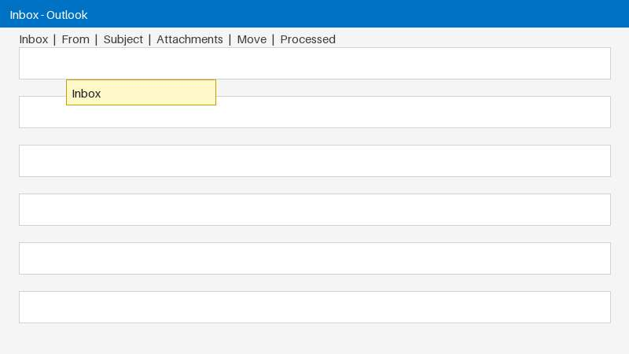 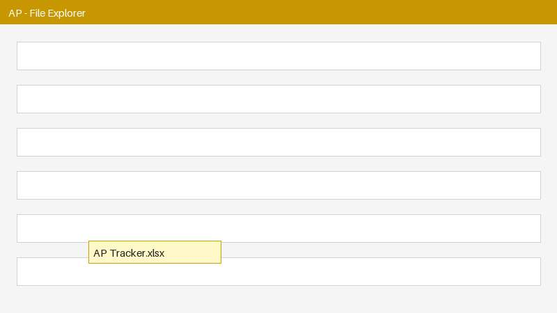 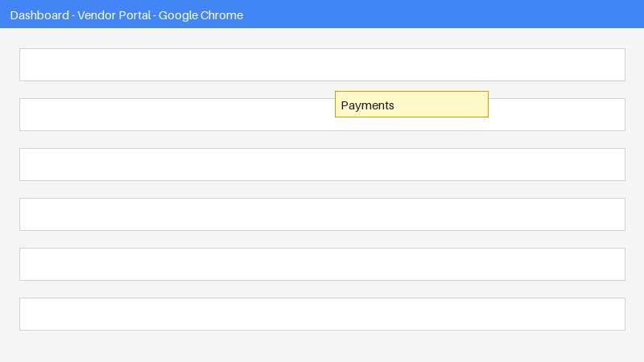

**Steps:**

1. [Outlook] Opens the Outlook inbox to review incoming emails.
2. [Outlook] Opens filter options to narrow down the inbox view.
3. [Outlook] Filters the inbox to show only unread messages.
4. [File Explorer] Opens the accounts payable tracker spreadsheet for updating.
5. [Excel] Switches to the October worksheet in the AP tracker.
6. [Excel] Selects the first cell in the tracker to begin review.
7. [Chrome] Click in the window, then type 22 characters, press Enter in Chrome
8. [Chrome · Vendor Portal] Navigates to the Payments section in the vendor portal.

**Standard operating procedure:** [sop-task1.html](sop-task1.html) (a draft with a screenshot per step, the rules and checks; for the process owner to review and approve)

#### Recommendations

_From the AI analysis._

1. **Auto-collect unread payable emails via Graph mail API**: _API integration · effort: hours · about 35% of this task's time · steps 1-3_

   Build a Power Automate cloud flow using the Outlook connector backed by Microsoft Graph mail API to list isRead eq false messages. Filter by AP keywords and sender domains, then flag with Category AP-Review-Oct instead of manually filtering. This replaces steps 1-3 with a scheduled pull and digest.

   *Why:* Theory of Constraints: fixes the recorded bottleneck at Outlook trigger 0.34 min per item and ECRS simplify before automating

   Tools: Power Automate, Microsoft Graph mail API

2. **Centralize October tracker for API read and single review view**: _API integration · effort: days · about 20% of this task's time · steps 4-6_

   Store the AP tracker in SharePoint or OneDrive as an Excel Table named October_AP. Use Power Automate Excel Online or Microsoft Graph Excel API List Rows to pull pending rows automatically. Surface them in the same digest and in Power BI for October review instead of manually opening File Explorer and selecting cell A1.

   *Why:* ECRS combine: eliminates motion waste from 4 window switches by merging inbox list and tracker list into one preparation step

   Tools: Power Automate, Microsoft Graph Excel API, Power BI

3. **Pull Payments status via vendor API, RPA only as interim**: _Desktop automation (RPA) · effort: weeks · about 25% of this task's time · steps 7-8_

   Ask vendor or IT in writing: is there a read-only Payments API or export, how to authenticate, and can it be tested in Postman. If no API, build interim Power Automate Desktop flow that opens the bookmarked Payments URL, logs in with vaulted credentials, exports Payments status to CSV, then stops for human review. Replace RPA with API once available.

   *Why:* Prefer official APIs over screen automation; Vendor Portal API status is unknown so do not assume it exists, use poka-yoke export instead of visual cross-check

   Tools: Power Automate Desktop

4. **Combine inbox, tracker and portal into one daily review list**: _Process change · effort: hours · about 10% of this task's time · steps 1-8_

   Change process to one daily October payables digest: unread AP emails plus pending October rows plus portal Payments export in one table with Vendor, Invoice, Amount, Status. Reviewer works top-down in that list and updates Status in Excel only. Measure time per review and mismatch rate weekly.

   *Why:* ECRS combine and rearrange plus control plan: removes repeated navigation and makes errors impossible to miss by forcing single source for review

   Tools: Power Automate, Power BI

**Assumptions to confirm:**

- The 22 characters typed in Chrome in step 7 is the vendor portal URL or search and not invoice data
- Unread inbox contains a mix of mail and only a subset are October payables; the rule for what counts as payable is not in the recording
- AP tracker spreadsheet can be moved to OneDrive or SharePoint so Microsoft Graph Excel API can read the October worksheet
- Vendor Portal Payments section requires authenticated login and its read API access is unknown until vendor or IT confirm
- Final payables approval decision stays manual; only gathering and cross-check preparation can be automated

**Quick wins:**

- Save Outlook unread filter as permanent view and add AP sender rule to categorize and flag payables instead of re-filtering each time
- Bookmark deep link to Vendor Portal Payments section and pin October worksheet with frozen filters to skip steps 2,5,7 navigation
- Move AP tracker to SharePoint/OneDrive and use Excel Table + Filter on Status=Pending/Unpaid so October review starts at first pending row

**Check before automating:**

- Vendor Portal RPA will break on UI, URL, or MFA change and needs credential vaulting; API access may be denied
- Auto-filter may miss payables or include non-AP unread mail if keywords are wrong; do not auto-mark as read
- Excel file lock or concurrent edits if tracker stays as local File Explorer file instead of SharePoint version with Table structure
- Privacy and over-sharing risk if invoice emails are copied to Power BI or Teams without access controls

**Tools that usually fit these applications:**

- [Microsoft Power Automate](https://www.microsoft.com/power-platform/products/power-automate): Desktop flows (RPA) plus cloud flows for Outlook, Excel, SharePoint, Teams and many other connectors
- [n8n](https://n8n.io): Self-hostable workflow automation that connects web apps through their APIs, with AI steps
- [Zapier](https://zapier.com): No-code integrations between cloud apps
- [Make](https://www.make.com): Visual multi-step integrations between cloud apps

**Automation draft** (power_automate, saved to `automations/task1.txt`)

Daily Power Automate cloud flow that replicates steps 1-6 using official connectors: pulls unread mail via Graph, reads October worksheet via Excel Online, and creates a single review digest instead of manual window switching.

```text
TRIGGER: Power Automate cloud flow - Recurrence daily 08:00 + Outlook trigger 'When a new email arrives (V3)' with Folder=Inbox, Filter=isRead eq false
ACTION 1: Get emails - Microsoft Graph mail API via Outlook connector 'Get emails' with $filter=isRead eq false and receivedDateTime ge startOfMonth(October)
ACTION 2: Filter array - Subject/From contains [invoice, bill, statement, remittance, vendor names] - keep AP candidates only
ACTION 3: Excel Online - 'List rows present in a table' on AP tracker (OneDrive/SharePoint) Table=October_AP - select Vendor, InvoiceNo, Amount, DueDate, Status
ACTION 4: Compose - Build HTML digest table: Unread AP emails (received, sender, subject, hasAttachment) LEFT JOIN October rows where Status <> Paid
ACTION 5: Create review task - 'Create a task' in Planner/To Do + send Teams/Outlook digest with deep link to October worksheet and Vendor Portal Payments URL
ACTION 6 (control): Mark processed only - Do NOT auto-mark inbox as read; set Flag or Category='AP-Review-Oct' via 'Update email' for poka-yoke
MEASURE: Log run time, count emails scanned vs AP candidates to Power BI dataset for control plan
```

#### Data flow: field to field

Taken from the recording: every value that was copied or typed, where from and where to.

No values were copied or typed in this task.

#### How the systems can connect

Each option has a status: *documented* (official documentation, access still needed), *found online, confirm* (a web search hit), *unknown* (no evidence: ask the vendor or IT), or a fallback.

| System | Role | Options |
|---|---|---|
| Outlook | used, no data moved | API: [Microsoft Graph mail API](https://learn.microsoft.com/graph/api/resources/mail-api-overview) *(documented)*<br>n8n: [n8n Microsoft Outlook node](https://docs.n8n.io/integrations/builtin/app-nodes/n8n-nodes-base.microsoftoutlook/) *(documented)*<br>Postman: [Try the Graph calls in Postman first](https://learn.microsoft.com/graph/use-postman) *(documented)* |
| Excel | used, no data moved | API: [Microsoft Graph Excel API](https://learn.microsoft.com/graph/api/resources/excel) *(documented)*<br>n8n: [n8n Microsoft Excel 365 node](https://docs.n8n.io/integrations/builtin/app-nodes/n8n-nodes-base.microsoftexcel/) *(documented)*<br>SQL: [Keep the tracker in a database table instead](https://docs.n8n.io/integrations/builtin/app-nodes/n8n-nodes-base.postgres/) *(option)*<br>File: [Read and write the file directly (n8n Read/Write Files)](https://docs.n8n.io/integrations/builtin/core-nodes/n8n-nodes-base.readwritefile/) *(documented)* |
| Chrome · Vendor Portal | used, no data moved | API: Vendor Portal API *(unknown, ask the vendor or IT)*<br>Postman: [Test the portal's API in Postman once you have its documentation](https://learning.postman.com/docs/introduction/overview/) *(after API access)*<br>SQL: Write to the portal's database directly *(unknown, ask the vendor or IT)*<br>Browser automation: [Playwright script that fills the form](https://playwright.dev/python/docs/locators) *(works without an API)* |

#### Proposed automation sequence

1. **Trigger** · Outlook: When a new email arrives (checked on a schedule, e.g. every 15 minutes).
   - _How: Microsoft Graph mail API (n8n: Microsoft Outlook node or HTTP Request) (documented)_
2. **Finish** · Outlook: Then in Outlook: Inbox → Filter → Unread.
   - _How: Microsoft Graph mail API (n8n: Microsoft Outlook node or HTTP Request) (documented)_
3. **Finish** · Excel: Then in Excel: October → A1.
   - _How: Microsoft Graph Excel API (workbook in OneDrive/SharePoint), or a SQL table (documented)_
4. **Finish** · Chrome · Vendor Portal: Then in Chrome · Vendor Portal: Payments.
   - _How: No public API found: ask the vendor for an API or bulk upload. Until then, browser automation (Playwright) (unknown, ask the vendor or IT)_
5. **Human check**: Which unread emails relate to payables and require follow-up
   - _How: Keep a person here, or define the rule (open)_
6. **Human check**: Which tracker entries need verification against the vendor portal
   - _How: Keep a person here, or define the rule (open)_

**To build it**, once the questions above are answered, run `python -m flowsme build demo-invoice-processing --task 1`. It writes an n8n workflow to import, a Postman collection to test each connection, and SQL and Playwright starters.

#### To-be process

What the work looks like after the change, and who does each part: automation (blue) or a person (orange). People handle only the exceptions the checks flag.

| | As-is | To-be with your tools | To-be with suggested tools |
|---|---|---|---|
| Hands-on minutes per item | 0.7 | 0.4 | 0.1 |
| Values typed or pasted by hand per item | 0 | 0 | 0 |
| Steps a person does per item | 7 | 1 | 1 |

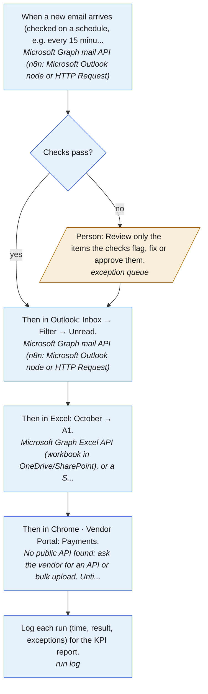

| # | Who | What | How |
|---|---|---|---|
| 1 | Automation | When a new email arrives (checked on a schedule, e.g. every 15 minutes). | Microsoft Graph mail API (n8n: Microsoft Outlook node or HTTP Request) |
| 2 | Automation | Check every item before writing it (0 validation rules, plus duplicates and mismatches between fields). | checks in the workflow |
| 3 | Person | Review only the items the checks flag, fix or approve them. | exception queue |
| 4 | Automation | Then in Outlook: Inbox → Filter → Unread. | Microsoft Graph mail API (n8n: Microsoft Outlook node or HTTP Request) |
| 5 | Automation | Then in Excel: October → A1. | Microsoft Graph Excel API (workbook in OneDrive/SharePoint), or a SQL table |
| 6 | Automation | Then in Chrome · Vendor Portal: Payments. | No public API found: ask the vendor for an API or bulk upload. Until then, browser automation (Playwright) |
| 7 | Automation | Log each run (time, result, exceptions) for the KPI report. | run log |

#### Business rules

Every rule the process follows, in one place: what the recording proves, what you said, and what is recommended or still to confirm. Confirm the open ones with the process owner before building.

| ID | Type | Rule | Field | Evidence | Status |
|---|---|---|---|---|---|
| BR-1 | decision | Which unread emails relate to payables and require follow-up | - | a judgement call seen in the recording | write down the rule |
| BR-2 | decision | Which tracker entries need verification against the vendor portal | - | a judgement call seen in the recording | write down the rule |

#### User stories and acceptance tests

For whoever builds the automation: each criterion is a test to pass before go-live. `flowsme build` also writes them as `acceptance.feature` (Gherkin) and `user_stories.md`.

**US-1 Start by itself: Outlook.** As the person who does this work today, I want the automation to start by itself (when a new email arrives (checked on a schedule, e.g. every 15 minutes)), so that nobody has to remember to run it.

- Given a new item is ready, when the trigger fires, then the automation starts and picks up the item.

**US-2 Check before writing.** As the person who does this work today, I want every item checked before it is written, so that mistakes are caught before they reach the records.

- Given an item that is already recorded, when it arrives again, then it is not written a second time and goes to review as a possible duplicate.

**US-3 Review only the exceptions.** As the person who does this work today, I want to see only the items that fail a check, with the reason, so that I review exceptions instead of every item.

- Given an item fails a check, when I open the review queue, then I see the item, the failed rule and its source, and can fix and approve it or reject it.
- Given I approve a fixed item, when the automation continues, then it is written like any other item.

**US-4 Write to Outlook.** As the person who does this work today, I want the automation to then in Outlook: Inbox → Filter → Unread, so that nobody re-keys these values.

- Given an item passed its checks, when the automation runs, then it does this: then in Outlook: Inbox → Filter → Unread.

**US-5 Write to Excel.** As the person who does this work today, I want the automation to then in Excel: October → A1, so that nobody re-keys these values.

- Given an item passed its checks, when the automation runs, then it does this: then in Excel: October → A1.

**US-6 Write to Chrome · Vendor Portal.** As the person who does this work today, I want the automation to then in Chrome · Vendor Portal: Payments, so that nobody re-keys these values.

- Given an item passed its checks, when the automation runs, then it does this: then in Chrome · Vendor Portal: Payments.

**US-7 Log every run.** As the process owner, I want every run logged with time, result and exceptions, so that I can see the time saved and the error rate, and prove the benefit.

- Given a normal item, when the automation processes it, then it needs no hands-on work and the remaining manual part takes under 0.1 min.
- Given a run finishes, when I open the KPI report, then I see items processed, exceptions, and minutes per item against the old process.

#### Process improvement (Lean Six Sigma, DMAIC)

**Define.** What must go right (critical to quality):

- Each item done within the agreed time (now about 0.7 min of hands-on work)

| Suppliers | Inputs | Process | Outputs | Customers |
|---|---|---|---|---|
| whoever sends to Outlook | - | Trigger: Outlook<br>Finish: Outlook<br>Finish: Excel<br>Finish: Chrome · Vendor Portal | - | Who uses these outputs? (not visible in the recording: ask) |

**Measure.** 0.7 min of hands-on work per item, 1 item in this recording, 0 manual entries per item.

| Time per item | Minutes | Share |
|---|---|---|
| waste (non-value-adding) | 0.74 | 100% |

Process cycle efficiency: **0%** (value-adding time ÷ total).

Error exposure: 0 manual entries per item now, 0 after automation, about 20 items a month.

| Human error rate (source) | Errors a month now | After automation | DPMO | Sigma level |
|---|---|---|---|---|
| 0.14% per entry: [Nahm et al. 2008: source to database, clinical trials](https://doi.org/10.1371/journal.pone.0003049) | 0.0 | 0.0 | 1,430 | 4.0 |
| 0.29% per entry: [Garza et al. 2025: meta-analysis of 93 studies, single data entry](https://doi.org/10.1016/j.ijmedinf.2024.105749) | 0.0 | 0.0 | 2,900 | 4.0 |
| 3.70% per entry: [Mays & Mathias 2019: manual transcription of numeric results](https://pmc.ncbi.nlm.nih.gov/articles/PMC6351970/) | 0.0 | 0.0 | 37,000 | 3.0 |

**Analyze.** Waste found in the recording:

| Waste | Evidence | Min per item |
|---|---|---|
| Motion waste | 4 window switches and 8 navigation steps per item | 0.74 |
| Unused talent | 100% of this person's time on this task is moving and re-typing data | - |

Bottleneck (Theory of Constraints): **Trigger · Outlook** at 0.34 min per item. Improve this stage first: speeding up any other stage doesn't shorten the whole.

**Improve.** First remove waste (ECRS), then automate what's left:

- **Automate:** Then automate what is left, as in the tool plan below.

Tool plan. Your tools: Microsoft 365, Power Automate, Power BI. Runs the workflow: Power Automate (cloud flows).

| Stage | Now (min/item) | With your tools | With suggested tools |
|---|---|---|---|
| 1. Trigger · Outlook | 0.34 | Email API (Microsoft 365 (Outlook and Excel through Microsoft Graph), Power Automate (cloud flows)): 0.02 | Email API (Microsoft 365 (Outlook and Excel through Microsoft Graph), Power Automate (cloud flows)): 0.02 |
| 2. Finish · Outlook | 0.00 | Email API (Microsoft 365 (Outlook and Excel through Microsoft Graph), Power Automate (cloud flows)): 0.00 | Email API (Microsoft 365 (Outlook and Excel through Microsoft Graph), Power Automate (cloud flows)): 0.00 |
| 3. Finish · Excel | 0.34 | stays manual: 0.34 | Desktop automation (Power Automate Desktop): 0.07 |
| 4. Finish · Chrome · Vendor Portal | 0.06 | stays manual: 0.06 | Desktop automation (Power Automate Desktop): 0.01 |
| **Total** | **0.7** | **0.4** | **0.1** |

Per month (20 items): 0.2 h now, 0.1 h with your tools, 0.0 h with the additions.

Adding tools, biggest gain first:

- **Power Automate Desktop** saves another 0.3 min per item (0.1 h a month). Cost: free on Windows for attended runs; unattended runs need a licence.

If the vendor provides an API key for **Vendor Portal API**, use it instead of browser automation: it is more reliable and won't break when the page changes.

<sub>Minutes after automation assume each method removes this share of a stage's time (people still review exceptions): api 95%, database 95%, ai extraction 85%, pdf rules 70%, api wrapper 90%, browser 85%, rpa 80%. These are planning estimates; measure after the pilot.</sub>

**Control.** Validation checklist: error-proofing first, then detection. Why that order: When values flowed electronically instead of being transcribed, transcription errors fell from 6.1% to zero. ([Poon et al. 2010](https://pubmed.ncbi.nlm.nih.gov/20445181/)) Checking entries by eye was not significantly better than no checking; double entry was far better. ([Barchard & Pace 2011](https://doi.org/10.1016/j.chb.2011.04.004)) Built-in validation alarms prevented only a small fraction of errors. ([Goldberg et al. 2008](https://pmc.ncbi.nlm.nih.gov/articles/PMC2656002/)) A second, independent entry of the same data caught 88% of errors. ([Kawado et al. 2003](https://pubmed.ncbi.nlm.nih.gov/14500053/))

| Where | Type | Check | Evidence |
|---|---|---|---|
| every run | control | Reconcile counts: items received = rows written = records submitted. Investigate any gap. | standard control for multi-system hand-offs |
| every run | control | Log each item with its result (done / exception / failed) and review exceptions daily. | needed to measure error rate after go-live |

Measure after go-live, in the final report (Power BI, Looker Studio or Excel, fed by the run log from `flowsme build`; suggested: Power BI):

- Items processed per day
- Hands-on minutes per item (target: 0.1 or less)
- Exceptions sent to a person (%)
- First-pass yield: items done with no correction (%)
- Errors caught by checks, by type
- Duplicates blocked

## Methods used

| Method | What it means | Sources |
|---|---|---|
| Transportation waste | Moving material between steps without changing it. In office work the material is data: carrying it between applications, files or people unchanged. | [1](https://www.lean.org/lexicon-terms/seven-wastes/), [2](https://asq.org/quality-resources/lean) |
| Motion waste | Unnecessary movement by the worker, such as searching for documents. On a desktop: navigating, searching, scrolling and switching windows without changing the work. | [1](https://www.lean.org/lexicon-terms/seven-wastes/), [2](https://asq.org/quality-resources/lean) |
| Waiting waste | Idle time waiting for machines, information, approvals or the previous step. | [1](https://www.lean.org/lexicon-terms/seven-wastes/), [2](https://asq.org/quality-resources/lean) |
| Over-processing waste | More work than the customer needs, such as entering the same data twice or checks beyond what the risk warrants. | [1](https://www.lean.org/lexicon-terms/seven-wastes/), [2](https://asq.org/quality-resources/lean) |
| Defects and rework | Errors that need inspection, correction or rework: the work is paid for twice and may reach the customer. | [1](https://www.lean.org/lexicon-terms/seven-wastes/), [2](https://asq.org/quality-resources/lean) |
| Inventory waste | More work-in-process than smooth flow needs: in offices, queues of unprocessed emails, requests and documents. More waiting work means longer lead time. | [1](https://www.lean.org/lexicon-terms/seven-wastes/), [2](https://www.isixsigma.com/dictionary/process-cycle-efficiency-pce/) |
| Overproduction | Producing more, or earlier, than the next step needs, such as reports nobody uses. | [1](https://www.lean.org/lexicon-terms/overproduction/) |
| Unused talent | Not using people's skills and judgement; added to Ohno's original seven wastes as the eighth. | [1](https://asq.org/quality-resources/lean), [2](https://www.isixsigma.com/dictionary/8-wastes-of-lean/) |
| Value-added analysis (VA / BVA / NVA) | Value-added steps change the output in a way the customer would pay for. Business-value-added steps are required (law, control, audit) but add nothing for the customer. Non-value-added steps are waste: eliminate them, and minimise BVA. | [1](https://www.isixsigma.com/dictionary/value-added/), [2](https://www.isixsigma.com/dictionary/business-value-added/), [3](https://www.isixsigma.com/dictionary/non-value-added/) |
| Process cycle efficiency | Value-added time divided by total lead time. A low figure means most time is waiting or non-value-added work. Here it is measured on hands-on time only, so the true figure (with waiting between items) is lower. | [1](https://www.isixsigma.com/dictionary/process-cycle-efficiency-pce/) |
| Value stream mapping | Mapping every step needed to deliver a service, with process time, waits and value class, to expose waste and design the future state. | [1](https://www.lean.org/lexicon-terms/value-stream-mapping/), [2](https://asq.org/quality-resources/value-stream-mapping) |
| Takt time vs cycle time | Takt time = available working time / customer demand: the pace work must keep. When the cycle time per item is above takt, a backlog grows. | [1](https://www.lean.org/lexicon-terms/takt-time/), [2](https://www.lean.org/lexicon-terms/cycle-time/) |
| 5S (digital workplace) | Sort, set in order, shine, standardize, sustain: organising the workplace so nothing has to be searched for. On a desktop: folders, file names, templates, bookmarks. | [1](https://www.lean.org/lexicon-terms/five-s/), [2](https://asq.org/quality-resources/five-s-tutorial) |
| Gemba (go and see) | Observe the real work where it happens instead of relying on reports or the written procedure. A recording is a digital gemba walk: it shows the actual process. | [1](https://www.lean.org/lexicon-terms/gemba/) |
| Standardized work | One precise, agreed way to do the work (sequence, timing, materials). It is the baseline improvement is measured against, and the automation script follows it. | [1](https://www.lean.org/lexicon-terms/standardized-work/) |
| Poka-yoke (error-proofing) | Simple means that stop a mistake from being made, or make it obvious at once. Prevention (it can't be done wrong) is preferred to detection. | [1](https://www.lean.org/lexicon-terms/poka-yoke/), [2](https://asq.org/quality-resources/mistake-proofing) |
| Jidoka (stop on abnormality) | Detect an abnormal condition and stop, instead of passing errors downstream. For automation: hand exceptions to a person rather than forcing them through. | [1](https://www.lean.org/lexicon-terms/jidoka/) |
| Kaizen | Small, frequent improvements by the people who do the work, usually run as plan-do-check-act cycles. | [1](https://www.lean.org/lexicon-terms/kaizen/), [2](https://asq.org/quality-resources/continuous-improvement) |
| Lean Six Sigma | Lean removes waste and improves flow; Six Sigma reduces variation and defects. Used together, usually through DMAIC. | [1](https://asq.org/quality-resources/six-sigma) |
| DMAIC | Define, Measure, Analyze, Improve, Control: the structured cycle for improving an existing process with data. | [1](https://asq.org/quality-resources/dmaic), [2](https://www.isixsigma.com/dictionary/dmaic/) |
| SIPOC | A one-page scope of a process: Suppliers, Inputs, Process (5-7 steps), Outputs, Customers. | [1](https://www.isixsigma.com/sipoc-copis/sipoc-diagram/), [2](https://asq.org/quality-resources/sipoc) |
| Critical to quality (CTQ) | Measurable requirements from the voice of the customer (e.g. 100% field accuracy). They define what counts as a defect. | [1](https://www.isixsigma.com/dictionary/critical-to-quality-ctq/) |
| DPMO and sigma level | DPMO = defects / (units x opportunities) x 1,000,000; each field entered is an opportunity. Six sigma is 3.4 DPMO (long term, with the conventional 1.5 sigma shift). | [1](https://www.isixsigma.com/dictionary/defects-per-million-opportunities-dpmo/), [2](https://www.isixsigma.com/dictionary/sigma-level/) |
| First-pass yield | Share of items that pass a step correctly the first time. A high final yield with a low first-pass yield reveals hidden rework. | [1](https://www.isixsigma.com/dictionary/first-time-yield-fty/), [2](https://www.isixsigma.com/dictionary/rolled-throughput-yield-rty/) |
| FMEA | Lists how each step can fail and rates severity, occurrence and detection (1-10); their product (RPN) ranks which risks to control first. | [1](https://asq.org/quality-resources/fmea) |
| Control plan | How the improved process is held: what is measured, how often, by whom, and what happens when a check fails. | [1](https://www.isixsigma.com/dictionary/control-plan/), [2](https://asq.org/quality-resources/dmaic) |
| Pareto analysis | Rank causes by frequency or impact; a vital few usually explain most of the effect. | [1](https://asq.org/quality-resources/pareto) |
| 5 Whys | Ask 'why' repeatedly to get from a symptom to its root cause. | [1](https://www.lean.org/lexicon-terms/5-whys/), [2](https://asq.org/quality-resources/five-whys) |
| Fishbone (Ishikawa) diagram | Groups possible causes of a problem by category (methods, systems, input data, people, environment), so automation isn't assumed to be the only fix. | [1](https://asq.org/quality-resources/fishbone) |
| Cost of poor quality | Quality costs split into prevention, appraisal (checking), internal failure (rework) and external failure. Turning rework and checking time into money justifies error-proofing on more than speed. | [1](https://asq.org/quality-resources/cost-of-quality) |
| Keystroke-Level Model | Predicts expert task time by adding operator times: keystroke about 0.2 s, pointing 1.1 s, moving a hand between keyboard and mouse 0.4 s, a mental step 1.35 s (Card, Moran and Newell 1980). Used to sanity-check claimed time savings. | [1](https://facsrv.cdm.depaul.edu/~cmiller/hci460/materials/goms.html), [2](https://doi.org/10.1145/358886.358895) |
| Theory of Constraints | Throughput is limited by the constraint. Identify it, exploit it, subordinate the rest to it, elevate it, repeat. Speeding up a non-constraint step doesn't shorten the whole. | [1](https://www.tocinstitute.org/five-focusing-steps.html) |
| ECRS | Improve in order: Eliminate unneeded steps, Combine, Rearrange, then Simplify. Only then automate, so you don't automate waste. | [1](https://www.lean.org/the-lean-post/articles/the-art-of-lean-use-these-tools-to-help-you-improve-a-process-part-2/) |
| PDCA | Plan, Do, Check, Act: try a change small, measure it, then standardise or adjust. | [1](https://asq.org/quality-resources/pdca-cycle), [2](https://deming.org/explore/pdsa/) |
| Automation suitability | Good candidates are standardised, stable, rule-based, frequent and long enough to matter, with structured digital inputs, few exceptions and error-prone manual work (Wellmann et al., BPM 2020: 13 criteria in 5 groups). | [1](https://arxiv.org/abs/2007.10900), [2](https://doi.org/10.1007/s12599-018-0542-4) |
| Robotic process mining | Finding automatable routines in user-interaction logs (clicks, keys, copy-paste) and generating automation from them: the research field closest to what FlowSME does. | [1](https://doi.org/10.1007/s12599-020-00641-4) |

## How to read this

- **One recording shows one path.** Exceptions and variations only appear across several recordings of the same process, so record it a few times before building anything.
- **Timing** comes from clicks, keystrokes and window changes. Reading and thinking time before the next action counts toward the step before it.
- **Automation potential** is a 0-100 signal score built from repetition, copy-paste between applications, typing, window switching and time spent.
- **Savings** use the AI model's estimate of the automatable share when one was available, otherwise 60%, 35% or 10% for high, medium or low potential.
- **Automation drafts** are starting points. Review and test them on sample data before using them on real work.
- **AI used for this report:** 37 AI calls (1 answered from cache), 92,792 input / 40,245 output tokens, 12 web searches: about $0.32 (screenshots $0.15, text $0.08, web search $0.09)
- **Privacy:** Typed text was not stored, only counted. Excluded apps and windows were not captured.
