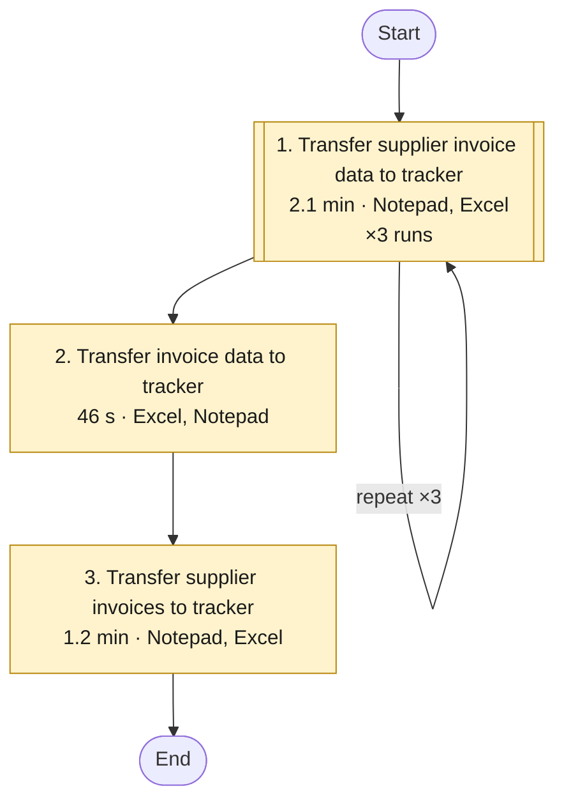
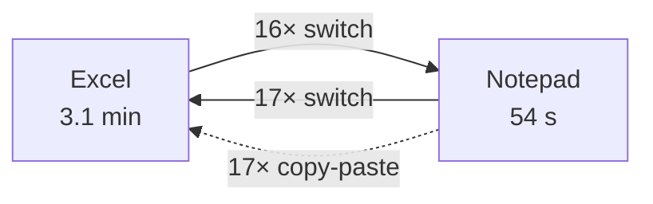

# Workflow analysis: 20261024-161537-ap-invoice-final

Recorded 2026-10-24 16:15 · 4.0 min of activity · 54 steps · 2 applications · 3 tasks · analysed with muse-spark-1.3 for screenshots and muse-spark-1.3 for text

## Summary

- **Recorded work:** 4.0 min
- **Time automation could save:** about 3.6 min per run (89% of the recorded time)
- **If this process runs 20 times a month:** about 1.2 hours a month, roughly $36 at $30 an hour
- **Biggest opportunity:** Transfer supplier invoice data to tracker (medium potential). The same 10-step routine ran 3 times.

> Savings are estimates based on this one recording. Set `runs_per_month` and `hourly_cost` in `config.toml` to match how often the process really runs.

## Opportunities

| # | Task | Time | Runs | Applications | Automation potential | Est. saving per run |
|---|---|---|---|---|---|---|
| 1 | Transfer supplier invoice data to tracker | 2.1 min | 3 | Notepad, Excel | Medium (50/100) | 1.8 min |
| 3 | Transfer supplier invoices to tracker | 1.2 min | 1 | Notepad, Excel | Medium (41/100) | 1.1 min |
| 2 | Transfer invoice data to tracker | 46 s | 1 | Excel, Notepad | Medium (40/100) | 42 s |

## Workflow map

Tasks in the order they happened. Double-bordered boxes are routines that repeated. Colour shows automation potential: red high, amber medium, green low.



## How the applications connect

Solid arrows: switching from one application to another. Dotted arrows: values copied in one application and pasted into another.



| Application | Time | Steps |
|---|---|---|
| Excel | 3.1 min | 32 |
| Notepad | 54 s | 22 |

## Task details

### 1. Transfer supplier invoice data to tracker

**Automation potential: Medium (50/100)** · 2.1 min in total · 3 runs of about 42 s · Notepad, Excel

The task creates a new entry in the Excel invoice tracker to record a supplier invoice for monitoring. The user copies the invoice number, vendor name, total, and due date from the invoice file in the text editor and pastes or enters them into the corresponding tracker columns.

**Inputs:** Supplier invoice file in text editor; Excel invoice tracker  
**Outputs:** Updated Excel invoice tracker with new invoice entry  

**Why it stands out:**

- The same 10-step routine ran 3 times
- 8 values copied by hand from one application to another
- 15 switches between applications

**Estimated saving:** about 1.8 min per run (86% of this task), about 0.6 hours or $18 a month.

  

**Steps (one run):**

1. [Notepad] Selects the supplier invoice file in the text editor
2. [Notepad] Copies the invoice number from the supplier invoice
3. [Excel] Pastes the invoice number into the invoice tracker
4. [Notepad] Copies the vendor name from the supplier invoice
5. [Excel] Pastes the vendor name from the invoice file into the tracker
6. [Notepad] Copies the invoice total from the invoice file for entry
7. [Excel] Selects the amount column in the tracker for the invoice total
8. [Excel] Paste in "B2", then press Esc in Excel
9. [Excel] Enters the due date from the invoice into column D of the tracker
10. [Excel] Enters a value in column E of the tracker

#### Data flow: field to field

Taken from the recording: every value that was copied or typed, where from and where to.

| Step | From | To | How | Seen in runs |
|---|---|---|---|---|
| 3 | Notepad · INV-#.txt · Text editor | Excel · AP Tracker · column A | copy-paste | 2 of 3 |
| 5, 8 | Notepad · INV-#.txt · Text editor | Excel · AP Tracker · column B | copy-paste | 2 of 3 |
| 9 | typed by hand | Excel · AP Tracker · column D | typed (10 characters) | 3 of 3 |
| 10 | typed by hand; **same value as Notepad · INV-#.txt · Text editor** (fingerprint match, 2 of 3 runs) | Excel · AP Tracker · column E | typed (8 characters) | 3 of 3 |
| - | Notepad · PopupHost · PopupHost | Excel · AP Tracker · column B | copy-paste | 1 of 3 |
| - | Notepad · INV-#.txt · Text editor | Excel · AP Tracker · column C | copy-paste | 2 of 3 |

**Decide before automating:**

- Where does **Excel · AP Tracker · column D** come from? It was typed by hand (10 characters). A fixed rule, a lookup, or a person's judgement?

#### How the systems can connect

Each option has a status: *documented* (official documentation, access still needed), *found online, confirm* (a web search hit), *unknown* (no evidence: ask the vendor or IT), or a fallback.

| System | Role | Options |
|---|---|---|
| Notepad | source | API: Notepad API *(unknown, ask the vendor or IT)*<br>RPA: [Power Automate Desktop or UiPath](https://learn.microsoft.com/power-automate/desktop-flows/introduction) *(works without an API)* |
| Excel | target | API: [Microsoft Graph Excel API](https://learn.microsoft.com/graph/api/resources/excel) *(documented)*<br>n8n: [n8n Microsoft Excel 365 node](https://docs.n8n.io/integrations/builtin/app-nodes/n8n-nodes-base.microsoftexcel/) *(documented)*<br>SQL: [Keep the tracker in a database table instead](https://docs.n8n.io/integrations/builtin/app-nodes/n8n-nodes-base.postgres/) *(option)*<br>File: [Read and write the file directly (n8n Read/Write Files)](https://docs.n8n.io/integrations/builtin/core-nodes/n8n-nodes-base.readwritefile/) *(documented)* |

#### Proposed automation sequence

1. **Trigger**: Start on a schedule or by hand: the recording shows no clear trigger.
   - _How: n8n Schedule Trigger (option)_
2. **Extract** · Notepad: Read Text editor, PopupHost from INV-#.txt.
   - _How: Screen automation (Power Automate Desktop / UiPath) unless the vendor offers an API (unknown, ask the vendor or IT)_
3. **Write** · Excel: Write into AP Tracker.
   - column A ← Text editor (Notepad)
   - column B ← Text editor (Notepad)
   - column D ← typed by hand (10 characters): open question
   - column E ← Text editor (Notepad): typed by hand, but the fingerprints prove it is the same value (2 of 3 runs)
   - column B ← PopupHost (Notepad)
   - column C ← Text editor (Notepad)
   - _How: Microsoft Graph Excel API (workbook in OneDrive/SharePoint), or a SQL table (documented)_
4. **Decide**: Where does Excel · AP Tracker · column D come from? It was typed by hand (10 characters). A fixed rule, a lookup, or a person's judgement?
   - _How: Business decision before building (open)_

**To build it**, once the questions above are answered, run `python -m flowsme build 20261024-161537-ap-invoice-final --task 1`. It writes an n8n workflow to import, a Postman collection to test each connection, and SQL and Playwright starters.

#### Process improvement (Lean Six Sigma, DMAIC)

**Define.** What must go right (critical to quality):

- Each item done within the agreed time (now about 0.7 min of hands-on work)

| Suppliers | Inputs | Process | Outputs | Customers |
|---|---|---|---|---|
| Notepad | Notepad · INV-#.txt · Text editor<br>Notepad · PopupHost · PopupHost | Trigger: Start on a schedule or by hand: the recording shows no clear trigger.<br>Extract: Notepad<br>Write: Excel | Excel · AP Tracker | Who uses these outputs? (not visible in the recording: ask) |

**Measure.** 0.7 min of hands-on work per item, 3 items in this recording, 6 manual entries per item.

| Time per item | Minutes | Share |
|---|---|---|
| waste (non-value-adding) | 0.66 | 96% |
| value-adding? (judgement, confirm) | 0.03 | 4% |

Process cycle efficiency: **4%** (value-adding time ÷ total).

Error exposure: 6 manual entries per item now, 1 after automation, about 60 items a month.

| Human error rate (source) | Errors a month now | After automation | DPMO | Sigma level |
|---|---|---|---|---|
| 0.14% per entry: [Nahm et al. 2008: source to database, clinical trials](https://doi.org/10.1371/journal.pone.0003049) | 0.5 | 0.1 | 1,430 | 4.0 |
| 0.29% per entry: [Garza et al. 2025: meta-analysis of 93 studies, single data entry](https://doi.org/10.1016/j.ijmedinf.2024.105749) | 1.0 | 0.2 | 2,900 | 4.0 |
| 3.70% per entry: [Mays & Mathias 2019: manual transcription of numeric results](https://pmc.ncbi.nlm.nih.gov/articles/PMC6351970/) | 13.3 | 2.2 | 37,000 | 3.0 |

**Analyze.** Waste found in the recording:

| Waste | Evidence | Min per item |
|---|---|---|
| Transportation waste | 4 values per item carried between applications by copy-paste | 0.13 |
| Motion waste | 5 window switches and 2 navigation steps per item | 0.04 |
| Over-processing waste | 1 value(s) typed by hand that the fingerprints prove already exist elsewhere (column E = Notepad · INV-#.txt · Text editor) | 0.5 |
| Defects and rework | In run 3, Excel · AP Tracker · column E did not match Notepad · INV-#.txt · Text editor for that item (the fingerprints differ): a likely wrong-item or duplicate entry. 'B2' in Excel was written 4 times: a value had to be corrected. 'A4' in Excel was written 2 times: a value had to be corrected. 'B4' in Excel was written 2 times: a value had to be corrected. 'C4' in Excel was written 2 times: a value had to be corrected. 'B5' in Excel was written 2 times: a value had to be corrected. | - |
| Unused talent | 96% of this person's time on this task is moving and re-typing data | - |

Bottleneck (Theory of Constraints): **Write · Excel** at 0.62 min per item. Improve this stage first: speeding up any other stage doesn't shorten the whole.

**Improve.** First remove waste (ECRS), then automate what's left:

- **Eliminate:** Stop re-typing values that already exist: column E in Excel.
- **Rearrange:** The routine ran 3 times one item at a time. Validate every item first, then submit in one batch; exceptions go to a person.
- **Simplify:** Turn free typing into rules, lookups or drop-downs: column D (Excel).
- **Automate:** Then automate what is left, as in the tool plan below.

Tool plan. Your tools: Microsoft 365, Power Automate, Power BI. Runs the workflow: Power Automate (cloud flows).

| Stage | Now (min/item) | With your tools | With suggested tools |
|---|---|---|---|
| 2. Extract · Notepad | 0.07 | stays manual: 0.07 | Desktop automation (Power Automate Desktop): 0.01 |
| 3. Write · Excel | 0.62 | Spreadsheet API (Microsoft 365 (Outlook and Excel through Microsoft Graph), Power Automate (cloud flows)): 0.06 | Spreadsheet API (Microsoft 365 (Outlook and Excel through Microsoft Graph), Power Automate (cloud flows)): 0.06 |
| **Total** | **0.7** | **0.1** | **0.1** |

Per month (60 items): 0.7 h now, 0.1 h with your tools, 0.1 h with the additions.

Adding tools, biggest gain first:

- **Power Automate Desktop** saves another 0.1 min per item (0.1 h a month). Cost: free on Windows for attended runs; unattended runs need a licence.

If the vendor provides an API key for **Notepad API**, use it instead of browser automation: it is more reliable and won't break when the page changes.

<sub>Minutes after automation assume each method removes this share of a stage's time (people still review exceptions): api 95%, database 95%, ai extraction 85%, pdf rules 70%, api wrapper 90%, browser 85%, rpa 80%. These are planning estimates; measure after the pilot.</sub>

**Control.** Validation checklist: error-proofing first, then detection. Why that order: When values flowed electronically instead of being transcribed, transcription errors fell from 6.1% to zero. ([Poon et al. 2010](https://pubmed.ncbi.nlm.nih.gov/20445181/)) Checking entries by eye was not significantly better than no checking; double entry was far better. ([Barchard & Pace 2011](https://doi.org/10.1016/j.chb.2011.04.004)) Built-in validation alarms prevented only a small fraction of errors. ([Goldberg et al. 2008](https://pmc.ncbi.nlm.nih.gov/articles/PMC2656002/)) A second, independent entry of the same data caught 88% of errors. ([Kawado et al. 2003](https://pubmed.ncbi.nlm.nih.gov/14500053/))

| Where | Type | Check | Evidence |
|---|---|---|---|
| Excel · AP Tracker · column A | prevent | Pass the value from Notepad · INV-#.txt · Text editor directly instead of re-keying it; after writing, compare the two automatically. | copied by hand at step 3 |
| Excel · AP Tracker · column B | prevent | Pass the value from Notepad · INV-#.txt · Text editor directly instead of re-keying it; after writing, compare the two automatically. | copied by hand at step 5, 8 |
| Excel · AP Tracker · column D | prevent | Replace free typing with a rule, a lookup or a drop-down. | typed by hand (10 characters) at step 9 |
| Excel · AP Tracker · column E | prevent | Pass the value from Notepad · INV-#.txt · Text editor directly instead of re-typing it; after writing, compare the two automatically. | typed by hand at step 10; the fingerprints show it is the same value as Notepad · INV-#.txt · Text editor (2 of 3 runs) |
| Excel · AP Tracker · column B | prevent | Pass the value from Notepad · PopupHost · PopupHost directly instead of re-keying it; after writing, compare the two automatically. | copied by hand at step  |
| Excel · AP Tracker · column C | prevent | Pass the value from Notepad · INV-#.txt · Text editor directly instead of re-keying it; after writing, compare the two automatically. | copied by hand at step  |
| Excel · AP Tracker · column E | detect | Before saving, check that the fields of one row belong to the same item (e.g. invoice number and reference); stop and ask a person if they don't. | In run 3, Excel · AP Tracker · column E did not match Notepad · INV-#.txt · Text editor for that item (the fingerprints differ): a likely wrong-item or duplicate entry. |
| corrections | detect | Values had to be corrected after entry. Check each value against its source before writing, and log corrections so their causes can be found (5 Whys). | 'B2' in Excel was written 4 times: a value had to be corrected. 'A4' in Excel was written 2 times: a value had to be corrected. 'B4' in Excel was written 2 times: a value had to be corrected. 'C4' in Excel was written 2 times: a value had to be corrected. 'B5' in Excel was written 2 times: a value had to be corrected. |
| every run | control | Reconcile counts: items received = rows written = records submitted. Investigate any gap. | standard control for multi-system hand-offs |
| every run | control | Log each item with its result (done / exception / failed) and review exceptions daily. | needed to measure error rate after go-live |

Measure after go-live, in the final report (Power BI, Looker Studio or Excel, fed by the run log from `flowsme build`; suggested: Power BI):

- Items processed per day
- Hands-on minutes per item (target: 0.1 or less)
- Exceptions sent to a person (%)
- First-pass yield: items done with no correction (%)
- Errors caught by checks, by type
- Duplicates blocked

**Recommendations** _(AI analysis)_

1. **Batch-read INV text files and append to AP Tracker via Excel API**: _API integration · effort: days · about 70% of this task's time · steps 1-8_

   Use Power Automate Desktop File actions to list INV-*.txt in one folder and parse invoice number, vendor, total and due date with regex/Text actions. Append each new invoice as one row to AP Tracker hosted on SharePoint/OneDrive using Excel Online (Business) Add a row or Microsoft Graph Update range. Run batched once per day with skip-if-invoice-number-exists check; no Notepad UI automation.

   *Why:* Theory of Constraints + ECRS automate: fixes the 0.62 min Write bottleneck and eliminates 4 copy-pastes and 5 switches per item. Evidence: 8 Notepad->Excel hand copies, 15 switches, B2 corrected 4x.

   Tools: Power Automate Desktop, Excel Online (Business), Microsoft Graph Excel API

2. **Eliminate column E re-typing and add duplicate poka-yoke**: _Built-in feature · effort: hours · about 10% of this task's time · steps 3, 10_

   Remove manual entry of column E. If it is truly a duplicate of a Notepad field, replace with formula (=C2 or =source) or delete column. Add Conditional Formatting + COUNTIF on column A to block duplicate invoice numbers and Data Validation to lock column types before automation go-live.

   *Why:* ECRS eliminate + poka-yoke: recording proves column E was typed but already existed in Notepad, and run 3 fingerprint mismatch plus A4/B4/C4/B5 rewrites show defect risk from re-typing.

   Tools: Excel

3. **Replace free-typed due date in column D with rule + validation**: _Process change · effort: hours · about 8% of this task's time · steps 9_

   Ask AP owner: is due date copied from invoice or calculated (e.g., invoice date + 30)? Document rule. Until then set column D to Date-only validation with calendar picker, and if calculated implement =EDATE(InvoiceDate,1) or XLOOKUP to terms table. Do not automate free-typed dates.

   *Why:* ECRS simplify: column D was 10-char hand typing with unknown origin per open questions; free typing invites late-payment defects. Turns judgement into rule/lookup/dropdown.

   Tools: Excel

4. **Validate first, submit in batch with exception queue and control measure**: _Process change · effort: days · about 7% of this task's time · steps 1-10_

   Change from one-item-at-a-time (3 runs) to validate-all-then-submit: stage parsed rows in a Staging sheet, show parse failures/missing totals/dates, person approves exceptions only, then one-click append. Track added vs skipped vs errors in Power BI or Excel table for control plan.

   *Why:* ECRS rearrange + control plan: reduces motion waste (5 switches/item) and prevents B2/A4 rework from propagating; measures defect rate after go-live using customer M365/Power BI tools they already own.

   Tools: Power Automate, Excel, Power BI

**Assumptions to confirm:**

- INV-#.txt files have consistent labels/separators for invoice number, vendor name, total and due date that can be parsed with regex - not proven in recording
- AP Tracker can be moved to OneDrive/SharePoint so Microsoft Graph Excel API / Excel Online (Business) connector can write it - local-only file would block API
- Column mapping to confirm: col A=invoice number, col B=vendor, col C=total, col D=due date, col E=to confirm - recording shows conflicting writes to B2 and multiple writes to A4/B4/C4/B5
- Where column D (10-char typed due date) comes from is unknown - not assumed to be invoice date + terms or copy from file; business owner must confirm rule
- Where column E comes from is unknown beyond fingerprint match to Notepad text in 2 runs and mismatch in run 3 - must confirm if duplicate, status, or lookup
- No Notepad API is assumed - status is unknown per evidence; ask vendor/IT if text editor exposes any API, otherwise use direct file read
- User/service account has read access to invoice folder and write access to tracker and volume stays low-medium batch suitable for flow

**Quick wins:**

- Immediately stop re-typing column E - copy or leave blank until rule confirmed; it already exists in Notepad and caused run 3 defect
- Add Excel Data Validation: column D = Date only, column A = Unique/no duplicates, column C = Decimal; add Conditional Formatting to highlight duplicate invoice numbers
- Open Notepad and Excel side-by-side and process all 3+ invoices in one batch instead of 1-by-1 switching to cut 15 switches
- Freeze header row and add filter on invoice number to avoid overwriting B2/A4/B4/C4 during paste

**Check before automating:**

- INV txt format varies (different labels, missing due date/total) causing parse failures - needs staging review and regex tuning on 10+ samples
- Tracker must move from local file to SharePoint/OneDrive for Graph/connector writes; concurrent edits can cause sync conflicts or range overwrites (B2/A4 issue)
- Column mapping ambiguous (flows show Notepad->A,B,C and PopupHost->B plus Esc in B2) - wrong-column write could corrupt tracker if not confirmed
- Automating column D/E without confirming business rules risks wrong due dates, duplicate payments, or hiding run-3 type wrong-item errors

**Existing tools and guides found online:**

- [File actions reference - Power Automate](https://learn.microsoft.com/en-us/power-automate/desktop-flows/actions-reference/file): 
- [Excel actions reference - Power Automate](https://learn.microsoft.com/en-us/power-automate/desktop-flows/actions-reference/excel): 
- [Excel Online (Business)](https://learn.microsoft.com/en-us/connectors/excelonlinebusiness/): 
- [Update range - Microsoft Graph v1.0](https://learn.microsoft.com/en-us/graph/api/range-update?view=graph-rest-1.0): 
- [Invoice processing prebuilt AI model](https://learn.microsoft.com/en-us/ai-builder/prebuilt-invoice-processing): 

**Tools that usually fit these applications:**

- [Microsoft Power Automate](https://www.microsoft.com/power-platform/products/power-automate): Desktop flows (RPA) plus cloud flows for Outlook, Excel, SharePoint, Teams and many other connectors
- [UiPath](https://www.uipath.com): Enterprise RPA for desktop and legacy apps without APIs (SAP GUI, Citrix, mainframe screens)
- [Excel Power Query and Office Scripts](https://learn.microsoft.com/office/dev/scripts/overview/excel): Repeatable imports, clean-up and transformations inside Excel
- [Python with pandas / openpyxl](https://pandas.pydata.org): Scripts that read, merge and write spreadsheets and CSV files

**Automation draft** (python, saved to `automations/task1.py`)

Python equivalent of top Power Automate recommendation: batch-parse INV-*.txt files and append new rows to AP Tracker, skipping duplicates. In production run same logic as Power Automate Desktop File reads + Excel Update range via Graph.

```python
import re, pathlib
import openpyxl

INV_DIR = pathlib.Path(r"C:\AP\Invoices")
TRACKER = pathlib.Path(r"C:\AP\AP Tracker.xlsx") # move to OneDrive/SharePoint for Graph API in production

# Adjust patterns after inspecting 5-10 real INV files
PATTERNS = {
    "inv_no": re.compile(r"Invoice\s*(No|Number|#)\s*[:#]?\s*(\S+)", re.I),
    "vendor": re.compile(r"Vendor\s*[:]?\s*(.+)", re.I),
    "total": re.compile(r"Total\s*[:]?\s*\$?\s*([0-9,]+\.\d{2})", re.I),
    "due": re.compile(r"Due\s*Date\s*[:]?\s*(\d{4}-\d{2}-\d{2}|\d{2}/\d{2}/\d{4})", re.I),
}

def parse_txt(p):
    t = p.read_text(encoding="utf-8", errors="ignore")
    def get(k):
        m = PATTERNS[k].search(t)
        return m.group(m.lastindex).strip() if m else ""
    total = get("total").replace(",","")
    return [get("inv_no"), get("vendor"), total, get("due")]

wb = openpyxl.load_workbook(TRACKER)
ws = wb["AP Tracker"]
# Assumes header in row 1: A=InvoiceNo, B=Vendor, C=Total, D=DueDate, E=Reserved - CONFIRM before run
existing = {c.value for c in ws["A"][1:] if c.value}

added = 0
for f in sorted(INV_DIR.glob("INV-*.txt")):
    inv_no, vendor, total, due = parse_txt(f)
    if not inv_no or inv_no in existing:
        print(f"SKIP {f.name}: missing or duplicate {inv_no}")
        continue
    ws.append([inv_no, vendor, float(total) if total else "", due, ""])
    existing.add(inv_no)
    added += 1

wb.save(TRACKER)
print(f"Added {added} rows")
```

### 3. Transfer supplier invoices to tracker

**Automation potential: Medium (41/100)** · 1.2 min in total · 1 run · Notepad, Excel

The task consolidates supplier invoice information into the central invoice tracker for monitoring. The user copies the invoice number and vendor name from each invoice file and pastes them into successive tracker rows, completing additional columns as needed.

**Inputs:** Supplier invoice files; Invoice tracker spreadsheet  
**Outputs:** Updated invoice tracker with new entries  
**Decision points:** Verifying the correct invoice file and tracker row before pasting  

**Why it stands out:**

- 7 values copied by hand from one application to another
- 13 switches between applications

**Estimated saving:** about 1.1 min per run (92% of this task), about 0.4 hours or $11 a month.

  

**Steps:**

1. [Notepad] Copies the invoice number from the supplier invoice file.
2. [Excel] Pastes the invoice number into the invoice tracker.
3. [Notepad] Copies the vendor name from the supplier invoice file.
4. [Excel] Pastes the vendor name into the invoice tracker.
5. [Notepad] Copies the vendor name from the supplier invoice file.
6. [Excel] Pastes the vendor name into the tracker and moves to the next cell.
7. [Excel] Paste in "C4", then press Esc in Excel
8. [Notepad] Opens the next supplier invoice file in the text editor.
9. [Notepad] Copies the invoice number from the supplier invoice.
10. [Excel] Pastes the invoice number into the next row of the tracker.
11. [Notepad] Copies the vendor name from the supplier invoice.
12. [Excel] Pastes the invoice number from the invoice file into the tracker
13. [Notepad] Copies the vendor name from the invoice file for entry
14. [Excel] Enters the vendor name into the vendor column of tracker
15. [Excel] Paste in "C5", then press Esc in Excel
16. [Excel] Enters a value in column D of the tracker
17. [Excel] Enters a value in column E of the tracker
18. [Notepad] Copies the vendor name from the invoice file
19. [Excel] Pastes the vendor name into the tracker

#### Data flow: field to field

Taken from the recording: every value that was copied or typed, where from and where to.

| Step | From | To | How | Seen in runs |
|---|---|---|---|---|
| 2, 10 | Notepad · INV-#.txt · Text editor | Excel · AP Tracker · column A | copy-paste | 1 of 1 |
| 4, 12, 19 | Notepad · INV-#.txt · Text editor | Excel · AP Tracker · column B | copy-paste | 1 of 1 |
| 7, 15 | Notepad · INV-#.txt · Text editor | Excel · AP Tracker · column C | copy-paste | 1 of 1 |
| 16 | typed by hand | Excel · AP Tracker · column D | typed (10 characters) | 1 of 1 |
| 17 | typed by hand; **same value as Notepad · INV-#.txt · Text editor** (fingerprint match, 1 of 1 runs) | Excel · AP Tracker · column E | typed (8 characters) | 1 of 1 |

**Decide before automating:**

- Where does **Excel · AP Tracker · column D** come from? It was typed by hand (10 characters). A fixed rule, a lookup, or a person's judgement?

#### How the systems can connect

Each option has a status: *documented* (official documentation, access still needed), *found online, confirm* (a web search hit), *unknown* (no evidence: ask the vendor or IT), or a fallback.

| System | Role | Options |
|---|---|---|
| Notepad | source | API: Notepad API *(unknown, ask the vendor or IT)*<br>RPA: [Power Automate Desktop or UiPath](https://learn.microsoft.com/power-automate/desktop-flows/introduction) *(works without an API)* |
| Excel | target | API: [Microsoft Graph Excel API](https://learn.microsoft.com/graph/api/resources/excel) *(documented)*<br>n8n: [n8n Microsoft Excel 365 node](https://docs.n8n.io/integrations/builtin/app-nodes/n8n-nodes-base.microsoftexcel/) *(documented)*<br>SQL: [Keep the tracker in a database table instead](https://docs.n8n.io/integrations/builtin/app-nodes/n8n-nodes-base.postgres/) *(option)*<br>File: [Read and write the file directly (n8n Read/Write Files)](https://docs.n8n.io/integrations/builtin/core-nodes/n8n-nodes-base.readwritefile/) *(documented)* |

#### Proposed automation sequence

1. **Trigger**: Start on a schedule or by hand: the recording shows no clear trigger.
   - _How: n8n Schedule Trigger (option)_
2. **Extract** · Notepad: Read Text editor from INV-#.txt.
   - _How: Screen automation (Power Automate Desktop / UiPath) unless the vendor offers an API (unknown, ask the vendor or IT)_
3. **Write** · Excel: Write into AP Tracker.
   - column A ← Text editor (Notepad)
   - column B ← Text editor (Notepad)
   - column C ← Text editor (Notepad)
   - column D ← typed by hand (10 characters): open question
   - column E ← Text editor (Notepad): typed by hand, but the fingerprints prove it is the same value (1 of 1 runs)
   - _How: Microsoft Graph Excel API (workbook in OneDrive/SharePoint), or a SQL table (documented)_
4. **Decide**: Where does Excel · AP Tracker · column D come from? It was typed by hand (10 characters). A fixed rule, a lookup, or a person's judgement?
   - _How: Business decision before building (open)_
5. **Human check**: Verifying the correct invoice file and tracker row before pasting
   - _How: Keep a person here, or define the rule (open)_

**To build it**, once the questions above are answered, run `python -m flowsme build 20261024-161537-ap-invoice-final --task 3`. It writes an n8n workflow to import, a Postman collection to test each connection, and SQL and Playwright starters.

#### Process improvement (Lean Six Sigma, DMAIC)

**Define.** What must go right (critical to quality):

- Each item done within the agreed time (now about 1.2 min of hands-on work)

| Suppliers | Inputs | Process | Outputs | Customers |
|---|---|---|---|---|
| Notepad | Notepad · INV-#.txt · Text editor | Trigger: Start on a schedule or by hand: the recording shows no clear trigger.<br>Extract: Notepad<br>Write: Excel | Excel · AP Tracker | Who uses these outputs? (not visible in the recording: ask) |

**Measure.** 1.2 min of hands-on work per item, 1 items in this recording, 5 manual entries per item.

| Time per item | Minutes | Share |
|---|---|---|
| waste (non-value-adding) | 1.14 | 96% |
| value-adding? (judgement, confirm) | 0.05 | 4% |

Process cycle efficiency: **4%** (value-adding time ÷ total).

Error exposure: 5 manual entries per item now, 1 after automation, about 20 items a month.

| Human error rate (source) | Errors a month now | After automation | DPMO | Sigma level |
|---|---|---|---|---|
| 0.14% per entry: [Nahm et al. 2008: source to database, clinical trials](https://doi.org/10.1371/journal.pone.0003049) | 0.1 | 0.0 | 1,430 | 4.0 |
| 0.29% per entry: [Garza et al. 2025: meta-analysis of 93 studies, single data entry](https://doi.org/10.1016/j.ijmedinf.2024.105749) | 0.3 | 0.1 | 2,900 | 4.0 |
| 3.70% per entry: [Mays & Mathias 2019: manual transcription of numeric results](https://pmc.ncbi.nlm.nih.gov/articles/PMC6351970/) | 3.7 | 0.7 | 37,000 | 3.0 |

**Analyze.** Waste found in the recording:

| Waste | Evidence | Min per item |
|---|---|---|
| Transportation waste | 3 values per item carried between applications by copy-paste | 0.8 |
| Motion waste | 13 window switches and 3 navigation steps per item | 0.12 |
| Over-processing waste | 1 value(s) typed by hand that the fingerprints prove already exist elsewhere (column E = Notepad · INV-#.txt · Text editor) | 0.22 |
| Defects and rework | 'B2' in Excel was written 4 times: a value had to be corrected. 'A4' in Excel was written 2 times: a value had to be corrected. 'B4' in Excel was written 2 times: a value had to be corrected. 'C4' in Excel was written 2 times: a value had to be corrected. 'B5' in Excel was written 2 times: a value had to be corrected. | - |
| Unused talent | 96% of this person's time on this task is moving and re-typing data | - |

Bottleneck (Theory of Constraints): **Write · Excel** at 0.94 min per item. Improve this stage first: speeding up any other stage doesn't shorten the whole.

**Improve.** First remove waste (ECRS), then automate what's left:

- **Eliminate:** Stop re-typing values that already exist: column E in Excel.
- **Simplify:** Turn free typing into rules, lookups or drop-downs: column D (Excel).
- **Automate:** Then automate what is left, as in the tool plan below.

Tool plan. Your tools: Microsoft 365, Power Automate, Power BI. Runs the workflow: Power Automate (cloud flows).

| Stage | Now (min/item) | With your tools | With suggested tools |
|---|---|---|---|
| 2. Extract · Notepad | 0.25 | stays manual: 0.25 | Desktop automation (Power Automate Desktop): 0.05 |
| 3. Write · Excel | 0.94 | Spreadsheet API (Microsoft 365 (Outlook and Excel through Microsoft Graph), Power Automate (cloud flows)): 0.09 | Spreadsheet API (Microsoft 365 (Outlook and Excel through Microsoft Graph), Power Automate (cloud flows)): 0.09 |
| **Total** | **1.2** | **0.3** | **0.1** |

Per month (20 items): 0.4 h now, 0.1 h with your tools, 0.0 h with the additions.

Adding tools, biggest gain first:

- **Power Automate Desktop** saves another 0.2 min per item (0.1 h a month). Cost: free on Windows for attended runs; unattended runs need a licence.

If the vendor provides an API key for **Notepad API**, use it instead of browser automation: it is more reliable and won't break when the page changes.

<sub>Minutes after automation assume each method removes this share of a stage's time (people still review exceptions): api 95%, database 95%, ai extraction 85%, pdf rules 70%, api wrapper 90%, browser 85%, rpa 80%. These are planning estimates; measure after the pilot.</sub>

**Control.** Validation checklist: error-proofing first, then detection. Why that order: When values flowed electronically instead of being transcribed, transcription errors fell from 6.1% to zero. ([Poon et al. 2010](https://pubmed.ncbi.nlm.nih.gov/20445181/)) Checking entries by eye was not significantly better than no checking; double entry was far better. ([Barchard & Pace 2011](https://doi.org/10.1016/j.chb.2011.04.004)) Built-in validation alarms prevented only a small fraction of errors. ([Goldberg et al. 2008](https://pmc.ncbi.nlm.nih.gov/articles/PMC2656002/)) A second, independent entry of the same data caught 88% of errors. ([Kawado et al. 2003](https://pubmed.ncbi.nlm.nih.gov/14500053/))

| Where | Type | Check | Evidence |
|---|---|---|---|
| Excel · AP Tracker · column A | prevent | Pass the value from Notepad · INV-#.txt · Text editor directly instead of re-keying it; after writing, compare the two automatically. | copied by hand at step 2, 10 |
| Excel · AP Tracker · column B | prevent | Pass the value from Notepad · INV-#.txt · Text editor directly instead of re-keying it; after writing, compare the two automatically. | copied by hand at step 4, 12, 19 |
| Excel · AP Tracker · column C | prevent | Pass the value from Notepad · INV-#.txt · Text editor directly instead of re-keying it; after writing, compare the two automatically. | copied by hand at step 7, 15 |
| Excel · AP Tracker · column D | prevent | Replace free typing with a rule, a lookup or a drop-down. | typed by hand (10 characters) at step 16 |
| Excel · AP Tracker · column E | prevent | Pass the value from Notepad · INV-#.txt · Text editor directly instead of re-typing it; after writing, compare the two automatically. | typed by hand at step 17; the fingerprints show it is the same value as Notepad · INV-#.txt · Text editor (1 of 1 runs) |
| corrections | detect | Values had to be corrected after entry. Check each value against its source before writing, and log corrections so their causes can be found (5 Whys). | 'B2' in Excel was written 4 times: a value had to be corrected. 'A4' in Excel was written 2 times: a value had to be corrected. 'B4' in Excel was written 2 times: a value had to be corrected. 'C4' in Excel was written 2 times: a value had to be corrected. 'B5' in Excel was written 2 times: a value had to be corrected. |
| every run | control | Reconcile counts: items received = rows written = records submitted. Investigate any gap. | standard control for multi-system hand-offs |
| every run | control | Log each item with its result (done / exception / failed) and review exceptions daily. | needed to measure error rate after go-live |

Measure after go-live, in the final report (Power BI, Looker Studio or Excel, fed by the run log from `flowsme build`; suggested: Power BI):

- Items processed per day
- Hands-on minutes per item (target: 0.1 or less)
- Exceptions sent to a person (%)
- First-pass yield: items done with no correction (%)
- Errors caught by checks, by type
- Duplicates blocked

**Recommendations** _(AI analysis)_

1. **Auto-read INV-*.txt files and append rows to AP Tracker with Power Automate Desktop**: _Desktop automation (RPA) · effort: days · about 75% of this task's time · steps 1-15, 18-19_

   In Power Automate Desktop loop the invoice folder for INV-*.txt with Get files in folder. For each file use Read text from file plus Parse text with regex to extract invoice number and vendor name. Use Launch Excel once then Write to Excel worksheet to append one row per file to the AP Tracker Table columns A-C and map column E from same vendor variable, leaving D blank.

   *Why:* Theory of Constraints fixes the 0.94 min/item Write in Excel bottleneck and ECRS automates transportation/motion waste evidenced by 7 hand copies and 13 switches

   Tools: Power Automate Desktop, Excel

2. **Eliminate retyping with Excel Table plus validation for columns D/E**: _Built-in feature · effort: hours · about 10% of this task's time · steps 7, 15-17, 19_

   Convert tracker to a formal Excel Table with headers InvoiceNo, Vendor, Vendor2, D, E. Set column E to formula =[@Vendor] or mapping instead of typing. Add Data Validation list plus XLOOKUP for column D once its source is documented and lock columns A-C/E.

   *Why:* ECRS eliminate retyping proven duplicate column E and ECRS simplify free typing in D plus poka-yoke to make B2 4x and A4/B4/C4/B5 corrections impossible

   Tools: Excel

3. **Keep column D manual until its source rule is confirmed**: _Process change · effort: hours · about 5% of this task's time · steps 16-17_

   Keep column D manual for now. Ask AP owner to document whether the 10-character typed value is a fixed rule, lookup, or judgement and log 20 examples. PAD flow highlights D blank for human fill until rule is proven, then convert to lookup.

   *Why:* Honest automation - never invent source of typed value; avoids defect risk from automating judgement per control plan

   Tools: Excel

**Assumptions to confirm:**

- Supplier invoice files are plain .txt files named INV-*.txt in a single folder with consistent labels for invoice number and vendor name
- AP Tracker is a standard .xlsx file accessible to Power Automate Desktop and can be converted to an Excel Table
- Column E value proven equal to Notepad text can be mapped directly without retyping
- Where column D 10-character typed value comes from is unknown - no lookup rule or judgement documented in recording
- Notepad has no usable API status unknown - automation assumes file-level reading not Notepad API, confirm with IT if needed

**Quick wins:**

- Stop re-typing column E - copy/map from invoice file, it already exists there
- Convert AP Tracker range to Excel Table with headers so next empty row is automatic
- Add Excel Data Validation dropdowns/XLOOKUP for columns D and E to prevent B2/A4/B4 corrections
- Process invoices in batch folder order without reopening/switching Notepad per field

**Check before automating:**

- TXT label variation breaks regex parsing - need exception folder and log for unmatched files
- Concurrent Excel edits overwrite rows if tracker not on OneDrive/SharePoint with Table locking
- Automating column D before its rule is known would create wrong postings
- Duplicate runs could double-append same INV file without processed-file check

**Existing tools and guides found online:**

- [File actions reference - Power Automate](https://learn.microsoft.com/en-us/power-automate/desktop-flows/actions-reference/file): 
- [Excel actions reference - Power Automate](https://learn.microsoft.com/en-us/power-automate/desktop-flows/actions-reference/excel): 
- [Excel Online (Business)](https://learn.microsoft.com/ms-my/connectors/excelonlinebusiness/): 

**Tools that usually fit these applications:**

- [Microsoft Power Automate](https://www.microsoft.com/power-platform/products/power-automate): Desktop flows (RPA) plus cloud flows for Outlook, Excel, SharePoint, Teams and many other connectors
- [Excel Power Query and Office Scripts](https://learn.microsoft.com/office/dev/scripts/overview/excel): Repeatable imports, clean-up and transformations inside Excel
- [Python with pandas / openpyxl](https://pandas.pydata.org): Scripts that read, merge and write spreadsheets and CSV files

**Automation draft** (power_automate, saved to `automations/task3.txt`)

Power Automate Desktop flow that loops INV-*.txt files, parses invoice number and vendor, and appends columns A-C+E to AP Tracker leaving unknown column D for human.

```text
DESKTOP FLOW: AP_Tracker_Append
1. SET FolderPath = "C:\AP\Invoices" AND TrackerPath = "C:\AP\AP Tracker.xlsx"
2. ACTION File.GetFilesInFolder Folder: FolderPath FileFilter: "INV-*.txt" -> FileList
3. ACTION Excel.LaunchExcelAndOpenDocument DocumentPath: TrackerPath Visible: FALSE -> ExcelInstance
4. LOOP ForEach CurrentFile IN FileList
5.   ACTION File.ReadTextFromFile File: CurrentFile -> FileText
6.   ACTION Text.ParseText Text: FileText Regex: "Invoice\s*(No|Number|#)\s*[:#]\s*(\S+)" -> InvoiceNo (FirstMatch Group2)
7.   ACTION Text.ParseText Text: FileText Regex: "Vendor\s*[:]\s*(.+)" -> VendorName (Trim FirstMatch Group1)
8.   ACTION Excel.GetFirstFreeRowOnColumn Instance: ExcelInstance Column: "A" -> NextRow
9.   ACTION Excel.WriteToExcel Worksheet: "Tracker" Row: NextRow Column: 1 Value: %InvoiceNo%
10.  ACTION Excel.WriteToExcel Row: NextRow Column: 2 Value: %VendorName%
11.  ACTION Excel.WriteToExcel Row: NextRow Column: 3 Value: %VendorName%
12.  ACTION Excel.WriteToExcel Row: NextRow Column: 5 Value: %VendorName% // ECRS eliminate retype, map not type
13.  // LEAVE Column D blank for human fill until rule documented
14. END LOOP
15. ACTION Excel.SaveExcel Instance: ExcelInstance
16. ACTION Excel.CloseExcel Instance: ExcelInstance
```

### 2. Transfer invoice data to tracker

**Automation potential: Medium (40/100)** · 46 s in total · 1 run · Excel, Notepad

Updates the invoice tracker with vendor and invoice details from supplier files. The user copies vendor names and invoice numbers from invoice files in the text editor and pastes them into the corresponding fields in the Excel tracker.

**Inputs:** Supplier invoice files in text format; Excel invoice tracker spreadsheet  
**Outputs:** Updated invoice tracker with vendor names and invoice numbers  
**Decision points:** Selecting the correct tracker row for each invoice file; Verifying that copied vendor and invoice data is complete and accurate  

**Why it stands out:**

- 2 values copied by hand from one application to another
- 5 switches between applications

**Estimated saving:** about 42 s per run (88% of this task), about 0.2 hours or $7 a month.

  

**Steps:**

1. [Excel] Cuts the vendor cell content in the tracker and moves to next field
2. [Excel] Paste in "C2", then press Esc in Excel
3. [Notepad] Copies the vendor name from the first supplier invoice file.
4. [Excel] Pastes the vendor name into the tracker spreadsheet.
5. [Notepad] Opens the second supplier invoice file in the editor.
6. [Notepad] Copies the invoice number from the second supplier invoice file.
7. [Excel] Pastes the invoice number from the invoice file into the tracker.
8. [Notepad] Selects the vendor name in the invoice file for copying.

#### Data flow: field to field

Taken from the recording: every value that was copied or typed, where from and where to.

| Step | From | To | How | Seen in runs |
|---|---|---|---|---|
| 2 | Excel · AP Tracker · column B (originally Notepad · INV-#.txt · Text editor) | Excel · AP Tracker · column C | copy-paste | 1 of 1 |
| 4 | Notepad · INV-#.txt · Text editor | Excel · AP Tracker · column B | copy-paste | 1 of 1 |
| 7 | Notepad · INV-#.txt · Text editor | Excel · AP Tracker · column A | copy-paste | 1 of 1 |

#### How the systems can connect

Each option has a status: *documented* (official documentation, access still needed), *found online, confirm* (a web search hit), *unknown* (no evidence: ask the vendor or IT), or a fallback.

| System | Role | Options |
|---|---|---|
| Excel | source and target | API: [Microsoft Graph Excel API](https://learn.microsoft.com/graph/api/resources/excel) *(documented)*<br>n8n: [n8n Microsoft Excel 365 node](https://docs.n8n.io/integrations/builtin/app-nodes/n8n-nodes-base.microsoftexcel/) *(documented)*<br>SQL: [Keep the tracker in a database table instead](https://docs.n8n.io/integrations/builtin/app-nodes/n8n-nodes-base.postgres/) *(option)*<br>File: [Read and write the file directly (n8n Read/Write Files)](https://docs.n8n.io/integrations/builtin/core-nodes/n8n-nodes-base.readwritefile/) *(documented)* |
| Notepad | source | API: Notepad API *(unknown, ask the vendor or IT)*<br>RPA: [Power Automate Desktop or UiPath](https://learn.microsoft.com/power-automate/desktop-flows/introduction) *(works without an API)* |

#### Proposed automation sequence

1. **Trigger**: Start on a schedule or by hand: the recording shows no clear trigger.
   - _How: n8n Schedule Trigger (option)_
2. **Extract** · Notepad: Read Text editor from INV-#.txt.
   - _How: Screen automation (Power Automate Desktop / UiPath) unless the vendor offers an API (unknown, ask the vendor or IT)_
3. **Write** · Excel: Write into AP Tracker.
   - column C ← Text editor (Notepad)
   - column B ← Text editor (Notepad)
   - column A ← Text editor (Notepad)
   - _How: Microsoft Graph Excel API (workbook in OneDrive/SharePoint), or a SQL table (documented)_
4. **Finish** · Notepad: Then in Notepad: Text editor.
   - _How: Screen automation (Power Automate Desktop / UiPath) unless the vendor offers an API (unknown, ask the vendor or IT)_
5. **Human check**: Selecting the correct tracker row for each invoice file
   - _How: Keep a person here, or define the rule (open)_
6. **Human check**: Verifying that copied vendor and invoice data is complete and accurate
   - _How: Keep a person here, or define the rule (open)_

**To build it**, once the questions above are answered, run `python -m flowsme build 20261024-161537-ap-invoice-final --task 2`. It writes an n8n workflow to import, a Postman collection to test each connection, and SQL and Playwright starters.

#### Process improvement (Lean Six Sigma, DMAIC)

**Define.** What must go right (critical to quality):

- Each item done within the agreed time (now about 0.8 min of hands-on work)

| Suppliers | Inputs | Process | Outputs | Customers |
|---|---|---|---|---|
| Notepad | Notepad · INV-#.txt · Text editor | Trigger: Start on a schedule or by hand: the recording shows no clear trigger.<br>Extract: Notepad<br>Write: Excel<br>Finish: Notepad | Excel · AP Tracker | Who uses these outputs? (not visible in the recording: ask) |

**Measure.** 0.8 min of hands-on work per item, 1 items in this recording, 3 manual entries per item.

| Time per item | Minutes | Share |
|---|---|---|
| waste (non-value-adding) | 0.77 | 100% |

Process cycle efficiency: **0%** (value-adding time ÷ total).

Error exposure: 3 manual entries per item now, 0 after automation, about 20 items a month.

| Human error rate (source) | Errors a month now | After automation | DPMO | Sigma level |
|---|---|---|---|---|
| 0.14% per entry: [Nahm et al. 2008: source to database, clinical trials](https://doi.org/10.1371/journal.pone.0003049) | 0.1 | 0.0 | 1,430 | 4.0 |
| 0.29% per entry: [Garza et al. 2025: meta-analysis of 93 studies, single data entry](https://doi.org/10.1016/j.ijmedinf.2024.105749) | 0.2 | 0.0 | 2,900 | 4.0 |
| 3.70% per entry: [Mays & Mathias 2019: manual transcription of numeric results](https://pmc.ncbi.nlm.nih.gov/articles/PMC6351970/) | 2.2 | 0.0 | 37,000 | 3.0 |

**Analyze.** Waste found in the recording:

| Waste | Evidence | Min per item |
|---|---|---|
| Transportation waste | 3 values per item carried between applications by copy-paste | 0.42 |
| Motion waste | 5 window switches and 2 navigation steps per item | 0.35 |
| Over-processing waste | 1 value(s) copied into one file only to be copied out again (column B in Excel) | - |
| Defects and rework | 'B2' in Excel was written 4 times: a value had to be corrected. 'A4' in Excel was written 2 times: a value had to be corrected. 'B4' in Excel was written 2 times: a value had to be corrected. 'C4' in Excel was written 2 times: a value had to be corrected. 'B5' in Excel was written 2 times: a value had to be corrected. | - |
| Unused talent | 100% of this person's time on this task is moving and re-typing data | - |

Bottleneck (Theory of Constraints): **Extract · Notepad** at 0.41 min per item. Improve this stage first: speeding up any other stage doesn't shorten the whole.

**Improve.** First remove waste (ECRS), then automate what's left:

- **Eliminate:** Stop copying values into an in-between file that is then copied out again (Excel). Keep it only if someone needs it as a record, and then let the automation write it.
- **Automate:** Then automate what is left, as in the tool plan below.

Tool plan. Your tools: Microsoft 365, Power Automate, Power BI. Runs the workflow: Power Automate (cloud flows).

| Stage | Now (min/item) | With your tools | With suggested tools |
|---|---|---|---|
| 2. Extract · Notepad | 0.41 | stays manual: 0.41 | Desktop automation (Power Automate Desktop): 0.08 |
| 3. Write · Excel | 0.37 | Spreadsheet API (Microsoft 365 (Outlook and Excel through Microsoft Graph), Power Automate (cloud flows)): 0.02 | Spreadsheet API (Microsoft 365 (Outlook and Excel through Microsoft Graph), Power Automate (cloud flows)): 0.02 |
| 4. Finish · Notepad | 0.00 | stays manual: 0.00 | Desktop automation (Power Automate Desktop): 0.00 |
| **Total** | **0.8** | **0.4** | **0.1** |

Per month (20 items): 0.3 h now, 0.1 h with your tools, 0.0 h with the additions.

Adding tools, biggest gain first:

- **Power Automate Desktop** saves another 0.3 min per item (0.1 h a month). Cost: free on Windows for attended runs; unattended runs need a licence.

If the vendor provides an API key for **Notepad API**, use it instead of browser automation: it is more reliable and won't break when the page changes.

If the vendor provides an API key for **Notepad API**, use it instead of browser automation: it is more reliable and won't break when the page changes.

<sub>Minutes after automation assume each method removes this share of a stage's time (people still review exceptions): api 95%, database 95%, ai extraction 85%, pdf rules 70%, api wrapper 90%, browser 85%, rpa 80%. These are planning estimates; measure after the pilot.</sub>

**Control.** Validation checklist: error-proofing first, then detection. Why that order: When values flowed electronically instead of being transcribed, transcription errors fell from 6.1% to zero. ([Poon et al. 2010](https://pubmed.ncbi.nlm.nih.gov/20445181/)) Checking entries by eye was not significantly better than no checking; double entry was far better. ([Barchard & Pace 2011](https://doi.org/10.1016/j.chb.2011.04.004)) Built-in validation alarms prevented only a small fraction of errors. ([Goldberg et al. 2008](https://pmc.ncbi.nlm.nih.gov/articles/PMC2656002/)) A second, independent entry of the same data caught 88% of errors. ([Kawado et al. 2003](https://pubmed.ncbi.nlm.nih.gov/14500053/))

| Where | Type | Check | Evidence |
|---|---|---|---|
| Excel · AP Tracker · column C | prevent | Pass the value from Notepad · INV-#.txt · Text editor directly instead of re-keying it; after writing, compare the two automatically. | copied by hand at step 2 |
| Excel · AP Tracker · column B | prevent | Pass the value from Notepad · INV-#.txt · Text editor directly instead of re-keying it; after writing, compare the two automatically. | copied by hand at step 4 |
| Excel · AP Tracker · column A | prevent | Pass the value from Notepad · INV-#.txt · Text editor directly instead of re-keying it; after writing, compare the two automatically. | copied by hand at step 7 |
| corrections | detect | Values had to be corrected after entry. Check each value against its source before writing, and log corrections so their causes can be found (5 Whys). | 'B2' in Excel was written 4 times: a value had to be corrected. 'A4' in Excel was written 2 times: a value had to be corrected. 'B4' in Excel was written 2 times: a value had to be corrected. 'C4' in Excel was written 2 times: a value had to be corrected. 'B5' in Excel was written 2 times: a value had to be corrected. |
| every run | control | Reconcile counts: items received = rows written = records submitted. Investigate any gap. | standard control for multi-system hand-offs |
| every run | control | Log each item with its result (done / exception / failed) and review exceptions daily. | needed to measure error rate after go-live |

Measure after go-live, in the final report (Power BI, Looker Studio or Excel, fed by the run log from `flowsme build`; suggested: Power BI):

- Items processed per day
- Hands-on minutes per item (target: 0.1 or less)
- Exceptions sent to a person (%)
- First-pass yield: items done with no correction (%)
- Errors caught by checks, by type
- Duplicates blocked

**Recommendations** _(AI analysis)_

1. **Auto-read supplier INV-*.txt files and write directly to AP Tracker**: _Desktop automation (RPA) · effort: days · about 80% of this task's time · steps 3-7_

   In Power Automate Desktop create a flow that loops Files in folder INV-*.txt. Use Read text from file then Parse text with the vendor and invoice-number patterns. Use Excel Launch and Write to Excel worksheet AP Tracker columns A and B in one write, no intermediate cut-paste. Run attended on the same PC that does the task today.

   *Why:* Theory of Constraints fix the bottleneck first plus ECRS automate. Bottleneck is Extract in Notepad 0.41 min and 3 values carried by hand Notepad to Excel. Direct file read eliminates copy-paste and 5 switches.

   Tools: Power Automate Desktop, Excel

2. **Eliminate Excel B to C staging copy**: _Process change · effort: hours · about 15% of this task's time · steps 1-2_

   Remove steps 1-2 as standard work. Agree that column B is the system entry, column C only if needed for audit. If audit needs it, let automation copy B to C, never by hand. Update one-page SOP to enter vendor once then invoice number once.

   *Why:* ECRS eliminate before automating. Recording shows over-processing of 1 value copied into Excel only to be copied out again from column B to C.

   Tools: Excel

3. **Harden tracker with Table and validation to stop rework**: _Built-in feature · effort: hours · about 20% of this task's time · steps 4, 7_

   Convert tracker range to Excel Table with headers Vendor and Invoice Number. Add Data Validation: invoice number TextLength >3 and duplicate check with COUNTIF, and lock other columns. Add Conditional Formatting to highlight duplicates for poka-yoke.

   *Why:* Poka-yoke to prevent defects. Evidence is B2 written 4 times and A4 B4 C4 B5 written 2 times, plus 0% process cycle efficiency with 100% time moving data.

   Tools: Excel, Office Scripts

4. **Move tracker to SharePoint and write via connector or Graph**: _API integration · effort: days · about 50% of this task's time · steps 4, 7_

   Move AP Tracker to SharePoint or OneDrive. Replace Desktop Excel writes with cloud flow using Excel Online Business connector Add a row into a table. Keep Desktop flow only for reading local .txt files, or switch to scheduled cloud flow if files move to SharePoint. Enables logging and Power BI reporting.

   *Why:* Prefer built-in API over RPA for Write Excel step. Uses documented Microsoft Graph Excel API and Excel Online connector instead of UI paste, enabling control plan measurement.

   Tools: Power Automate, Excel Online (Business), SharePoint

**Assumptions to confirm:**

- Supplier invoice files are plain .txt files in a known folder with consistent labels for vendor name and invoice number
- AP Tracker Excel file path and sheet name and target columns A and B are stable and file is not password locked
- No usable Notepad API exists, file read is via filesystem, confirm with IT if suppliers can send CSV or structured export instead
- Copying Excel column B to column C is staging with no separate business need unless retention requires it

**Quick wins:**

- Stop cut-paste of Excel column B to C staging, write vendor and invoice number once directly
- Put AP Tracker on OneDrive or SharePoint and convert range to Excel Table with Data Validation on vendor and invoice number to prevent typos
- Keep Notepad invoice folder and Excel side-by-side and process in batches to cut window switches until automated

**Check before automating:**

- TXT label variation across suppliers causes parse misses, need fallback review queue and duplicate check on invoice number
- Excel file locked or open by another user causes write failure, need OneDrive co-authoring and retry logic
- Automating bad staging logic preserves waste, must confirm column C is not required downstream before removing it

**Existing tools and guides found online:**

- [File actions reference - Power Automate](https://learn.microsoft.com/en-us/power-automate/desktop-flows/actions-reference/file): 
- [Excel actions reference - Power Automate](https://learn.microsoft.com/en-us/power-automate/desktop-flows/actions-reference/excel): 
- [Excel Online (Business)](https://learn.microsoft.com/en-us/connectors/excelonlinebusiness/): 
- [Working with Excel in Microsoft Graph](https://learn.microsoft.com/en-us/graph/api/resources/excel?view=graph-rest-1.0): 

**Tools that usually fit these applications:**

- [Microsoft Power Automate](https://www.microsoft.com/power-platform/products/power-automate): Desktop flows (RPA) plus cloud flows for Outlook, Excel, SharePoint, Teams and many other connectors
- [Excel Power Query and Office Scripts](https://learn.microsoft.com/office/dev/scripts/overview/excel): Repeatable imports, clean-up and transformations inside Excel
- [Python with pandas / openpyxl](https://pandas.pydata.org): Scripts that read, merge and write spreadsheets and CSV files

**Automation draft** (python, saved to `automations/task2.py`)

Python script implementing top recommendation: read all INV-*.txt files, extract vendor and invoice number by regex, de-duplicate on invoice number, and append directly to AP Tracker columns A and B with no intermediate copy.

```python
import glob
import re
from pathlib import Path
import openpyxl

# Folder containing supplier files like INV-001.txt, INV-002.txt
INVOICE_GLOB = r"C:\Invoices\INV-*.txt"
TRACKER_PATH = r"C:\Invoices\AP Tracker.xlsx"
SHEET_NAME = "AP Tracker"

vendor_pat = re.compile(r"(?im)^\s*vendor\s*[:\-]\s*(.+?)\s*$")
inv_pat = re.compile(r"(?im)^\s*(invoice\s*(no|number|#)|inv\s*[#:]?)\s*[:\-#]?\s*([A-Z0-9\-]+)\s*$")

def parse_invoice_txt(path):
    text = Path(path).read_text(encoding="utf-8", errors="ignore")
    vendor = vendor_pat.search(text)
    inv = inv_pat.search(text)
    vendor_val = vendor.group(1).strip() if vendor else ""
    inv_val = inv.group(3).strip() if inv else ""
    # fallback: first non-empty line as vendor if label missing
    if not vendor_val:
        lines = [l.strip() for l in text.splitlines() if l.strip()]
        if lines:
            vendor_val = lines[0]
    return vendor_val, inv_val

rows = []
for f in glob.glob(INVOICE_GLOB):
    v, inv = parse_invoice_txt(f)
    if v or inv:
        rows.append((v, inv, Path(f).name))

wb = openpyxl.load_workbook(TRACKER_PATH)
ws = wb[SHEET_NAME]
# Assume row 1 header, columns A=Vendor, B=Invoice Number. Append after last used row.
for vendor_val, inv_val, _src in rows:
    # skip if invoice already in column B to make reruns idempotent
    exists = False
    for r in ws.iter_rows(min_row=2, max_col=2, values_only=True):
        if r[1] and str(r[1]).strip() == inv_val and inv_val != "":
            exists = True
            break
    if not exists:
        ws.append([vendor_val, inv_val])
wb.save(TRACKER_PATH)
print(f"Appended {len(rows)} rows to {TRACKER_PATH}")
```

## Methods used

| Method | What it means | Sources |
|---|---|---|
| Transportation waste | Moving material between steps without changing it. In office work the material is data: carrying it between applications, files or people unchanged. | [1](https://www.lean.org/lexicon-terms/seven-wastes/), [2](https://asq.org/quality-resources/lean) |
| Motion waste | Unnecessary movement by the worker, such as searching for documents. On a desktop: navigating, searching, scrolling and switching windows without changing the work. | [1](https://www.lean.org/lexicon-terms/seven-wastes/), [2](https://asq.org/quality-resources/lean) |
| Waiting waste | Idle time waiting for machines, information, approvals or the previous step. | [1](https://www.lean.org/lexicon-terms/seven-wastes/), [2](https://asq.org/quality-resources/lean) |
| Over-processing waste | More work than the customer needs, such as entering the same data twice or checks beyond what the risk warrants. | [1](https://www.lean.org/lexicon-terms/seven-wastes/), [2](https://asq.org/quality-resources/lean) |
| Defects and rework | Errors that need inspection, correction or rework: the work is paid for twice and may reach the customer. | [1](https://www.lean.org/lexicon-terms/seven-wastes/), [2](https://asq.org/quality-resources/lean) |
| Inventory waste | More work-in-process than smooth flow needs: in offices, queues of unprocessed emails, requests and documents. More waiting work means longer lead time. | [1](https://www.lean.org/lexicon-terms/seven-wastes/), [2](https://www.isixsigma.com/dictionary/process-cycle-efficiency-pce/) |
| Overproduction | Producing more, or earlier, than the next step needs, such as reports nobody uses. | [1](https://www.lean.org/lexicon-terms/overproduction/) |
| Unused talent | Not using people's skills and judgement; added to Ohno's original seven wastes as the eighth. | [1](https://asq.org/quality-resources/lean), [2](https://www.isixsigma.com/dictionary/8-wastes-of-lean/) |
| Value-added analysis (VA / BVA / NVA) | Value-added steps change the output in a way the customer would pay for. Business-value-added steps are required (law, control, audit) but add nothing for the customer. Non-value-added steps are waste: eliminate them, and minimise BVA. | [1](https://www.isixsigma.com/dictionary/value-added/), [2](https://www.isixsigma.com/dictionary/business-value-added/), [3](https://www.isixsigma.com/dictionary/non-value-added/) |
| Process cycle efficiency | Value-added time divided by total lead time. A low figure means most time is waiting or non-value-added work. Here it is measured on hands-on time only, so the true figure (with waiting between items) is lower. | [1](https://www.isixsigma.com/dictionary/process-cycle-efficiency-pce/) |
| Value stream mapping | Mapping every step needed to deliver a service, with process time, waits and value class, to expose waste and design the future state. | [1](https://www.lean.org/lexicon-terms/value-stream-mapping/), [2](https://asq.org/quality-resources/value-stream-mapping) |
| Takt time vs cycle time | Takt time = available working time / customer demand: the pace work must keep. When the cycle time per item is above takt, a backlog grows. | [1](https://www.lean.org/lexicon-terms/takt-time/), [2](https://www.lean.org/lexicon-terms/cycle-time/) |
| 5S (digital workplace) | Sort, set in order, shine, standardize, sustain: organising the workplace so nothing has to be searched for. On a desktop: folders, file names, templates, bookmarks. | [1](https://www.lean.org/lexicon-terms/five-s/), [2](https://asq.org/quality-resources/five-s-tutorial) |
| Gemba (go and see) | Observe the real work where it happens instead of relying on reports or the written procedure. A recording is a digital gemba walk: it shows the actual process. | [1](https://www.lean.org/lexicon-terms/gemba/) |
| Standardized work | One precise, agreed way to do the work (sequence, timing, materials). It is the baseline improvement is measured against, and the automation script follows it. | [1](https://www.lean.org/lexicon-terms/standardized-work/) |
| Poka-yoke (error-proofing) | Simple means that stop a mistake from being made, or make it obvious at once. Prevention (it can't be done wrong) is preferred to detection. | [1](https://www.lean.org/lexicon-terms/poka-yoke/), [2](https://asq.org/quality-resources/mistake-proofing) |
| Jidoka (stop on abnormality) | Detect an abnormal condition and stop, instead of passing errors downstream. For automation: hand exceptions to a person rather than forcing them through. | [1](https://www.lean.org/lexicon-terms/jidoka/) |
| Kaizen | Small, frequent improvements by the people who do the work, usually run as plan-do-check-act cycles. | [1](https://www.lean.org/lexicon-terms/kaizen/), [2](https://asq.org/quality-resources/continuous-improvement) |
| Lean Six Sigma | Lean removes waste and improves flow; Six Sigma reduces variation and defects. Used together, usually through DMAIC. | [1](https://asq.org/quality-resources/six-sigma) |
| DMAIC | Define, Measure, Analyze, Improve, Control: the structured cycle for improving an existing process with data. | [1](https://asq.org/quality-resources/dmaic), [2](https://www.isixsigma.com/dictionary/dmaic/) |
| SIPOC | A one-page scope of a process: Suppliers, Inputs, Process (5-7 steps), Outputs, Customers. | [1](https://www.isixsigma.com/sipoc-copis/sipoc-diagram/), [2](https://asq.org/quality-resources/sipoc) |
| Critical to quality (CTQ) | Measurable requirements from the voice of the customer (e.g. 100% field accuracy). They define what counts as a defect. | [1](https://www.isixsigma.com/dictionary/critical-to-quality-ctq/) |
| DPMO and sigma level | DPMO = defects / (units x opportunities) x 1,000,000; each field entered is an opportunity. Six sigma is 3.4 DPMO (long term, with the conventional 1.5 sigma shift). | [1](https://www.isixsigma.com/dictionary/defects-per-million-opportunities-dpmo/), [2](https://www.isixsigma.com/dictionary/sigma-level/) |
| First-pass yield | Share of items that pass a step correctly the first time. A high final yield with a low first-pass yield reveals hidden rework. | [1](https://www.isixsigma.com/dictionary/first-time-yield-fty/), [2](https://www.isixsigma.com/dictionary/rolled-throughput-yield-rty/) |
| FMEA | Lists how each step can fail and rates severity, occurrence and detection (1-10); their product (RPN) ranks which risks to control first. | [1](https://asq.org/quality-resources/fmea) |
| Control plan | How the improved process is held: what is measured, how often, by whom, and what happens when a check fails. | [1](https://www.isixsigma.com/dictionary/control-plan/), [2](https://asq.org/quality-resources/dmaic) |
| Pareto analysis | Rank causes by frequency or impact; a vital few usually explain most of the effect. | [1](https://asq.org/quality-resources/pareto) |
| 5 Whys | Ask 'why' repeatedly to get from a symptom to its root cause. | [1](https://www.lean.org/lexicon-terms/5-whys/), [2](https://asq.org/quality-resources/five-whys) |
| Fishbone (Ishikawa) diagram | Groups possible causes of a problem by category (methods, systems, input data, people, environment), so automation isn't assumed to be the only fix. | [1](https://asq.org/quality-resources/fishbone) |
| Cost of poor quality | Quality costs split into prevention, appraisal (checking), internal failure (rework) and external failure. Turning rework and checking time into money justifies error-proofing on more than speed. | [1](https://asq.org/quality-resources/cost-of-quality) |
| Keystroke-Level Model | Predicts expert task time by adding operator times: keystroke about 0.2 s, pointing 1.1 s, moving a hand between keyboard and mouse 0.4 s, a mental step 1.35 s (Card, Moran and Newell 1980). Used to sanity-check claimed time savings. | [1](https://facsrv.cdm.depaul.edu/~cmiller/hci460/materials/goms.html), [2](https://doi.org/10.1145/358886.358895) |
| Theory of Constraints | Throughput is limited by the constraint. Identify it, exploit it, subordinate the rest to it, elevate it, repeat. Speeding up a non-constraint step doesn't shorten the whole. | [1](https://www.tocinstitute.org/five-focusing-steps.html) |
| ECRS | Improve in order: Eliminate unneeded steps, Combine, Rearrange, then Simplify. Only then automate, so you don't automate waste. | [1](https://www.lean.org/the-lean-post/articles/the-art-of-lean-use-these-tools-to-help-you-improve-a-process-part-2/) |
| PDCA | Plan, Do, Check, Act: try a change small, measure it, then standardise or adjust. | [1](https://asq.org/quality-resources/pdca-cycle), [2](https://deming.org/explore/pdsa/) |
| Automation suitability | Good candidates are standardised, stable, rule-based, frequent and long enough to matter, with structured digital inputs, few exceptions and error-prone manual work (Wellmann et al., BPM 2020: 13 criteria in 5 groups). | [1](https://arxiv.org/abs/2007.10900), [2](https://doi.org/10.1007/s12599-018-0542-4) |
| Robotic process mining | Finding automatable routines in user-interaction logs (clicks, keys, copy-paste) and generating automation from them: the research field closest to what FlowSME does. | [1](https://doi.org/10.1007/s12599-020-00641-4) |

## How to read this

- **One recording shows one path.** Exceptions and variations only appear across several recordings of the same process, so record it a few times before building anything.
- **Timing** comes from clicks, keystrokes and window changes. Reading and thinking time before the next action counts toward the step before it.
- **Automation potential** is a 0-100 signal score built from repetition, copy-paste between applications, typing, window switching and time spent.
- **Savings** use the AI model's estimate of the automatable share when one was available, otherwise 60%, 35% or 10% for high, medium or low potential.
- **Automation drafts** are starting points. Review and test them on sample data before using them on real work.
- **Privacy:** Typed text was not stored, only counted. Excluded apps and windows were not captured.
