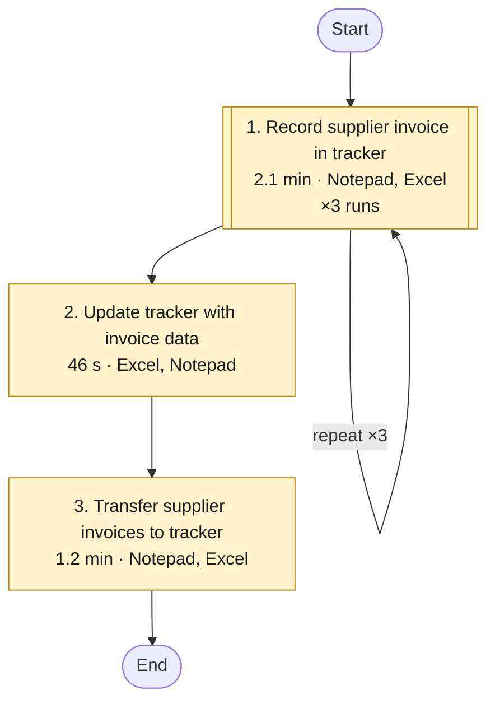
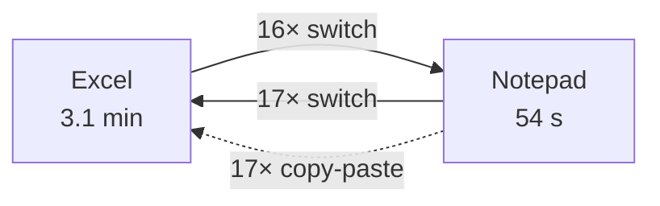
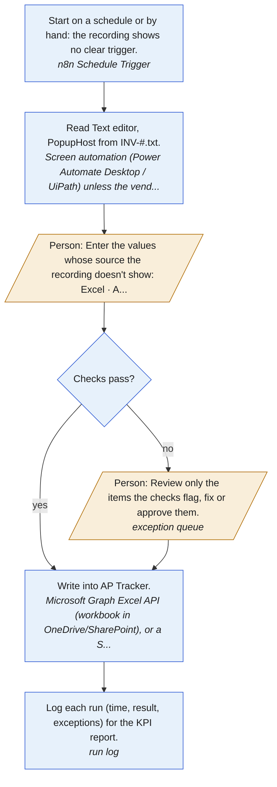

# Workflow analysis: Ap invoice final

Recorded 2026-10-24 16:15 · 4.0 min of activity · 54 steps · 2 applications · 1 task · analysed with muse-spark-1.3 for screenshots and muse-spark-1.3 for text

## Summary

- **Recorded work:** 4.0 min
- **Time automation could save:** about 3.6 min per recording like this one (89% of the recorded time)
- **If the recorded work is done 20 times a month:** about 1.2 hours a month, roughly $36 at $30 an hour
- **Biggest opportunity:** Record supplier invoice in tracker (medium potential). The same 10-step routine ran 3 times.

> Savings are estimates based on this one recording. Set how often the process runs (and, in the app's Admin panel, what an hour of each position costs) to match the real business.

## Opportunities

| # | Task | Time | Repeats | Applications | Automation potential | Est. saving per recording |
|---|---|---|---|---|---|---|
| 1 | Record supplier invoice in tracker | 2.1 min | 3 | Notepad, Excel | Medium (50/100) | 1.8 min |
| 3 | Transfer supplier invoices to tracker | 1.2 min | 1 | Notepad, Excel | same process as task 1 | 1.1 min |
| 2 | Update tracker with invoice data | 46 s | 1 | Excel, Notepad | same process as task 1 | 42 s |

## What to automate first

Impact (hours saved a month) against effort (days to build). Quick wins come first: high impact for under 5 days of work. High impact here means at least 1.2 hours a month.

<svg viewBox="0 0 640 360" width="100%" style="max-width:640px" role="img" aria-label="Impact against effort, one bubble per task" xmlns="http://www.w3.org/2000/svg" font-family="system-ui,Segoe UI,sans-serif" font-size="11"><rect x="58.0" y="20.0" width="308.2" height="148.0" fill="#1e8e3e" fill-opacity="0.07"/><text x="66.0" y="36.0" fill="#1e8e3e" font-weight="600">Quick wins</text><rect x="366.2" y="20.0" width="253.8" height="148.0" fill="#2f5bd3" fill-opacity="0.07"/><text x="374.2" y="36.0" fill="#2f5bd3" font-weight="600">Major projects</text><rect x="58.0" y="168.0" width="308.2" height="148.0" fill="#b06d00" fill-opacity="0.07"/><text x="66.0" y="184.0" fill="#b06d00" font-weight="600">Fill-ins</text><rect x="366.2" y="168.0" width="253.8" height="148.0" fill="#9aa0a6" fill-opacity="0.07"/><text x="374.2" y="184.0" fill="#9aa0a6" font-weight="600">Not worth it yet</text><line x1="366.2" x2="366.2" y1="20" y2="316" stroke="#9aa0a6" stroke-dasharray="4 4"/><line x1="58" x2="620" y1="168.0" y2="168.0" stroke="#9aa0a6" stroke-dasharray="4 4"/><text x="85.2" y="332" text-anchor="middle" fill="#5f6368">0.5</text><text x="169.8" y="332" text-anchor="middle" fill="#5f6368">1</text><text x="254.4" y="332" text-anchor="middle" fill="#5f6368">2</text><text x="366.2" y="332" text-anchor="middle" fill="#5f6368">5</text><text x="450.8" y="332" text-anchor="middle" fill="#5f6368">10</text><text x="535.4" y="332" text-anchor="middle" fill="#5f6368">20</text><text x="339" y="352" text-anchor="middle" fill="#5f6368">effort: days to build (log scale)</text><text x="52" y="320.0" text-anchor="end" fill="#5f6368">0</text><text x="52" y="172.0" text-anchor="end" fill="#5f6368">1</text><text x="52" y="24.0" text-anchor="end" fill="#5f6368">2</text><text transform="translate(14 168) rotate(-90)" text-anchor="middle" fill="#5f6368">impact: hours saved a month</text><circle cx="377.9" cy="168.0" r="7.2" fill="#9aa0a6" fill-opacity="0.85"><title>1. Record supplier invoice in tracker: 1.2 h a month ($36), about 5.5 days to build</title></circle><text x="377.9" y="172.0" text-anchor="middle" fill="#fff" font-weight="700">1</text></svg>

| Phase | # | Task | Saves a month | Effort | Pays back | Why this effort |
|---|---|---|---|---|---|---|
| **Hold** (Not worth it yet) | 1 | Record supplier invoice in tracker | 1.2 h ($36) | 5.5 days | 36.7 months | recommended approach: about 3 days; Notepad has no known API: screen automation, +2 days; 1 open question to settle first, +0.5 days |

<sub>Effort starts from the recommendation's estimate (hours 0.5, days 3, weeks 15) and adds 2 days per system without a known API and half a day per open question. Payback: the hours to build it (days × 8) against the hours saved each month. Planning estimates: confirm with whoever builds it.</sub>

## Workflow map

Tasks in the order they happened. Double-bordered boxes are routines that repeated. Colour shows automation potential: red high, amber medium, green low.



## How the applications connect

Solid arrows: switching from one application to another. Dotted arrows: values copied in one application and pasted into another.



| Application | Time | Steps |
|---|---|---|
| Excel | 3.1 min | 32 |
| Notepad | 54 s | 22 |

## Task details

### 1. Record supplier invoice in tracker

**Automation potential: Medium (50/100)** · 2.1 min in total · 3 repeats of about 42 s · Notepad, Excel

The task records supplier invoice details in the invoice tracker to support accounts payable monitoring. The user copies the invoice number, vendor name, and invoice total from the invoice file and pastes them into the tracker, then enters the due date and the column E value.

**Inputs:** Supplier invoice file in text editor; Invoice tracker spreadsheet  
**Outputs:** Updated invoice tracker with new invoice entry  
**Decision points:** Determine the correct due date to enter for the invoice; Determine the appropriate value to enter in column E  

**Why it stands out:**

- The same 10-step routine ran 3 times
- 8 values copied by hand from one application to another
- 15 switches between applications

**Estimated saving:** about 1.8 min per recording like this one (86% of this task; about 36 s for each of the 3 repeats), about 0.6 hours or $18 a month.

  

**Steps (one repeat):**

1. [Notepad] Selects the supplier invoice file in the text editor.
2. [Notepad] Copies the invoice number from the invoice file.
3. [Excel] Pastes the invoice number into the invoice tracker.
4. [Notepad] Copies the vendor name from the invoice file.
5. [Excel] Pastes the vendor name from the invoice file into the tracker.
6. [Notepad] Copies the invoice total from the invoice file.
7. [Excel] Selects the next cell in the tracker to continue the entry.
8. [Excel] Paste in "B2", then press Esc in Excel
9. [Excel] Enters the due date into the tracker for the supplier invoice.
10. [Excel] Enters a value in column E of the invoice tracker.

**Standard operating procedure:** [sop-task1.html](sop-task1.html) (a draft with a screenshot per step, the rules and checks; for the process owner to review and approve)

#### Recommendations

_From the AI analysis._

1. **Batch parse INV txt files and append to AP Tracker in one write**: _Desktop automation (RPA) · effort: days · about 70% of this task's time · steps 1-8, 10_

   Monitor folder for INV-*.txt. For each file use Power Automate Desktop Read text from file + Parse text with regex to extract invoice number, vendor name and total. Use Microsoft 365 Excel connector (Microsoft Graph Excel API) Add a row into table on AP Tracker on SharePoint/OneDrive to write columns A/B/C and set Column E = parsed source value in the same call; loop all files with zero window switching.

   *Why:* Theory of Constraints on Write in Excel bottleneck (0.62 min/item) + ECRS Automate; removes 4 copy-pastes, 5 switches per item and B2 double-write / Paste+Esc waste evidenced in runs 1-3.

   Tools: Power Automate Desktop, Microsoft 365 Excel connector, Microsoft Graph Excel API

2. **Eliminate Column E re-typing with copy + duplicate check**: _Process change · effort: hours · about 10% of this task's time · steps 10_

   Change SOP: never re-type Column E, always copy from source or use =C2 formula. Add COUNTIF duplicate check on invoice-number Column A and require validation of parsed values before batch submit; exceptions go to manual queue for a person.

   *Why:* ECRS Eliminate + poka-yoke; recording proves Column E already exists in Notepad file yet was typed, and run 3 fingerprint mismatch plus run 1 B2 corrected write show defect risk.

   Tools: Excel

3. **Replace free-typed due date and Column D with rules and validation**: _Built-in feature · effort: hours · about 8% of this task's time · steps 9-10_

   Replace free typing with Excel Data Validation: due date via date-picker plus formula InvoiceDate+Terms where business confirms terms, otherwise lookup. Convert Column D 10-char free type to dropdown/formula/lookup once rule is confirmed; lock automation-written columns A-C/E.

   *Why:* ECRS Simplify + poka-yoke; open question on Column D source means it must stay manual until rule confirmed, free typing is over-processing and error-prone.

   Tools: Excel, Excel Data Validation

4. **Add batch validation and Power BI control for AP Tracker**: _Built-in feature · effort: days · about 5% of this task's time · steps 1-10_

   Keep AP Tracker as Excel Table on SharePoint; build Power BI report on row count, missing due dates, duplicate invoice numbers and total variance. Schedule daily Power Automate reminder for due/overdue invoices and review defects weekly.

   *Why:* Control plan + ECRS Rearrange (validate every item first, then submit in one batch); catches wrong-item entries like run 3 and supports accounts payable monitoring purpose.

   Tools: Power BI, Microsoft 365

**Assumptions to confirm:**

- INV-*.txt files have consistent labels or delimiters for invoice number, vendor name and total so regex or split parsing will work; to be confirmed on sample files
- Excel AP Tracker column mapping is stable (A=invoice number, B=vendor, C=total, D=due date/manual 10-char value, E=copy of source value) and file lives on SharePoint/OneDrive or fixed path accessible to Power Automate
- Column E is intended to equal a value already in the Notepad file and is not independent judgement; to be confirmed
- Due date and Column D 10-char typed value derivation is not invented - requires business/IT to confirm if fixed rule (e.g., invoice date + terms), lookup, or human judgement; stays manual until confirmed
- No Notepad API is assumed - ask vendor/IT to confirm; automation uses direct .txt file read plus Power Automate Desktop, not screen scraping where possible
- AP Tracker is an Excel Table with no concurrent-lock conflict and invoice numbers are expected to be unique

**Quick wins:**

- Stop re-typing Column E immediately - copy-paste or =C2 formula until automation live; eliminates proven over-processing and run 3 mismatch
- Keep Notepad and Excel side-by-side and use next empty row Table (Ctrl+T) to avoid Select next cell + B2 double-write and Esc churn
- Add COUNTIF + conditional formatting on invoice-number Column A for instant duplicate/wrong-row poka-yoke
- Batch the work: validate all 3+ invoices first, then enter in one Excel session instead of one-item-at-a-time switching

**Check before automating:**

- Fragile parsing if INV-*.txt layout varies by supplier - needs regex testing and exception folder, otherwise wrong vendor/total
- Wrong-row overwrite risk from B2/paste pattern and duplicate invoice numbers - must add duplicate lookup before Add row
- Automating Column D or due date before business confirms rule would encode wrong judgement - keep manual with validation until confirmed
- Excel file lock / concurrent edits on shared AP Tracker - use SharePoint Table + single batch write and Power BI monitoring, not parallel RPA writers

**Existing tools and guides found online:**

- [How to Convert Notepad to Excel with Columns (5 Methods)](https://www.exceldemy.com/convert-notepad-to-excel-with-columns/): May 14, 2024 · In Windows, text files are usually accessed using Notepad, a dedicated text editor application owned by Microsoft. Let’s explore how to convert f
- [How to Convert Notepad to Excel with Columns \| Excel Insider](https://excelinsider.com/excel-pro-tips/import-text-file/convert-notepad-to-excel-with-columns/): 1 day ago · Learn how to convert Notepad to Excel with columns using copy-paste, Text Import Wizard, delimiters, fixed width, or Power Query features.
- [Excel VBA: Automating pasting data from notepad files to excel](https://stackoverflow.com/questions/71912302/excel-vba-automating-pasting-data-from-notepad-files-to-excel): Apr 18, 2022 · As shown below I need to automate opening/saving/closing excel after pasting data from .txt files. A screenshot of the files is attached below. T
- [How to Convert a Text File to Excel Automatically (3 Ways)](https://www.exceldemy.com/convert-text-file-to-excel-automatically/): Jun 18, 2024 · The article shows 3 ways of how to convert text file to excel automatically. Text Import Wizard, Get Data Wizard etc. were used in it.
- [How to Automate Supplier Invoice Tracking - ones.com](https://ones.com/blog/how-to-automate-supplier-invoice-tracking/): Learn how to automate supplier invoice tracking with a central register, clear statuses, approval owners, and automated reminders to prevent delays and errors.
- [Invoice Tracker: Free Template & Automate Tracker Alternative](https://expense.mekari.com/en/blog/invoice-tracker): An invoice tracker is a tool used to record, monitor, and manage invoices from receipt to payment. It can be as simple as a spreadsheet or as advanced as dedica

**Tools that usually fit these applications:**

- [Microsoft Power Automate](https://www.microsoft.com/power-platform/products/power-automate): Desktop flows (RPA) plus cloud flows for Outlook, Excel, SharePoint, Teams and many other connectors
- [UiPath](https://www.uipath.com): Enterprise RPA for desktop and legacy apps without APIs (SAP GUI, Citrix, mainframe screens)
- [Excel Power Query and Office Scripts](https://learn.microsoft.com/office/dev/scripts/overview/excel): Repeatable imports, clean-up and transformations inside Excel
- [Python with pandas / openpyxl](https://pandas.pydata.org): Scripts that read, merge and write spreadsheets and CSV files

**Automation draft** (power_automate, saved to `automations/task1.txt`)

Power Automate batch flow that reads all INV-*.txt files, parses 3 fields with regex, duplicate-checks and appends to AP Tracker Table in one Excel write per invoice, leaving due date/Column D for validated manual entry.

```text
TRIGGER: Power Automate cloud flow - Scheduled (daily) OR When files added to SharePoint folder / Desktop flow - monitor folder C:\Invoices\INV-*.txt
ACTION 1: List files in folder (Get files in folder) -> %Files%
ACTION 2: Excel - Open AP Tracker from SharePoint/OneDrive (Launch Excel / Excel Online Business - Get tables)
LOOP 3: For each %File% in %Files%:
  3.1: Read text from file %File% -> %Text%
  3.2: Parse text - Text actions: Extract with regex InvoiceNo: `INV-\d+`, Vendor: `Vendor:\s*(.+)`, Total: `Total:?\s*([0-9.,]+)` -> %InvNo%, %Vendor%, %Total%
  3.3: Validate - If %InvNo% is empty OR %Vendor% is empty OR %Total% not numeric -> Move %File% to \Exceptions\ and Continue
  3.4: Excel - Check duplicate: Lookup %InvNo% in AP Tracker Column A (Find / Filter). If found -> log duplicate and Continue
  3.5: Excel - Add a row into table AP_Tracker: ColumnA=%InvNo%, ColumnB=%Vendor%, ColumnC=%Total%, ColumnE=%Total% (copy, do NOT re-type), leave ColumnD/DueDate blank for rule/manual step
  3.6: Move %File% to \Processed\%InvNo%.txt and log to run history
END LOOP
ACTION 4: Save and Close Excel, send Teams/Email summary: processed count, exceptions, duplicates
MANUAL GATE 5: Operator fills Due Date and Column D only for new rows via dropdown/date validation, then marks Reviewed
```

#### Data flow: field to field

Taken from the recording: every value that was copied or typed, where from and where to.

| Step | From | To | How | Seen in runs |
|---|---|---|---|---|
| 3 | Notepad · INV-#.txt · Text editor | Excel · AP Tracker · column A | copy-paste | 2 of 3 |
| 5, 8 | Notepad · INV-#.txt · Text editor | Excel · AP Tracker · column B | copy-paste | 2 of 3 |
| 9 | typed by hand | Excel · AP Tracker · column D | typed (10 characters) | 3 of 3 |
| 10 | typed by hand; **same value as Notepad · INV-#.txt · Text editor** (fingerprint match, 2 of 3 runs) | Excel · AP Tracker · column E | typed (8 characters) | 3 of 3 |
| - | Notepad · PopupHost · PopupHost | Excel · AP Tracker · column B | copy-paste | 1 of 3 |
| - | Notepad · INV-#.txt · Text editor | Excel · AP Tracker · column C | copy-paste | 2 of 3 |

**Decide before automating:**

- Where does **Excel · AP Tracker · column D** come from? It was typed by hand (10 characters). A fixed rule, a lookup, or a person's judgement?

#### How the systems can connect

Each option has a status: *documented* (official documentation, access still needed), *found online, confirm* (a web search hit), *unknown* (no evidence: ask the vendor or IT), or a fallback.

| System | Role | Options |
|---|---|---|
| Notepad | source | API: Notepad API *(unknown, ask the vendor or IT)*<br>RPA: [Power Automate Desktop or UiPath](https://learn.microsoft.com/power-automate/desktop-flows/introduction) *(works without an API)* |
| Excel | target | API: [Microsoft Graph Excel API](https://learn.microsoft.com/graph/api/resources/excel) *(documented)*<br>n8n: [n8n Microsoft Excel 365 node](https://docs.n8n.io/integrations/builtin/app-nodes/n8n-nodes-base.microsoftexcel/) *(documented)*<br>SQL: [Keep the tracker in a database table instead](https://docs.n8n.io/integrations/builtin/app-nodes/n8n-nodes-base.postgres/) *(option)*<br>File: [Read and write the file directly (n8n Read/Write Files)](https://docs.n8n.io/integrations/builtin/core-nodes/n8n-nodes-base.readwritefile/) *(documented)* |

#### Proposed automation sequence

1. **Trigger**: Start on a schedule or by hand: the recording shows no clear trigger.
   - _How: n8n Schedule Trigger (option)_
2. **Extract** · Notepad: Read Text editor, PopupHost from INV-#.txt.
   - _How: Screen automation (Power Automate Desktop / UiPath) unless the vendor offers an API (unknown, ask the vendor or IT)_
3. **Write** · Excel: Write into AP Tracker.
   - column A ← Text editor (Notepad)
   - column B ← Text editor (Notepad)
   - column D ← typed by hand (10 characters): open question
   - column E ← Text editor (Notepad): typed by hand, but the fingerprints prove it is the same value (2 of 3 runs)
   - column B ← PopupHost (Notepad)
   - column C ← Text editor (Notepad)
   - _How: Microsoft Graph Excel API (workbook in OneDrive/SharePoint), or a SQL table (documented)_
4. **Decide**: Where does Excel · AP Tracker · column D come from? It was typed by hand (10 characters). A fixed rule, a lookup, or a person's judgement?
   - _How: Business decision before building (open)_
5. **Human check**: Determine the correct due date to enter for the invoice
   - _How: Keep a person here, or define the rule (open)_
6. **Human check**: Determine the appropriate value to enter in column E
   - _How: Keep a person here, or define the rule (open)_

**To build it**, once the questions above are answered, run `python -m flowsme build 20261024-161537-ap-invoice-final --task 1`. It writes an n8n workflow to import, a Postman collection to test each connection, and SQL and Playwright starters.

#### To-be process

What the work looks like after the change, and who does each part: automation (blue) or a person (orange). People handle only the exceptions the checks flag.

| | As-is | To-be with your tools | To-be with suggested tools |
|---|---|---|---|
| Hands-on minutes per item | 0.7 | 0.1 | 0.1 |
| Values typed or pasted by hand per item | 6 | 1 | 1 |
| Steps a person does per item | 10 | 2 | 2 |



| # | Who | What | How |
|---|---|---|---|
| 1 | Automation | Start on a schedule or by hand: the recording shows no clear trigger. | n8n Schedule Trigger |
| 2 | Automation | Read Text editor, PopupHost from INV-#.txt. | Screen automation (Power Automate Desktop / UiPath) unless the vendor offers an API |
| 3 | Person | Enter the values whose source the recording doesn't show: Excel · AP Tracker · column D (until a rule or lookup replaces them). | - |
| 4 | Automation | Check every item before writing it (0 validation rules, plus duplicates and mismatches between fields). | checks in the workflow |
| 5 | Person | Review only the items the checks flag, fix or approve them. | exception queue |
| 6 | Automation | Write into AP Tracker. | Microsoft Graph Excel API (workbook in OneDrive/SharePoint), or a SQL table |
| 7 | Automation | Log each run (time, result, exceptions) for the KPI report. | run log |

#### Business rules

Every rule the process follows, in one place: what the recording proves, what you said, and what is recommended or still to confirm. Confirm the open ones with the process owner before building.

| ID | Type | Rule | Field | Evidence | Status |
|---|---|---|---|---|---|
| BR-1 | mapping | column A = Text editor from Notepad · INV-#.txt · Text editor | Excel · AP Tracker · column A | copied in 2 of 3 runs | confirmed by the recording |
| BR-2 | mapping | column B = Text editor from Notepad · INV-#.txt · Text editor | Excel · AP Tracker · column B | copied in 2 of 3 runs | confirmed by the recording |
| BR-3 | unknown | Where column D comes from is not recorded | Excel · AP Tracker · column D | typed by hand in 3 of 3 runs | ask the process owner |
| BR-4 | mapping | column E = Text editor from Notepad · INV-#.txt · Text editor | Excel · AP Tracker · column E | typed, and the fingerprints match in 3 of 3 runs | confirmed by the recording |
| BR-5 | mapping | column B = PopupHost from Notepad · PopupHost · PopupHost | Excel · AP Tracker · column B | copied in 1 of 3 runs | confirmed by the recording |
| BR-6 | mapping | column C = Text editor from Notepad · INV-#.txt · Text editor | Excel · AP Tracker · column C | copied in 2 of 3 runs | confirmed by the recording |
| BR-7 | decision | Determine the correct due date to enter for the invoice | - | a judgement call seen in the recording | write down the rule |
| BR-8 | decision | Determine the appropriate value to enter in column E | - | a judgement call seen in the recording | write down the rule |

#### User stories and acceptance tests

For whoever builds the automation: each criterion is a test to pass before go-live. `flowsme build` also writes them as `acceptance.feature` (Gherkin) and `user_stories.md`.

**US-1 Start by itself: trigger.** As the person who does this work today, I want the automation to start by itself (start on a schedule or by hand: the recording shows no clear trigger), so that nobody has to remember to run it.

- Given a new item is ready, when the trigger fires, then the automation starts and picks up the item.

**US-2 Read the source: Notepad.** As the person who does this work today, I want the automation to read Text editor, PopupHost from INV-#.txt, so that nobody has to open each item by hand.

- Given a new item arrives, when the automation runs, then it does this: read Text editor, PopupHost from INV-#.txt.

**US-3 Enter values without a known source.** As the person who does this work today, I want to enter only the values whose source isn't recorded, so that the rest is automated while those rules are settled.

- Given the source of Excel · AP Tracker · column D is not yet known, when an item is processed, then the item waits for a person to enter that value.

**US-4 Check before writing.** As the person who does this work today, I want every item checked before it is written, so that mistakes are caught before they reach the records.

- Given an item that is already recorded, when it arrives again, then it is not written a second time and goes to review as a possible duplicate.

**US-5 Review only the exceptions.** As the person who does this work today, I want to see only the items that fail a check, with the reason, so that I review exceptions instead of every item.

- Given an item fails a check, when I open the review queue, then I see the item, the failed rule and its source, and can fix and approve it or reject it.
- Given I approve a fixed item, when the automation continues, then it is written like any other item.

**US-6 Write to Excel.** As the person who does this work today, I want the automation to write into AP Tracker, so that nobody re-keys these values.

- Given an item passed its checks, when the automation writes it, then Excel · AP Tracker · column A = Text editor from Notepad · INV-#.txt · Text editor (BR-1).
- Given an item passed its checks, when the automation writes it, then Excel · AP Tracker · column B = Text editor from Notepad · INV-#.txt · Text editor (BR-2).
- Given an item passed its checks, when the automation writes it, then Excel · AP Tracker · column E = Text editor from Notepad · INV-#.txt · Text editor (BR-4).
- Given an item passed its checks, when the automation writes it, then Excel · AP Tracker · column B = PopupHost from Notepad · PopupHost · PopupHost (BR-5).
- Given an item passed its checks, when the automation writes it, then Excel · AP Tracker · column C = Text editor from Notepad · INV-#.txt · Text editor (BR-6).

**US-7 Log every run.** As the process owner, I want every run logged with time, result and exceptions, so that I can see the time saved and the error rate, and prove the benefit.

- Given a normal item, when the automation processes it, then it needs no hands-on work and the remaining manual part takes under 0.1 min.
- Given a run finishes, when I open the KPI report, then I see items processed, exceptions, and minutes per item against the old process.

#### Process improvement (Lean Six Sigma, DMAIC)

**Define.** What must go right (critical to quality):

- Each item done within the agreed time (now about 0.7 min of hands-on work)

| Suppliers | Inputs | Process | Outputs | Customers |
|---|---|---|---|---|
| Notepad | Notepad · INV-#.txt · Text editor<br>Notepad · PopupHost · PopupHost | Trigger: Start on a schedule or by hand: the recording shows no clear trigger.<br>Extract: Notepad<br>Write: Excel | Excel · AP Tracker | Who uses these outputs? (not visible in the recording: ask) |

**Measure.** 0.7 min of hands-on work per item, 3 items in this recording, 6 manual entries per item.

Run-to-run variation over 3 items: mean 42 s, standard deviation 24 s (coefficient of variation 58%), fastest 24 s (item 3), slowest 69 s (item 1).

<svg viewBox="0 0 640 220" width="100%" style="max-width:640px" role="img" aria-label="Seconds per item, Record supplier invoice in tracker" xmlns="http://www.w3.org/2000/svg" font-family="system-ui,Segoe UI,sans-serif" font-size="11"><line x1="56" x2="624" y1="30.4" y2="30.4" stroke="#c5221f" stroke-width="1.2" stroke-dasharray="5 4"/><text x="50" y="34.4" text-anchor="end" fill="#c5221f">UCL 101s</text><line x1="56" x2="624" y1="122.2" y2="122.2" stroke="#5f6368" stroke-width="1.2"/><text x="50" y="126.2" text-anchor="end" fill="#5f6368">mean 42s</text><polyline points="56.0,79.6 340.0,138.3 624.0,148.6" fill="none" stroke="#2f5bd3" stroke-width="2"/><circle cx="56.0" cy="79.6" r="4" fill="#2f5bd3"><title>Run 1: 69 s</title></circle><text x="56.0" y="208" text-anchor="middle" fill="#5f6368">1</text><circle cx="340.0" cy="138.3" r="4" fill="#2f5bd3"><title>Run 2: 31 s</title></circle><text x="340.0" y="208" text-anchor="middle" fill="#5f6368">2</text><circle cx="624.0" cy="148.6" r="4" fill="#2f5bd3"><title>Run 3: 24 s</title></circle><text x="624.0" y="208" text-anchor="middle" fill="#5f6368">3</text><text x="340" y="219" text-anchor="middle" fill="#5f6368">run</text></svg>

<sub>Individuals control chart: limits at the mean ± 2.66 × the average change between items. All items are inside, so the process is stable and its time is predictable.</sub>

Steps that vary most between items:

- Step 10: Enters a value in column E of the invoice tracker. (24 s on average, ± 19 s)

| Time per item | Minutes | Share |
|---|---|---|
| waste (non-value-adding) | 0.66 | 96% |
| value-adding? (judgement, confirm) | 0.03 | 4% |

Process cycle efficiency: **4%** (value-adding time ÷ total).

Error exposure: 6 manual entries per item now, 1 after automation, about 60 items a month.

| Human error rate (source) | Errors a month now | After automation | DPMO | Sigma level |
|---|---|---|---|---|
| 0.14% per entry: [Nahm et al. 2008: source to database, clinical trials](https://doi.org/10.1371/journal.pone.0003049) | 0.5 | 0.1 | 1,430 | 4.0 |
| 0.29% per entry: [Garza et al. 2025: meta-analysis of 93 studies, single data entry](https://doi.org/10.1016/j.ijmedinf.2024.105749) | 1.0 | 0.2 | 2,900 | 4.0 |
| 3.70% per entry: [Mays & Mathias 2019: manual transcription of numeric results](https://pmc.ncbi.nlm.nih.gov/articles/PMC6351970/) | 13.3 | 2.2 | 37,000 | 3.0 |

**Analyze.** Waste found in the recording:

| Waste | Evidence | Min per item |
|---|---|---|
| Transportation waste | 4 values per item carried between applications by copy-paste | 0.13 |
| Motion waste | 5 window switches and 2 navigation steps per item | 0.04 |
| Over-processing waste | 1 value typed by hand that the fingerprints prove already exist elsewhere (column E = Notepad · INV-#.txt · Text editor) | 0.5 |
| Defects and rework | In run 3, Excel · AP Tracker · column E did not match Notepad · INV-#.txt · Text editor for that item (the fingerprints differ): a likely wrong-item or duplicate entry. 'B2' in Excel was written 2 times in run 1: a value had to be corrected. | - |
| Unused talent | 96% of this person's time on this task is moving and re-typing data | - |

Bottleneck (Theory of Constraints): **Write · Excel** at 0.62 min per item. Improve this stage first: speeding up any other stage doesn't shorten the whole.

**Improve.** First remove waste (ECRS), then automate what's left:

- **Eliminate:** Stop re-typing values that already exist: column E in Excel.
- **Rearrange:** The routine ran 3 times one item at a time. Validate every item first, then submit in one batch; exceptions go to a person.
- **Simplify:** Turn free typing into rules, lookups or drop-downs: column D (Excel).
- **Automate:** Then automate what is left, as in the tool plan below.

Tool plan. Your tools: Microsoft 365, Power Automate, Power BI. Runs the workflow: Power Automate (cloud flows).

| Stage | Now (min/item) | With your tools | With suggested tools |
|---|---|---|---|
| 2. Extract · Notepad | 0.07 | stays manual: 0.07 | Desktop automation (Power Automate Desktop): 0.01 |
| 3. Write · Excel | 0.62 | Spreadsheet API (Microsoft 365 (Outlook and Excel through Microsoft Graph), Power Automate (cloud flows)): 0.06 | Spreadsheet API (Microsoft 365 (Outlook and Excel through Microsoft Graph), Power Automate (cloud flows)): 0.06 |
| **Total** | **0.7** | **0.1** | **0.1** |

Per month (60 items): 0.7 h now, 0.1 h with your tools, 0.1 h with the additions.

Adding tools, biggest gain first:

- **Power Automate Desktop** saves another 0.1 min per item (0.1 h a month). Cost: free on Windows for attended runs; unattended runs need a licence.

If the vendor provides an API key for **Notepad API**, use it instead of browser automation: it is more reliable and won't break when the page changes.

<sub>Minutes after automation assume each method removes this share of a stage's time (people still review exceptions): api 95%, database 95%, ai extraction 85%, pdf rules 70%, api wrapper 90%, browser 85%, rpa 80%. These are planning estimates; measure after the pilot.</sub>

**Control.** Validation checklist: error-proofing first, then detection. Why that order: When values flowed electronically instead of being transcribed, transcription errors fell from 6.1% to zero. ([Poon et al. 2010](https://pubmed.ncbi.nlm.nih.gov/20445181/)) Checking entries by eye was not significantly better than no checking; double entry was far better. ([Barchard & Pace 2011](https://doi.org/10.1016/j.chb.2011.04.004)) Built-in validation alarms prevented only a small fraction of errors. ([Goldberg et al. 2008](https://pmc.ncbi.nlm.nih.gov/articles/PMC2656002/)) A second, independent entry of the same data caught 88% of errors. ([Kawado et al. 2003](https://pubmed.ncbi.nlm.nih.gov/14500053/))

| Where | Type | Check | Evidence |
|---|---|---|---|
| Excel · AP Tracker · column A | prevent | Pass the value from Notepad · INV-#.txt · Text editor directly instead of re-keying it; after writing, compare the two automatically. | copied by hand at step 3 |
| Excel · AP Tracker · column B | prevent | Pass the value from Notepad · INV-#.txt · Text editor directly instead of re-keying it; after writing, compare the two automatically. | copied by hand at step 5, 8 |
| Excel · AP Tracker · column D | prevent | Replace free typing with a rule, a lookup or a drop-down. | typed by hand (10 characters) at step 9 |
| Excel · AP Tracker · column E | prevent | Pass the value from Notepad · INV-#.txt · Text editor directly instead of re-typing it; after writing, compare the two automatically. | typed by hand at step 10; the fingerprints show it is the same value as Notepad · INV-#.txt · Text editor (2 of 3 runs) |
| Excel · AP Tracker · column B | prevent | Pass the value from Notepad · PopupHost · PopupHost directly instead of re-keying it; after writing, compare the two automatically. | copied by hand at step  |
| Excel · AP Tracker · column C | prevent | Pass the value from Notepad · INV-#.txt · Text editor directly instead of re-keying it; after writing, compare the two automatically. | copied by hand at step  |
| Excel · AP Tracker · column E | detect | Before saving, check that the fields of one row belong to the same item (e.g. invoice number and reference); stop and ask a person if they don't. | In run 3, Excel · AP Tracker · column E did not match Notepad · INV-#.txt · Text editor for that item (the fingerprints differ): a likely wrong-item or duplicate entry. |
| corrections | detect | Values had to be corrected after entry. Check each value against its source before writing, and log corrections so their causes can be found (5 Whys). | 'B2' in Excel was written 2 times in run 1: a value had to be corrected. |
| every run | control | Reconcile counts: items received = rows written = records submitted. Investigate any gap. | standard control for multi-system hand-offs |
| every run | control | Log each item with its result (done / exception / failed) and review exceptions daily. | needed to measure error rate after go-live |

Measure after go-live, in the final report (Power BI, Looker Studio or Excel, fed by the run log from `flowsme build`; suggested: Power BI):

- Items processed per day
- Hands-on minutes per item (target: 0.1 or less)
- Exceptions sent to a person (%)
- First-pass yield: items done with no correction (%)
- Errors caught by checks, by type
- Duplicates blocked

### 3. Transfer supplier invoices to tracker

**The same process as task 1** (the same fields filled in the same applications), recorded outside its main run: 1.2 min, 19 steps in Notepad, Excel. Its data flow, automation design, checks and SOP are described once, under task 1, and the roadmap counts this time there.

### 2. Update tracker with invoice data

**The same process as task 1** (the same fields filled in the same applications), recorded outside its main run: 46 s, 8 steps in Excel, Notepad. Its data flow, automation design, checks and SOP are described once, under task 1, and the roadmap counts this time there.

## Methods used

| Method | What it means | Sources |
|---|---|---|
| Transportation waste | Moving material between steps without changing it. In office work the material is data: carrying it between applications, files or people unchanged. | [1](https://www.lean.org/lexicon-terms/seven-wastes/), [2](https://asq.org/quality-resources/lean) |
| Motion waste | Unnecessary movement by the worker, such as searching for documents. On a desktop: navigating, searching, scrolling and switching windows without changing the work. | [1](https://www.lean.org/lexicon-terms/seven-wastes/), [2](https://asq.org/quality-resources/lean) |
| Waiting waste | Idle time waiting for machines, information, approvals or the previous step. | [1](https://www.lean.org/lexicon-terms/seven-wastes/), [2](https://asq.org/quality-resources/lean) |
| Over-processing waste | More work than the customer needs, such as entering the same data twice or checks beyond what the risk warrants. | [1](https://www.lean.org/lexicon-terms/seven-wastes/), [2](https://asq.org/quality-resources/lean) |
| Defects and rework | Errors that need inspection, correction or rework: the work is paid for twice and may reach the customer. | [1](https://www.lean.org/lexicon-terms/seven-wastes/), [2](https://asq.org/quality-resources/lean) |
| Inventory waste | More work-in-process than smooth flow needs: in offices, queues of unprocessed emails, requests and documents. More waiting work means longer lead time. | [1](https://www.lean.org/lexicon-terms/seven-wastes/), [2](https://www.isixsigma.com/dictionary/process-cycle-efficiency-pce/) |
| Overproduction | Producing more, or earlier, than the next step needs, such as reports nobody uses. | [1](https://www.lean.org/lexicon-terms/overproduction/) |
| Unused talent | Not using people's skills and judgement; added to Ohno's original seven wastes as the eighth. | [1](https://asq.org/quality-resources/lean), [2](https://www.isixsigma.com/dictionary/8-wastes-of-lean/) |
| Value-added analysis (VA / BVA / NVA) | Value-added steps change the output in a way the customer would pay for. Business-value-added steps are required (law, control, audit) but add nothing for the customer. Non-value-added steps are waste: eliminate them, and minimise BVA. | [1](https://www.isixsigma.com/dictionary/value-added/), [2](https://www.isixsigma.com/dictionary/business-value-added/), [3](https://www.isixsigma.com/dictionary/non-value-added/) |
| Process cycle efficiency | Value-added time divided by total lead time. A low figure means most time is waiting or non-value-added work. Here it is measured on hands-on time only, so the true figure (with waiting between items) is lower. | [1](https://www.isixsigma.com/dictionary/process-cycle-efficiency-pce/) |
| Value stream mapping | Mapping every step needed to deliver a service, with process time, waits and value class, to expose waste and design the future state. | [1](https://www.lean.org/lexicon-terms/value-stream-mapping/), [2](https://asq.org/quality-resources/value-stream-mapping) |
| Takt time vs cycle time | Takt time = available working time / customer demand: the pace work must keep. When the cycle time per item is above takt, a backlog grows. | [1](https://www.lean.org/lexicon-terms/takt-time/), [2](https://www.lean.org/lexicon-terms/cycle-time/) |
| 5S (digital workplace) | Sort, set in order, shine, standardize, sustain: organising the workplace so nothing has to be searched for. On a desktop: folders, file names, templates, bookmarks. | [1](https://www.lean.org/lexicon-terms/five-s/), [2](https://asq.org/quality-resources/five-s-tutorial) |
| Gemba (go and see) | Observe the real work where it happens instead of relying on reports or the written procedure. A recording is a digital gemba walk: it shows the actual process. | [1](https://www.lean.org/lexicon-terms/gemba/) |
| Standardized work | One precise, agreed way to do the work (sequence, timing, materials). It is the baseline improvement is measured against, and the automation script follows it. | [1](https://www.lean.org/lexicon-terms/standardized-work/) |
| Poka-yoke (error-proofing) | Simple means that stop a mistake from being made, or make it obvious at once. Prevention (it can't be done wrong) is preferred to detection. | [1](https://www.lean.org/lexicon-terms/poka-yoke/), [2](https://asq.org/quality-resources/mistake-proofing) |
| Jidoka (stop on abnormality) | Detect an abnormal condition and stop, instead of passing errors downstream. For automation: hand exceptions to a person rather than forcing them through. | [1](https://www.lean.org/lexicon-terms/jidoka/) |
| Kaizen | Small, frequent improvements by the people who do the work, usually run as plan-do-check-act cycles. | [1](https://www.lean.org/lexicon-terms/kaizen/), [2](https://asq.org/quality-resources/continuous-improvement) |
| Lean Six Sigma | Lean removes waste and improves flow; Six Sigma reduces variation and defects. Used together, usually through DMAIC. | [1](https://asq.org/quality-resources/six-sigma) |
| DMAIC | Define, Measure, Analyze, Improve, Control: the structured cycle for improving an existing process with data. | [1](https://asq.org/quality-resources/dmaic), [2](https://www.isixsigma.com/dictionary/dmaic/) |
| SIPOC | A one-page scope of a process: Suppliers, Inputs, Process (5-7 steps), Outputs, Customers. | [1](https://www.isixsigma.com/sipoc-copis/sipoc-diagram/), [2](https://asq.org/quality-resources/sipoc) |
| Critical to quality (CTQ) | Measurable requirements from the voice of the customer (e.g. 100% field accuracy). They define what counts as a defect. | [1](https://www.isixsigma.com/dictionary/critical-to-quality-ctq/) |
| DPMO and sigma level | DPMO = defects / (units x opportunities) x 1,000,000; each field entered is an opportunity. Six sigma is 3.4 DPMO (long term, with the conventional 1.5 sigma shift). | [1](https://www.isixsigma.com/dictionary/defects-per-million-opportunities-dpmo/), [2](https://www.isixsigma.com/dictionary/sigma-level/) |
| First-pass yield | Share of items that pass a step correctly the first time. A high final yield with a low first-pass yield reveals hidden rework. | [1](https://www.isixsigma.com/dictionary/first-time-yield-fty/), [2](https://www.isixsigma.com/dictionary/rolled-throughput-yield-rty/) |
| FMEA | Lists how each step can fail and rates severity, occurrence and detection (1-10); their product (RPN) ranks which risks to control first. | [1](https://asq.org/quality-resources/fmea) |
| Control plan | How the improved process is held: what is measured, how often, by whom, and what happens when a check fails. | [1](https://www.isixsigma.com/dictionary/control-plan/), [2](https://asq.org/quality-resources/dmaic) |
| Pareto analysis | Rank causes by frequency or impact; a vital few usually explain most of the effect. | [1](https://asq.org/quality-resources/pareto) |
| 5 Whys | Ask 'why' repeatedly to get from a symptom to its root cause. | [1](https://www.lean.org/lexicon-terms/5-whys/), [2](https://asq.org/quality-resources/five-whys) |
| Fishbone (Ishikawa) diagram | Groups possible causes of a problem by category (methods, systems, input data, people, environment), so automation isn't assumed to be the only fix. | [1](https://asq.org/quality-resources/fishbone) |
| Cost of poor quality | Quality costs split into prevention, appraisal (checking), internal failure (rework) and external failure. Turning rework and checking time into money justifies error-proofing on more than speed. | [1](https://asq.org/quality-resources/cost-of-quality) |
| Keystroke-Level Model | Predicts expert task time by adding operator times: keystroke about 0.2 s, pointing 1.1 s, moving a hand between keyboard and mouse 0.4 s, a mental step 1.35 s (Card, Moran and Newell 1980). Used to sanity-check claimed time savings. | [1](https://facsrv.cdm.depaul.edu/~cmiller/hci460/materials/goms.html), [2](https://doi.org/10.1145/358886.358895) |
| Theory of Constraints | Throughput is limited by the constraint. Identify it, exploit it, subordinate the rest to it, elevate it, repeat. Speeding up a non-constraint step doesn't shorten the whole. | [1](https://www.tocinstitute.org/five-focusing-steps.html) |
| ECRS | Improve in order: Eliminate unneeded steps, Combine, Rearrange, then Simplify. Only then automate, so you don't automate waste. | [1](https://www.lean.org/the-lean-post/articles/the-art-of-lean-use-these-tools-to-help-you-improve-a-process-part-2/) |
| PDCA | Plan, Do, Check, Act: try a change small, measure it, then standardise or adjust. | [1](https://asq.org/quality-resources/pdca-cycle), [2](https://deming.org/explore/pdsa/) |
| Automation suitability | Good candidates are standardised, stable, rule-based, frequent and long enough to matter, with structured digital inputs, few exceptions and error-prone manual work (Wellmann et al., BPM 2020: 13 criteria in 5 groups). | [1](https://arxiv.org/abs/2007.10900), [2](https://doi.org/10.1007/s12599-018-0542-4) |
| Robotic process mining | Finding automatable routines in user-interaction logs (clicks, keys, copy-paste) and generating automation from them: the research field closest to what FlowSME does. | [1](https://doi.org/10.1007/s12599-020-00641-4) |

## How to read this

- **One recording shows one path.** Exceptions and variations only appear across several recordings of the same process, so record it a few times before building anything.
- **Timing** comes from clicks, keystrokes and window changes. Reading and thinking time before the next action counts toward the step before it.
- **Automation potential** is a 0-100 signal score built from repetition, copy-paste between applications, typing, window switching and time spent.
- **Savings** use the AI model's estimate of the automatable share when one was available, otherwise 60%, 35% or 10% for high, medium or low potential.
- **Automation drafts** are starting points. Review and test them on sample data before using them on real work.
- **AI used for this report:** 18 AI calls (3 answered from cache), 49,511 input / 25,446 output tokens, 3 web searches: about $0.18 (screenshots $0.12, text $0.04, web search $0.02)
- **Privacy:** Typed text was not stored, only counted. Excluded apps and windows were not captured.
